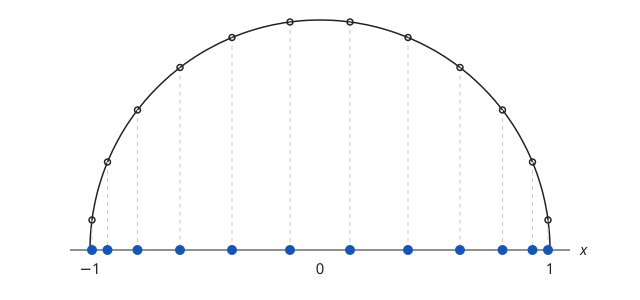
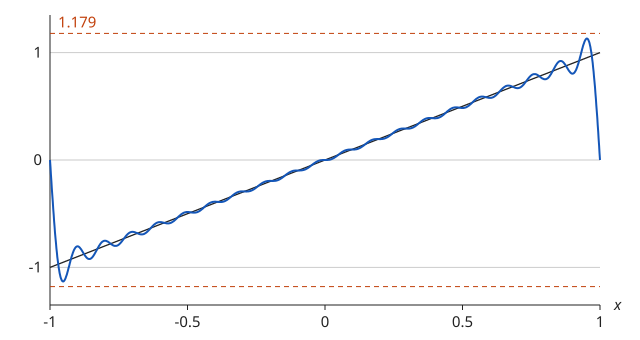
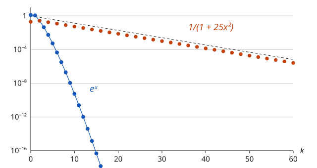

# Chebyshev polynomials: cosines in disguise

*How to flatten a circle, outwit the Gibbs phenomenon, and what a 19th-century steam engine has to do with it. Notes from a conversation about fitting data optimally on an interval and on a circle. Statements come with proofs; click "Proof" to expand them. Numbers marked "computed" were checked in NumPy/SciPy.*

**The short version.** On an interval, fit with Chebyshev polynomials and, if you can choose where to sample, sample at Chebyshev points: the fit is then a fast cosine transform away. On a circle, use sines and cosines on an equally spaced grid: the fit is an FFT. The two are the same thing seen from different angles. Substitute $x = \cos\varphi$ and every Chebyshev polynomial becomes a cosine. Data with a trend is not periodic. To fit it with Fourier anyway, first make it periodic: bridge the gap smoothly, penalise curvature, or subtract the trend.

## 0. The problem

We have $N$ measurements $(x_i, y_i)$ and want a model with $K < N$ parameters,

$$
f(x) \approx \sum_{k=0}^{K-1} c_k\,\phi_k(x),
$$

chosen by least squares: minimise $\sum_i \bigl(y_i - \sum_k c_k \phi_k(x_i)\bigr)^2$. With the $N\times K$ matrix $A_{ik} = \phi_k(x_i)$ this is $\min_c \lVert y - Ac \rVert_2$, solved by the normal equations $A^{\mathsf T}A\,c = A^{\mathsf T}y$ (or, more stably, by a QR factorisation of $A$).

Two choices are ours: the **functions** $\phi_k$ and, sometimes, the **points** $x_i$. They do different jobs and are easy to mix up, so we start by separating them.

## 1. The interval $[-1, 1]$: Chebyshev polynomials and Chebyshev points

Any interval $[a, b]$ maps onto $[-1, 1]$ by $x = \dfrac{2t - a - b}{b - a}$, so it is enough to study $[-1, 1]$.

### 1.1 The basis decides the conditioning, the points decide the stability

The polynomials of degree $< K$ form the same space whether we write them with $1, x, x^2, \dots$ or with Chebyshev polynomials. In exact arithmetic the least-squares fit is therefore **the same polynomial** in either basis. The basis changes only how accurately a computer can find it. The *condition number* of $A$ measures that: roughly how many digits are lost. For $N = 100$ equally spaced points (computed):

| Parameters $K$ | 4 | 6 | 8 | 10 | 12 |
| --- | --- | --- | --- | --- | --- |
| cond $A$, powers $x^k$ | 8.0 | 42 | 230 | 1 200 | 6 900 |
| cond $A$, Chebyshev $T_k$ | 2.3 | 2.6 | 2.8 | 2.9 | 2.9 |

The power basis loses roughly three quarters of a digit with every two extra parameters. The Chebyshev basis stays near-perfect here, and does so as long as $K$ is well below $\sqrt N$.

The **Runge phenomenon** (wild oscillation near the ends) comes from the *points*, not the basis. Fitting Runge's function $1/(1+25x^2)$ from $N = 40$ equally spaced samples gives a maximum error of 0.15 at $K = 10$ and 0.047 at $K = 20$. At $K = 30$ it is 1.95, and at $K = 40$ it is $1.4\cdot10^{4}$ (computed). In exact arithmetic the basis makes no difference to these numbers. On equally spaced points, polynomial least squares is stable only while $K$ grows no faster than about $\sqrt N$ (Rakhmanov, 2007). And no stable method of any kind can converge exponentially fast from equispaced samples (Platte, Trefethen & Kuijlaars, 2011).

So the rule is: **use the Chebyshev basis always; use Chebyshev points whenever you are free to choose where to measure.**

### 1.2 Chebyshev polynomials

> **Definition.** $T_n(x) = \cos(n\arccos x)$ for $x \in [-1,1]$, i.e. $T_n(\cos\theta) = \cos n\theta$.
> Then $T_0 = 1$, $T_1 = x$, and $T_{n+1}(x) = 2x\,T_n(x) - T_{n-1}(x)$.
> So $T_n$ is a polynomial of degree $n$ with leading coefficient $2^{n-1}$ ($n \ge 1$): $T_2 = 2x^2-1$, $T_3 = 4x^3 - 3x$, …

Proof

Add the identities $\cos((n+1)\theta) = \cos n\theta\cos\theta - \sin n\theta\sin\theta$ and $\cos((n-1)\theta) = \cos n\theta\cos\theta + \sin n\theta\sin\theta$:

$$
\cos((n+1)\theta) + \cos((n-1)\theta) = 2\cos\theta\,\cos n\theta .
$$

With $x = \cos\theta$ this is $T_{n+1}(x) + T_{n-1}(x) = 2x\,T_n(x)$. Since $T_0 = 1$ and $T_1 = x$ are polynomials, induction shows that every $T_n$ is a polynomial of degree $n$. The recurrence doubles the leading coefficient at each step, giving $2^{n-1}$.

On $[-1,1]$, $T_n$ swings between $-1$ and $+1$ exactly $n+1$ times, at $x_j = \cos(j\pi/n)$, $j = 0,\dots,n$, where $T_n(x_j) = (-1)^j$. Its $n$ zeros are $\cos\bigl((2i+1)\pi/(2n)\bigr)$. Both sets of points crowd towards the ends of the interval.

### 1.3 The least-deviation property

> **Theorem (Chebyshev).** Among all polynomials of degree $n \ge 1$ with leading coefficient 1, the smallest possible maximum of $\lvert p(x)\rvert$ on $[-1,1]$ is $2^{1-n}$. It is attained by $2^{1-n}T_n$, and only by it.

Proof

$2^{1-n}T_n$ has leading coefficient 1 and maximum $2^{1-n}$, so the minimum is at most $2^{1-n}$.

Suppose some monic $p$ of degree $n$ had $\max\lvert p\rvert < 2^{1-n}$. Let $q = 2^{1-n}T_n - p$. The leading terms cancel, so $\deg q \le n-1$. At the $n+1$ points $x_j = \cos(j\pi/n)$,

$$
q(x_j) = (-1)^j\,2^{1-n} - p(x_j), \qquad \lvert p(x_j)\rvert < 2^{1-n},
$$

so $q(x_j)$ has the sign of $(-1)^j$. Then $q$ changes sign between each pair of neighbours and has at least $n$ zeros. A nonzero polynomial of degree $\le n-1$ cannot have $n$ zeros, so $q \equiv 0$. That means $p = 2^{1-n}T_n$, whose maximum is exactly $2^{1-n}$, contradicting the assumption.

*Uniqueness.* If $\max\lvert p\rvert = 2^{1-n}$, the same $q$ satisfies only $(-1)^j q(x_j) \ge 0$. A polynomial of degree $\le n-1$ that weakly alternates in sign at $n+1$ points still has $n$ zeros counted with multiplicity, so again $q \equiv 0$. For this counting lemma, see Rivlin, *Chebyshev Polynomials*, ch. 2.

**Why it matters for choosing points.** Interpolate a smooth $f$ by a polynomial $p$ of degree $N-1$ through $N$ points. Then for every $x$ there is a $\xi$ in the interval with

$$
f(x) - p(x) = \frac{f^{(N)}(\xi)}{N!}\,\omega_N(x), \qquad \omega_N(x) = \prod_{i=1}^{N}(x - x_i).
$$

Proof

Fix $x$ that is not a node (at a node both sides are 0). Pick the constant $\kappa$ so that $F(t) = f(t) - p(t) - \kappa\,\omega_N(t)$ vanishes at $t = x$. Then $F$ has $N+1$ zeros: the $N$ nodes and $x$. By Rolle's theorem $F'$ has $N$ zeros, …, and $F^{(N)}$ has a zero $\xi$. Since $p^{(N)} = 0$ and $\omega_N^{(N)} = N!$, we get $f^{(N)}(\xi) - \kappa N! = 0$. So $\kappa = f^{(N)}(\xi)/N!$, and $F(x) = 0$ is the claim.

The only part we control is $\omega_N$, a monic polynomial of degree $N$. By the theorem its maximum is smallest when the nodes are the zeros of $T_N$, since then $\omega_N = 2^{1-N}T_N$. Equally spaced nodes do worse, and the gap grows fast. Computed: for $N = 10$, $\max\lvert\omega_N\rvert$ is 6.5 times larger; for $N = 20$, 173 times; for $N = 40$, about 230 000 times. The amplification of data errors (the Lebesgue constant) grows only like $\tfrac{2}{\pi}\log N$ for Chebyshev points, but like $2^N/(e N \log N)$ for equispaced ones (Trefethen, *ATAP*, ch. 15).

### 1.4 Chebyshev points make least squares diagonal

Take the $N$ zeros of $T_N$ as sample points,

$$
x_i = \cos\theta_i, \qquad \theta_i = \frac{(2i+1)\pi}{2N}, \quad i = 0, 1, \dots, N-1 .
$$

*Figure 1.* Twelve equally spaced points on a half circle and their shadows on the diameter: the Chebyshev nodes for $N = 12$. They crowd towards $\pm1$.

A word on names. These are the zeros of $T_N$, also called Chebyshev points of the first kind. Many texts, Trefethen's among them, say "Chebyshev points" for the $N+1$ extrema $\cos(j\pi/N)$ instead. Everything below works for those too, with a slightly different cosine transform (DCT-I).

> **Discrete orthogonality.** For $0 \le j, k \le N-1$:
> $$\sum_{i=0}^{N-1} T_j(x_i)\,T_k(x_i) = \begin{cases} 0, & j \ne k,\\ N, & j = k = 0,\\ N/2, & j = k \ne 0.\end{cases}$$

Proof

Since $T_jT_k = \tfrac12\bigl[T_{j+k} + T_{\lvert j-k\rvert}\bigr]$ (from $\cos a\cos b = \tfrac12[\cos(a+b) + \cos(a-b)]$), it is enough to show that for an integer $m$ with $0 < m < 2N$

$$
S_m = \sum_{i=0}^{N-1}\cos(m\theta_i) = 0, \qquad\text{while } S_0 = N .
$$

Sum the complex exponentials as a geometric series:

$$
\sum_{i=0}^{N-1} e^{\mathrm{i} m\theta_i} = e^{\mathrm{i} m\pi/(2N)}\sum_{i=0}^{N-1}\bigl(e^{\mathrm{i} m\pi/N}\bigr)^i = e^{\mathrm{i} m\pi/(2N)}\,\frac{1 - e^{\mathrm{i} m\pi}}{1 - e^{\mathrm{i} m\pi/N}} .
$$

The denominator is nonzero because $0 < m < 2N$. If $m$ is even, $1 - e^{\mathrm{i} m\pi} = 0$ and the sum is 0. If $m$ is odd, the numerator is 2, and the sum equals

$$
\frac{2}{e^{-\mathrm{i} m\pi/(2N)} - e^{\mathrm{i} m\pi/(2N)}} = \frac{2}{-2\mathrm{i}\sin\frac{m\pi}{2N}} = \frac{\mathrm{i}}{\sin\frac{m\pi}{2N}},
$$

which is purely imaginary. In both cases its real part $S_m$ is 0. For $j, k \le N-1$ we have $j+k \le 2N-2$ and $\lvert j-k\rvert \le N-1$, so only the term with $j = k$ can survive: it gives $\tfrac12(S_{2k} + S_0) = N/2$ for $k \ne 0$, and $S_0 = N$ for $k = 0$.

**Consequences.**

- With $\phi_k = T_k$ the matrix $A^{\mathsf T}A$ is diagonal. The least-squares coefficients need no linear algebra at all:

  $$
  c_0 = \frac1N\sum_i y_i, \qquad c_k = \frac2N\sum_i y_i\,T_k(x_i) = \frac2N\sum_i y_i\cos(k\theta_i)\quad (k \ge 1).
  $$

  This is a discrete cosine transform (DCT-II), computed by the FFT in $O(N\log N)$ operations; [§4 of the FFT article](fft.en.md#s4) shows how.
- The $K$-term least-squares fit is simply the $N$-term interpolant with its last $N-K$ coefficients dropped (computed: they agree to $2.5\cdot10^{-16}$). Choosing $K$ is therefore just a cut-off, which can be decided after looking at how fast the coefficients decay.
- If the data comes at points you did not choose, keep the Chebyshev basis and solve by QR. You lose the diagonal structure but keep the good conditioning of [§1.1](#s1-1).

## 2. Closing the interval into a circle $[0, 2\pi)$: Fourier series

If the data is genuinely periodic — an angle, time of day, a closed contour — there are no ends, and with them goes the trouble at the ends.

**Basis:** $1, \cos m\varphi, \sin m\varphi$ for $m = 1, \dots, M$, so $K = 2M+1$ parameters.
**Points:** equally spaced, $\varphi_n = 2\pi n/N$. A rotation of the circle maps this grid onto itself, so every point is in the same position as every other. On a circle, crowding the points anywhere could only help one place at the expense of another. *(This is a heuristic, not a theorem.)*

> **Discrete orthogonality on the circle.** For integers $j, k$:
> $\displaystyle\sum_{n=0}^{N-1} e^{\mathrm{i}(j-k)\varphi_n} = N$ if $j \equiv k \pmod N$, and $0$ otherwise.
> Hence for $2M+1 \le N$ the columns $1, \cos m\varphi, \sin m\varphi$ are orthogonal, and
> $$a_m = \frac2N\sum_n y_n\cos m\varphi_n, \qquad b_m = \frac2N\sum_n y_n\sin m\varphi_n$$
> (with $\tfrac1N$ for $a_0$). This is the discrete Fourier transform, computed by the FFT in $O(N\log N)$ operations ([how the FFT works](fft.en.md#s2)).

Proof

With $r = e^{2\pi\mathrm{i}(j-k)/N}$ the sum is $\sum_{n=0}^{N-1} r^n$. If $j \equiv k \pmod N$ then $r = 1$ and the sum is $N$. Otherwise $r \ne 1$, and the sum is $(1 - r^N)/(1 - r) = 0$ because $r^N = 1$. Write $\cos$ and $\sin$ through $e^{\pm\mathrm{i}m\varphi}$. With $0 \le m, m' \le M$ and $2M < N$, two frequencies $\pm m$ and $\pm m'$ are congruent mod $N$ only when $m = m'$ with the same sign, or when $m = m' = 0$. Every cross term therefore vanishes.

**The truncated Fourier series is the best fit.** For a square-integrable $f$ on the circle, the trigonometric polynomial of degree $M$ closest to $f$ in the mean-square sense is the partial sum $S_M f$, and

$$
\frac1\pi\int_0^{2\pi}\lvert f - S_Mf\rvert^2\,d\varphi = \sum_{m > M}\bigl(a_m^2 + b_m^2\bigr).
$$

Proof

The functions $1, \cos m\varphi, \sin m\varphi$ are orthogonal on $[0, 2\pi)$. So $f - S_Mf$ is orthogonal to every trigonometric polynomial $t$ of degree $\le M$, and by Pythagoras

$$
\lVert f - t\rVert^2 = \lVert f - S_Mf\rVert^2 + \lVert S_Mf - t\rVert^2 \ge \lVert f - S_Mf\rVert^2,
$$

with equality only for $t = S_Mf$. The error formula is Parseval's identity applied to $f - S_Mf = \sum_{m>M}(\dots)$.

**How fast do the coefficients fall off?** "Smooth implies exponential decay" is a common shorthand, and it is too strong. The precise statements:

> **(a)** If $f$ is $2\pi$-periodic, $f, f', \dots, f^{(p-1)}$ are continuous and $f^{(p)}$ is piecewise smooth (it may jump), then $a_m, b_m = O(m^{-p-1})$. More generally it is enough that $f^{(p-1)}$ is absolutely continuous and $f^{(p)}$ has bounded variation.
> **(b)** If $f$ is analytic and bounded by $B$ in the strip $\lvert\operatorname{Im}\varphi\rvert < \sigma$, then $\lvert a_m\rvert, \lvert b_m\rvert \le 2B\,e^{-\sigma' m}$ for every $\sigma' < \sigma$.

Proof

(a) Write $c_m = \frac1{\pi}\int_0^{2\pi} f(\varphi)\,e^{-\mathrm{i}m\varphi}\,d\varphi$ (so $a_m = \operatorname{Re} c_m$, $b_m = -\operatorname{Im} c_m$). Integrate by parts $p$ times. The boundary terms cancel by periodicity, because $f, \dots, f^{(p-1)}$ are continuous on the circle. This gives $c_m = (\mathrm{i}m)^{-p}\,\frac1\pi\int f^{(p)}e^{-\mathrm{i}m\varphi}\,d\varphi$. One more integration by parts, in the Stieltjes sense, gives $\bigl\lvert\int f^{(p)}e^{-\mathrm{i}m\varphi}\bigr\rvert \le \operatorname{Var}(f^{(p)})/m$. Altogether $\lvert c_m\rvert \le \operatorname{Var}(f^{(p)})/(\pi m^{p+1})$.

(b) Take $m > 0$ and move the path of integration from the real axis down to $\operatorname{Im}\varphi = -\sigma'$. The integrand is analytic in between, and the two vertical sides of the rectangle cancel by periodicity. On the new path $\lvert e^{-\mathrm{i}m\varphi}\rvert = e^{-m\sigma'}$, so $\lvert c_m\rvert \le \frac1\pi\cdot 2\pi B\,e^{-m\sigma'}$. For $m < 0$ shift up instead.

| | Interval $[-1, 1]$ | Circle $[0, 2\pi)$ |
| --- | --- | --- |
| Basis ($K$ parameters) | Chebyshev polynomials $T_k(x)$ | $\cos m\varphi$, $\sin m\varphi$ |
| Best grid ($N$ points) | Chebyshev points (crowded at the ends) | Equally spaced |
| Fast least squares | DCT (on Chebyshev points), QR otherwise | FFT |
| Smooth data converges | Exponentially, if $f$ is analytic near $[-1,1]$ | Exponentially, if $f$ is analytic near the real axis |

## 3. What the Chebyshev coefficients mean: a flattened wave

Run a point around the unit circle at constant angular speed, $\varphi = \omega t$. Its shadow on the horizontal diameter moves like a piston, $x = \cos\varphi$. In that variable, every Chebyshev polynomial is a plain cosine:

$$
T_k(\cos\varphi) = \cos k\varphi .
$$

So for a function $f$ on $[-1,1]$, look at $g(\varphi) = f(\cos\varphi)$. It is $2\pi$-periodic and even. Most importantly, **it has no jump**: as $\varphi$ goes round the circle, $x$ goes from $1$ to $-1$ and *back*, so the ends of the interval become turning points, not seams. The Chebyshev series of $f$ is exactly the Fourier cosine series of $g$:

$$
f(x) = \sum_{k=0}^{\infty} c_k\,T_k(x), \qquad c_k = \frac2\pi\int_0^\pi f(\cos\varphi)\cos k\varphi\,d\varphi = \frac2\pi\int_{-1}^{1}\frac{f(x)\,T_k(x)}{\sqrt{1-x^2}}\,dx \quad (k \ge 1),
$$

and $c_0$ is given by the same formulas with $\tfrac1\pi$ in place of $\tfrac2\pi$, in agreement with [§1.4](#s1-4). The second form is the substitution $x = \cos\varphi$. It also explains the weight $1/\sqrt{1-x^2}$: the piston spends more time near the ends, where it slows down to turn.

**Reading the coefficients** (a loose guide rather than theorems):

- $c_0$ is the average of $f$ *in piston time*, i.e. weighted towards the ends.
- $c_1$ is the part of $f$ that looks like $x$: the overall tilt from left to right.
- $c_2$ is the part that looks like $2x^2-1$: overall bending, up or down.
- High-order $c_k$ measure ripples of width about $1/k$ in $\varphi$. In $x$ the ripples are finer near the ends and coarser in the middle, matching where the Chebyshev points sit.

**Why bother, if it is "just Fourier"?** Because applying Fourier to $f$ directly on the interval glues $f(1)$ to $f(-1)$. Take $f(x) = x$. Its periodic extension is a sawtooth with a jump of height 2 at $x = \pm1$, and

$$
x = \sum_{k\ge1} \frac{2(-1)^{k+1}}{k\pi}\sin k\pi x \qquad (-1 < x < 1).
$$

Proof

$b_k = \int_{-1}^{1} x\sin(k\pi x)\,dx$. Integrating by parts, $b_k = \Bigl[-\frac{x\cos k\pi x}{k\pi}\Bigr]_{-1}^{1} + \frac{1}{k\pi}\int_{-1}^{1}\cos k\pi x\,dx = -\frac{2\cos k\pi}{k\pi} + 0 = \frac{2(-1)^{k+1}}{k\pi}$.

The coefficients fall off only like $1/k$. Near the jump, the partial sums overshoot by about 9 % of the jump, however many terms are taken: the **Gibbs phenomenon**. Computed: the peak is 1.131 with 20 terms and 1.174 with 200, approaching $1.179$. In the Chebyshev basis the same function is $x = T_1(x)$: one coefficient, error zero.

*Figure 2.* $f(x) = x$ (thin line) and the first 20 terms of its Fourier series. The dashed lines mark $\pm1.179$, the level that the overshoot approaches.

**For analytic functions the series converges geometrically.** The precise statement uses the *Bernstein ellipse* $E_\rho$, which has foci $\pm1$ and semi-axes summing to $\rho > 1$:

> **Theorem (Bernstein).** If $f$ is analytic inside $E_\rho$ and $\lvert f\rvert \le B$ there, then $\lvert c_k\rvert \le 2B\rho^{-k}$, and truncating after degree $n$ leaves an error at most $2B\rho^{-n}/(\rho - 1)$.

Proof

This is [§2](#s2)(b) in disguise. The map $x = \cos\varphi$ sends the horizontal line $\operatorname{Im}\varphi = \eta$ onto the ellipse with semi-axes $\cosh\eta$ and $\sinh\eta$, whose sum is $e^\eta$. So "$f$ analytic inside $E_\rho$" means "$g(\varphi) = f(\cos\varphi)$ is analytic in the strip $\lvert\operatorname{Im}\varphi\rvert < \log\rho$". The contour shift of [§2](#s2)(b), applied to the cosine coefficients $c_k$ of $g$, gives $\lvert c_k\rvert \le 2B\rho'^{-k}$ for all $\rho' < \rho$, and by continuity also for $\rho' = \rho$. The truncation bound follows, since $\lvert T_k\rvert \le 1$ on $[-1,1]$, by summing the geometric series $\sum_{k > n}2B\rho^{-k}$.

Two examples:

- **$e^x$** is analytic everywhere, so it converges faster than any $\rho^{-k}$. Its coefficients are $c_0 = I_0(1)$ and $c_k = 2I_k(1)$ for $k \ge 1$ (modified Bessel functions; this is the Jacobi–Anger expansion of $e^{\cos\varphi}$), and $I_k(1) \approx 2^{-k}/k!$. It is often said that 10–12 coefficients reach machine precision ($10^{-16}$). Computed, the maximum error is $6.0\cdot10^{-10}$ with 10 coefficients, $1.1\cdot10^{-12}$ with 12, and $\approx 10^{-14}$, the level of double-precision rounding, with 14. So it takes about **14 coefficients**.
- **Runge's function** $1/(1+25x^2)$ has poles at $\pm\mathrm{i}/5$, so $\rho = \tfrac15 + \sqrt{1 + \tfrac1{25}} \approx 1.22$. Its Chebyshev coefficients fall like $1.22^{-k}$, slowly but steadily: $5\cdot10^{-2}$ at $k = 10$, $1.4\cdot10^{-4}$ at $k = 40$, $7\cdot10^{-15}$ at $k = 160$ (computed). This is the function on which equispaced fitting failed in [§1.1](#s1-1). With Chebyshev points there is no Runge phenomenon, only a convergence rate.

*Figure 3.* Size of the Chebyshev coefficients $\lvert c_k\rvert$ of $e^x$ and of Runge's function (even $k$ only; the odd ones vanish) on a logarithmic scale. The dashed line is $1.22^{-k}$.

**Cutting the series off is nearly the best one can do.** The best uniform approximation of degree $n$ is a different polynomial, and harder to find. But the truncated Chebyshev series is never far behind: its maximum error is at most $4 + \frac{4}{\pi^2}\ln(n+1)$ times the smallest possible one (Trefethen, *ATAP*, Theorem 16.1). For $n = 100$ that factor is below 6, less than one digit. The error curve of the truncated series also oscillates almost evenly across the interval, instead of piling up at the ends.

## 4. Closing a curve that isn't periodic: Fourier continuation

Suppose the data on $[0, L]$ has a trend (linear, exponential, …) and we still want the speed of the FFT. Gluing the end to the start creates a jump, and with it $O(1/k)$ coefficients and Gibbs ringing, as in [§3](#s3). The idea is to **add an empty gap** $[L, L + \Delta]$ between the last and the first sample, and to treat the whole $[0, L+\Delta]$ as one turn of the circle. Inside the gap the curve can bend back smoothly. This idea is known as **Fourier continuation**. A well-developed modern version is the FC–Gram method of Bruno and Lyon (2010).

**The catch.** The gap has no data. If the fit is left unconstrained there, least squares will happily put huge swings into the gap if that helps it match the samples on $[0, L]$ slightly better. The system is also badly conditioned for the same reason. Three ways to tame the gap follow, each with what it buys, made precise by [§2](#s2)(a).

**1. Smooth bridge.** Fill the gap with artificial points on a curve that matches the data at both ends in value, first and second derivative. A quintic Hermite polynomial has exactly the six coefficients needed for this. The extended function is then $C^2$ on the circle, with a piecewise smooth third derivative. By [§2](#s2)(a) with $p = 3$, its coefficients decay like $O(m^{-4})$ instead of $O(m^{-1})$.

**2. Tikhonov regularisation.** Penalise roughness instead of prescribing the gap. Minimise

$$
\sum_i\bigl(y_i - F(t_i)\bigr)^2 + \lambda\sum_m m^4\bigl(a_m^2 + b_m^2\bigr),
$$

over trigonometric polynomials $F$ on the circle. The penalty is exactly the bending energy (in the rescaled angle $\varphi = 2\pi t/(L+\Delta)$):

$$
\int_0^{2\pi}\lvert F''(\varphi)\rvert^2\,d\varphi = \pi\sum_m m^4\bigl(a_m^2 + b_m^2\bigr).
$$

Proof

Differentiating twice multiplies $\cos m\varphi$ and $\sin m\varphi$ by $-m^2$, so $F''$ has Fourier coefficients $-m^2a_m$ and $-m^2b_m$. Parseval's identity, $\int_0^{2\pi}\lvert h\rvert^2 = \pi\sum(\alpha_m^2 + \beta_m^2)$ for $h$ with zero mean, gives the formula.

So the curve crosses the gap like an elastic ruler. That is literal: among all functions through given values, $\int\lvert F''\rvert^2$ is minimised by a cubic spline. The data no longer cover the circle evenly, so $A^{\mathsf T}A$ is not diagonal any more. We solve $(A^{\mathsf T}A + \lambda D)\,c = A^{\mathsf T}y$, with $D = \operatorname{diag}(m^4)$, which is symmetric positive definite and well-behaved for $\lambda > 0$.

**3. Subtract the trend.** Subtract the straight line through the end values: $h(t) = f(t) - f(0) - \bigl(f(L) - f(0)\bigr)t/L$, so that $h(0) = h(L) = 0$. Now extend $h$ to $[-L, L]$ as an odd function and expand it in the sine series $h(t) = \sum_k \beta_k\sin(k\pi t/L)$.

> If $f$ is smooth on $[0, L]$, then $\beta_k = O(k^{-3})$. If one also subtracts a cubic that makes $h''(0) = h''(L) = 0$, then $\beta_k = O(k^{-5})$.

Proof

The odd extension $\tilde h$ is continuous, since $h(0) = h(\pm L) = 0$. Its derivative is even, hence continuous at $0$ and at $\pm L$. Its second derivative is odd, so it jumps at $0$ and $\pm L$ unless $h''$ vanishes there. So $\tilde h \in C^1$ with $\tilde h''$ piecewise smooth, and [§2](#s2)(a) with $p = 2$ gives $O(k^{-3})$. If in addition $h''(0) = h''(L) = 0$, then $\tilde h \in C^3$ with $\tilde h^{(4)}$ piecewise smooth, and $p = 4$ gives $O(k^{-5})$.

For $L = 1$, integrating by parts three times gives the leading term $\beta_k \approx \frac{2}{(k\pi)^3}\bigl[(-1)^k h''(1) - h''(0)\bigr]$. Computed for $f = e^t$ on $[0, 1]$, where $h'' = e^t$: $k^3\beta_k$ settles at $2(e-1)/\pi^3 \approx 0.111$ for even $k$ and at $-2(e+1)/\pi^3 \approx -0.240$ for odd $k$, as the formula says.

The trend is added back after the fit. This route needs no gap at all: the "gap" is the mirror image of the data.

## 5. A bit of history: Paris, prime numbers, and Watt's steam engine

Internationally the polynomials carry their author's name: *Chebyshev polynomials*. Older papers, and the filter-design literature, also use the French and German spellings *Tchebycheff* and *Tschebyscheff* (or *Tschebyschow*). The letter $T$ in $T_n$ comes from them.

Pafnuty Lvovich Chebyshev (1821–1894) was a classic of world mathematics in his own lifetime:

- In 1850, at 29, he proved **Bertrand's postulate**: for every $n > 1$ there is a prime between $n$ and $2n$. The proof was published in 1852.
- The **Paris Academy of Sciences** elected him a corresponding member in 1860 and a foreign associate in 1874. The Brockhaus–Efron encyclopedia (1903) dates the second honour to 1860. It notes that among Russian scientists only Karl Ernst von Baer, elected in 1876, shared it.
- The polynomials came out of **engineering**. In the summer of 1852 Chebyshev toured France, England and Germany. Besides meeting mathematicians he inspected factories, windmills and steam engines, and one of them sent him home with a question. In Watt's steam engines, a hinged linkage (Watt's "parallelogram") guides the piston rod along an almost straight line. The point of the linkage traces Watt's curve, an algebraic curve of degree six. Chebyshev asked how to choose the dimensions so that the curve deviates as little as possible from a straight line over the working stroke. His memoir *Théorie des mécanismes connus sous le nom de parallélogrammes* was presented to the St Petersburg Academy in January 1853 and published in 1854. The polynomial of least deviation from zero, our $2^{1-n}T_n$ of [§1.3](#s1-3), appears there. He went on building linkages for the rest of his life: more than forty of them, among them a "plantigrade machine" that walks, shown at the 1878 World's Fair in Paris.

## References

- P. L. Chebyshev, *Théorie des mécanismes connus sous le nom de parallélogrammes*, Mém. Acad. Sci. St-Pétersbourg 7 (1854), 539–568; also on [Math-Net.Ru](https://m.mathnet.ru/eng/rm7033). See also [History of Approximation Theory: Chebyshev](https://history-of-approximation-theory.com/people/chebyshev).
- L. N. Trefethen, *Approximation Theory and Approximation Practice* (ATAP), SIAM, 2013 / extended edition 2019. Chapters on Chebyshev points, Bernstein ellipses, Lebesgue constants.
- T. J. Rivlin, *Chebyshev Polynomials*, 2nd ed., Wiley, 1990.
- J. P. Boyd, *Chebyshev and Fourier Spectral Methods*, 2nd ed., Dover, 2001.
- R. B. Platte, L. N. Trefethen, A. B. J. Kuijlaars, *Impossibility of fast stable approximation of analytic functions from equispaced samples*, SIAM Review 53 (2011).
- E. A. Rakhmanov, *Bounds for polynomials with a unit discrete norm*, Annals of Mathematics 165 (2007).
- O. P. Bruno, M. Lyon, *High-order unconditionally stable FC-AD solvers for general smooth domains I*, J. Comput. Phys. 229 (2010).
- [Pafnuty Chebyshev](https://en.wikipedia.org/wiki/Pafnuty_Chebyshev), Wikipedia.
