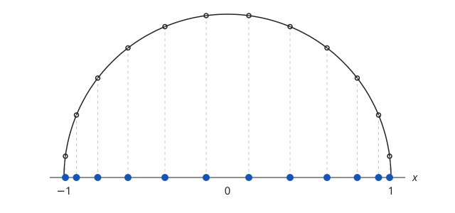
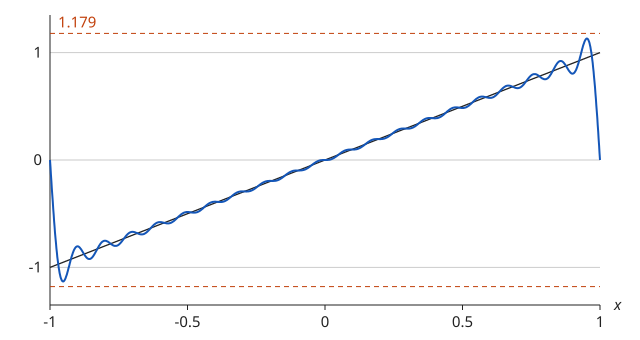
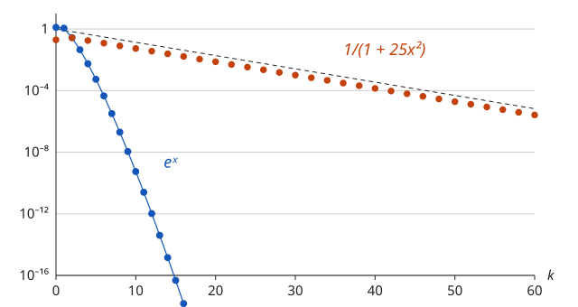

# От МНК до Фурье-продолжения: как сплющить окружность, обмануть эффект Гиббса и при чём тут паровая машина XIX века

*Конспект беседы о том, как оптимально приближать данные на отрезке и на окружности. Утверждения даны с доказательствами — их можно раскрыть, нажав «Доказательство». Числа с пометкой «посчитано» проверены в NumPy/SciPy.*

**Коротко.** На отрезке приближайте полиномами Чебышёва. Если можете выбирать, где мерить, мерьте в узлах Чебышёва: тогда подгонка сводится к быстрому косинус-преобразованию. На окружности берите синусы и косинусы на равномерной сетке: подгонка — это БПФ. По сути это одно и то же, увиденное с разных сторон. Подстановка $x = \cos\varphi$ превращает каждый полином Чебышёва в косинус. Данные с трендом непериодичны. Чтобы всё же применить к ним Фурье, их сначала нужно сделать периодическими: гладко перекрыть зазор, оштрафовать кривизну или вычесть тренд.

## 0. Постановка задачи

Есть $N$ измерений $(x_i, y_i)$, и нужна модель с $K < N$ параметрами,

$$
f(x) \approx \sum_{k=0}^{K-1} c_k\,\phi_k(x),
$$

подобранная методом наименьших квадратов (МНК): минимизируем $\sum_i \bigl(y_i - \sum_k c_k \phi_k(x_i)\bigr)^2$. В матричном виде, с матрицей $A_{ik} = \phi_k(x_i)$ размера $N\times K$, это $\min_c \lVert y - Ac \rVert_2$. Задачу решают нормальными уравнениями $A^{\mathsf T}A\,c = A^{\mathsf T}y$ или, что устойчивее, через QR-разложение $A$.

В наших руках два выбора: **функции** $\phi_k$ и иногда **точки** $x_i$. Они отвечают за разное, и их легко перепутать. Поэтому начнём с того, что разведём их.

## 1. Отрезок $[-1, 1]$: полиномы Чебышёва и узлы Чебышёва

Любой отрезок $[a, b]$ переводится в $[-1, 1]$ заменой $x = \dfrac{2t - a - b}{b - a}$, так что достаточно изучить $[-1, 1]$.

### 1.1 Базис отвечает за обусловленность, точки — за устойчивость

Многочлены степени $< K$ образуют одно и то же пространство, как их ни записывай: через $1, x, x^2, \dots$ или через полиномы Чебышёва. Поэтому в точной арифметике решение МНК — **один и тот же многочлен** в любом базисе. Базис влияет только на то, насколько точно его найдёт компьютер. Это измеряет *число обусловленности* матрицы $A$ — грубо говоря, сколько верных цифр теряется. Для $N = 100$ равноотстоящих точек (посчитано):

| Параметров $K$ | 4 | 6 | 8 | 10 | 12 |
| --- | --- | --- | --- | --- | --- |
| cond $A$, степени $x^k$ | 8,0 | 42 | 230 | 1 200 | 6 900 |
| cond $A$, Чебышёв $T_k$ | 2,3 | 2,6 | 2,8 | 2,9 | 2,9 |

Степенной базис теряет примерно три четверти цифры на каждые два новых параметра. Базис Чебышёва здесь почти идеален, и так будет, пока $K$ заметно меньше $\sqrt N$.

**Феномен Рунге** (сильные колебания у концов) вызывают *точки*, а не базис. Приблизим функцию Рунге $1/(1+25x^2)$ по $N = 40$ равноотстоящим отсчётам. Максимальная ошибка равна 0,15 при $K = 10$ и 0,047 при $K = 20$. При $K = 30$ она уже 1,95, а при $K = 40$ — $1{,}4\cdot10^{4}$ (посчитано). В точной арифметике выбор базиса на эти числа не влияет. На равноотстоящих точках полиномиальный МНК устойчив, только пока $K$ растёт не быстрее примерно $\sqrt N$ (Рахманов, 2007). А по равноотстоящим отсчётам никакой устойчивый метод вообще не может сходиться экспоненциально быстро (Platte, Trefethen, Kuijlaars, 2011).

Отсюда правило: **базис Чебышёва — всегда; узлы Чебышёва — всегда, когда вы вольны выбирать, где измерять.**

### 1.2 Полиномы Чебышёва

> **Определение.** $T_n(x) = \cos(n\arccos x)$ при $x \in [-1,1]$, то есть $T_n(\cos\theta) = \cos n\theta$.
> Тогда $T_0 = 1$, $T_1 = x$ и $T_{n+1}(x) = 2x\,T_n(x) - T_{n-1}(x)$.
> Значит, $T_n$ — многочлен степени $n$ со старшим коэффициентом $2^{n-1}$ ($n \ge 1$): $T_2 = 2x^2-1$, $T_3 = 4x^3 - 3x$, …

Доказательство

Сложим тождества $\cos((n+1)\theta) = \cos n\theta\cos\theta - \sin n\theta\sin\theta$ и $\cos((n-1)\theta) = \cos n\theta\cos\theta + \sin n\theta\sin\theta$:

$$
\cos((n+1)\theta) + \cos((n-1)\theta) = 2\cos\theta\,\cos n\theta .
$$

При $x = \cos\theta$ это и есть $T_{n+1}(x) + T_{n-1}(x) = 2x\,T_n(x)$. Поскольку $T_0 = 1$ и $T_1 = x$ — многочлены, по индукции каждый $T_n$ — многочлен степени $n$. Рекуррентная формула на каждом шаге удваивает старший коэффициент, отсюда $2^{n-1}$.

На $[-1,1]$ многочлен $T_n$ ровно $n+1$ раз достигает значений $\pm1$, попеременно: в точках $x_j = \cos(j\pi/n)$, $j = 0,\dots,n$, где $T_n(x_j) = (-1)^j$. Его $n$ корней — $\cos\bigl((2i+1)\pi/(2n)\bigr)$. Обе системы точек сгущаются к концам отрезка.

### 1.3 Свойство наименьшего уклонения

> **Теорема (Чебышёв).** Среди всех многочленов степени $n \ge 1$ со старшим коэффициентом 1 наименьший возможный максимум $\lvert p(x)\rvert$ на $[-1,1]$ равен $2^{1-n}$. Он достигается на $2^{1-n}T_n$ и только на нём.

Доказательство

У $2^{1-n}T_n$ старший коэффициент 1, а максимум модуля $2^{1-n}$; значит, минимум не больше $2^{1-n}$.

Пусть некоторый приведённый $p$ степени $n$ имеет $\max\lvert p\rvert < 2^{1-n}$. Положим $q = 2^{1-n}T_n - p$. Старшие члены сокращаются, так что $\deg q \le n-1$. В $n+1$ точках $x_j = \cos(j\pi/n)$

$$
q(x_j) = (-1)^j\,2^{1-n} - p(x_j), \qquad \lvert p(x_j)\rvert < 2^{1-n},
$$

поэтому знак $q(x_j)$ совпадает со знаком $(-1)^j$. Значит, $q$ меняет знак между каждыми соседними точками и имеет не меньше $n$ корней. У ненулевого многочлена степени $\le n-1$ не может быть $n$ корней, поэтому $q \equiv 0$. Тогда $p = 2^{1-n}T_n$, но у него максимум ровно $2^{1-n}$, а не меньше. Противоречие.

*Единственность.* Если $\max\lvert p\rvert = 2^{1-n}$, то для того же $q$ верно лишь $(-1)^j q(x_j) \ge 0$. Многочлен степени $\le n-1$, нестрого чередующий знак в $n+1$ точках, всё равно имеет $n$ корней с учётом кратности, и снова $q \equiv 0$. Эту лемму о подсчёте корней см. в книге Rivlin, *Chebyshev Polynomials*, гл. 2.

**Почему это важно при выборе точек.** Проинтерполируем гладкую $f$ многочленом $p$ степени $N-1$ по $N$ точкам. Тогда для каждого $x$ найдётся $\xi$ на отрезке, такое что

$$
f(x) - p(x) = \frac{f^{(N)}(\xi)}{N!}\,\omega_N(x), \qquad \omega_N(x) = \prod_{i=1}^{N}(x - x_i).
$$

Доказательство

Зафиксируем $x$, не совпадающее с узлом (в узле обе части равны нулю). Подберём константу $\kappa$ так, чтобы $F(t) = f(t) - p(t) - \kappa\,\omega_N(t)$ обращалась в ноль при $t = x$. Тогда у $F$ есть $N+1$ нулей: $N$ узлов и $x$. По теореме Ролля у $F'$ есть $N$ нулей, …, у $F^{(N)}$ — нуль $\xi$. Так как $p^{(N)} = 0$ и $\omega_N^{(N)} = N!$, получаем $f^{(N)}(\xi) - \kappa N! = 0$. Значит, $\kappa = f^{(N)}(\xi)/N!$, а $F(x) = 0$ — это и есть утверждение.

В наших руках только $\omega_N$ — приведённый многочлен степени $N$. По теореме его максимум минимален, когда узлы — корни $T_N$: тогда $\omega_N = 2^{1-N}T_N$. Равноотстоящие узлы хуже, и разрыв быстро растёт. Посчитано: при $N = 10$ величина $\max\lvert\omega_N\rvert$ больше в 6,5 раза, при $N = 20$ — в 173 раза, при $N = 40$ — примерно в 230 000 раз. Коэффициент усиления ошибок данных (константа Лебега) растёт для узлов Чебышёва лишь как $\tfrac{2}{\pi}\log N$, а для равноотстоящих — как $2^N/(e N \log N)$ (Trefethen, *ATAP*, гл. 15).

### 1.4 Узлы Чебышёва делают МНК диагональным

Возьмём в качестве точек измерения $N$ корней $T_N$:

$$
x_i = \cos\theta_i, \qquad \theta_i = \frac{(2i+1)\pi}{2N}, \quad i = 0, 1, \dots, N-1 .
$$

*Рис. 1.* Двенадцать равноотстоящих точек на полуокружности и их тени на диаметре: узлы Чебышёва при $N = 12$. Они сгущаются к $\pm1$.

Замечание о названиях. Это корни $T_N$, их называют ещё узлами Чебышёва первого рода. Во многих книгах, в том числе у Трефетена, «точками Чебышёва» (*Chebyshev points*) называют другой набор: $N+1$ точку экстремума $\cos(j\pi/N)$. Всё сказанное ниже верно и для них, только косинус-преобразование будет немного другим (DCT-I).

> **Дискретная ортогональность.** При $0 \le j, k \le N-1$:
> $$\sum_{i=0}^{N-1} T_j(x_i)\,T_k(x_i) = \begin{cases} 0, & j \ne k,\\ N, & j = k = 0,\\ N/2, & j = k \ne 0.\end{cases}$$

Доказательство

Поскольку $T_jT_k = \tfrac12\bigl[T_{j+k} + T_{\lvert j-k\rvert}\bigr]$ (из $\cos a\cos b = \tfrac12[\cos(a+b) + \cos(a-b)]$), достаточно показать, что для целого $m$, $0 < m < 2N$,

$$
S_m = \sum_{i=0}^{N-1}\cos(m\theta_i) = 0, \qquad\text{а } S_0 = N .
$$

Сложим комплексные экспоненты как геометрическую прогрессию:

$$
\sum_{i=0}^{N-1} e^{\mathrm{i} m\theta_i} = e^{\mathrm{i} m\pi/(2N)}\sum_{i=0}^{N-1}\bigl(e^{\mathrm{i} m\pi/N}\bigr)^i = e^{\mathrm{i} m\pi/(2N)}\,\frac{1 - e^{\mathrm{i} m\pi}}{1 - e^{\mathrm{i} m\pi/N}} .
$$

Знаменатель не равен нулю, так как $0 < m < 2N$. При чётном $m$ числитель $1 - e^{\mathrm{i} m\pi} = 0$ и сумма равна 0. При нечётном $m$ числитель равен 2, и сумма равна

$$
\frac{2}{e^{-\mathrm{i} m\pi/(2N)} - e^{\mathrm{i} m\pi/(2N)}} = \frac{2}{-2\mathrm{i}\sin\frac{m\pi}{2N}} = \frac{\mathrm{i}}{\sin\frac{m\pi}{2N}},
$$

то есть чисто мнимая. В обоих случаях её вещественная часть $S_m$ равна 0. При $j, k \le N-1$ имеем $j+k \le 2N-2$ и $\lvert j-k\rvert \le N-1$, поэтому выжить может только слагаемое с $j = k$: оно даёт $\tfrac12(S_{2k} + S_0) = N/2$ при $k \ne 0$ и $S_0 = N$ при $k = 0$.

**Следствия.**

- При $\phi_k = T_k$ матрица $A^{\mathsf T}A$ диагональна. Коэффициенты МНК находятся вообще без линейной алгебры:

  $$
  c_0 = \frac1N\sum_i y_i, \qquad c_k = \frac2N\sum_i y_i\,T_k(x_i) = \frac2N\sum_i y_i\cos(k\theta_i)\quad (k \ge 1).
  $$

  Это дискретное косинусное преобразование (DCT-II). Через БПФ оно считается за $O(N\log N)$; как именно, показано в [§4 статьи о БПФ](fft.ru.md#s4).
- Подгонка по $K$ параметрам — это просто интерполянт по $N$ точкам с отброшенными последними $N-K$ коэффициентами (посчитано: совпадают с точностью $2{,}5\cdot10^{-16}$). Поэтому выбор $K$ сводится к отсечке, и решать о ней можно уже после того, как видно, как быстро убывают коэффициенты.
- Если точки измерения заданы не вами, оставьте базис Чебышёва и решайте через QR. Диагональность теряется, но хорошая обусловленность из [§1.1](#s1-1) остаётся.

## 2. Замыкаем отрезок в окружность $[0, 2\pi)$: ряд Фурье

Если данные по-настоящему периодичны (угол, время суток, замкнутый контур), концов нет, а вместе с ними исчезают и проблемы на концах.

**Базис:** $1, \cos m\varphi, \sin m\varphi$ при $m = 1, \dots, M$, то есть $K = 2M+1$ параметров.
**Точки:** равномерные, $\varphi_n = 2\pi n/N$. Поворот окружности переводит такую сетку в себя, так что все точки равноправны. На окружности сгущение точек в одном месте могло бы помочь там только за счёт другого. *(Это эвристика, а не теорема.)*

> **Дискретная ортогональность на окружности.** Для целых $j, k$:
> $\displaystyle\sum_{n=0}^{N-1} e^{\mathrm{i}(j-k)\varphi_n} = N$, если $j \equiv k \pmod N$, и $0$ в остальных случаях.
> Поэтому при $2M+1 \le N$ столбцы $1, \cos m\varphi, \sin m\varphi$ ортогональны, и
> $$a_m = \frac2N\sum_n y_n\cos m\varphi_n, \qquad b_m = \frac2N\sum_n y_n\sin m\varphi_n$$
> (для $a_0$ — множитель $\tfrac1N$). Это дискретное преобразование Фурье; БПФ считает его за $O(N\log N)$ операций ([как устроено БПФ](fft.ru.md#s2)).

Доказательство

Положим $r = e^{2\pi\mathrm{i}(j-k)/N}$; сумма равна $\sum_{n=0}^{N-1} r^n$. Если $j \equiv k \pmod N$, то $r = 1$ и сумма равна $N$. Иначе $r \ne 1$, и сумма равна $(1 - r^N)/(1 - r) = 0$, так как $r^N = 1$. Выразим $\cos$ и $\sin$ через $e^{\pm\mathrm{i}m\varphi}$. При $0 \le m, m' \le M$ и $2M < N$ частоты $\pm m$ и $\pm m'$ сравнимы по модулю $N$, только если $m = m'$ с тем же знаком или $m = m' = 0$. Поэтому все перекрёстные слагаемые обращаются в ноль.

**Усечённый ряд Фурье — наилучшее приближение.** Для квадратично интегрируемой $f$ на окружности ближайший к ней в среднеквадратичном смысле тригонометрический многочлен степени $M$ — это частичная сумма $S_M f$, причём

$$
\frac1\pi\int_0^{2\pi}\lvert f - S_Mf\rvert^2\,d\varphi = \sum_{m > M}\bigl(a_m^2 + b_m^2\bigr).
$$

Доказательство

Функции $1, \cos m\varphi, \sin m\varphi$ ортогональны на $[0, 2\pi)$. Поэтому $f - S_Mf$ ортогональна любому тригонометрическому многочлену $t$ степени $\le M$, и по теореме Пифагора

$$
\lVert f - t\rVert^2 = \lVert f - S_Mf\rVert^2 + \lVert S_Mf - t\rVert^2 \ge \lVert f - S_Mf\rVert^2,
$$

с равенством только при $t = S_Mf$. Формула для ошибки — равенство Парсеваля для $f - S_Mf = \sum_{m>M}(\dots)$.

**Как быстро убывают коэффициенты?** Расхожая формулировка «гладкость влечёт экспоненциальное убывание» слишком сильна. Точные утверждения:

> **(а)** Если $f$ $2\pi$-периодична, $f, f', \dots, f^{(p-1)}$ непрерывны, а $f^{(p)}$ кусочно гладкая (скачки допускаются), то $a_m, b_m = O(m^{-p-1})$. В общем виде достаточно, чтобы $f^{(p-1)}$ была абсолютно непрерывной, а $f^{(p)}$ имела ограниченную вариацию.
> **(б)** Если $f$ аналитична и ограничена числом $B$ в полосе $\lvert\operatorname{Im}\varphi\rvert < \sigma$, то $\lvert a_m\rvert, \lvert b_m\rvert \le 2B\,e^{-\sigma' m}$ для любого $\sigma' < \sigma$.

Доказательство

(а) Запишем $c_m = \frac1{\pi}\int_0^{2\pi} f(\varphi)\,e^{-\mathrm{i}m\varphi}\,d\varphi$ (так что $a_m = \operatorname{Re} c_m$, $b_m = -\operatorname{Im} c_m$). Проинтегрируем по частям $p$ раз. Внеинтегральные члены сокращаются в силу периодичности, так как $f, \dots, f^{(p-1)}$ непрерывны на окружности. Получаем $c_m = (\mathrm{i}m)^{-p}\,\frac1\pi\int f^{(p)}e^{-\mathrm{i}m\varphi}\,d\varphi$. Ещё одно интегрирование по частям (в смысле Стилтьеса) даёт $\bigl\lvert\int f^{(p)}e^{-\mathrm{i}m\varphi}\bigr\rvert \le \operatorname{Var}(f^{(p)})/m$. Итого $\lvert c_m\rvert \le \operatorname{Var}(f^{(p)})/(\pi m^{p+1})$.

(б) Пусть $m > 0$. Сдвинем путь интегрирования с вещественной оси вниз, на прямую $\operatorname{Im}\varphi = -\sigma'$. Подынтегральная функция аналитична между ними, а вертикальные стороны прямоугольника взаимно уничтожаются благодаря периодичности. На новом пути $\lvert e^{-\mathrm{i}m\varphi}\rvert = e^{-m\sigma'}$, откуда $\lvert c_m\rvert \le \frac1\pi\cdot 2\pi B\,e^{-m\sigma'}$. При $m < 0$ сдвигаем путь вверх.

| | Отрезок $[-1, 1]$ | Окружность $[0, 2\pi)$ |
| --- | --- | --- |
| Базис ($K$ параметров) | Полиномы Чебышёва $T_k(x)$ | $\cos m\varphi$, $\sin m\varphi$ |
| Лучшая сетка ($N$ точек) | Узлы Чебышёва (сгущение к краям) | Равномерная |
| Быстрый МНК | DCT (на узлах Чебышёва), иначе QR | БПФ (FFT) |
| Сходимость для гладких данных | Экспоненциальная, если $f$ аналитична в окрестности $[-1,1]$ | Экспоненциальная, если $f$ аналитична в окрестности вещественной оси |

## 3. Физический смысл коэффициентов Чебышёва: «сплюснутая» волна

Пустим точку по единичной окружности с постоянной угловой скоростью, $\varphi = \omega t$. Её тень на горизонтальном диаметре движется как поршень: $x = \cos\varphi$. В этой переменной каждый полином Чебышёва — обычный косинус:

$$
T_k(\cos\varphi) = \cos k\varphi .
$$

Поэтому для функции $f$ на $[-1,1]$ рассмотрим $g(\varphi) = f(\cos\varphi)$. Она $2\pi$-периодична и чётна. А главное, **у неё нет скачка**: при обходе окружности $x$ идёт от $1$ к $-1$ и *обратно*, так что концы отрезка становятся точками разворота, а не швами. Ряд Чебышёва для $f$ — это в точности косинус-ряд Фурье для $g$:

$$
f(x) = \sum_{k=0}^{\infty} c_k\,T_k(x), \qquad c_k = \frac2\pi\int_0^\pi f(\cos\varphi)\cos k\varphi\,d\varphi = \frac2\pi\int_{-1}^{1}\frac{f(x)\,T_k(x)}{\sqrt{1-x^2}}\,dx \quad (k \ge 1),
$$

а $c_0$ даётся теми же формулами с $\tfrac1\pi$ вместо $\tfrac2\pi$, в согласии с [§1.4](#s1-4). Вторая форма получается заменой $x = \cos\varphi$. Она же объясняет вес $1/\sqrt{1-x^2}$: поршень дольше находится у концов, где он тормозит, чтобы развернуться.

**Как читать коэффициенты** (это скорее ориентир, чем теоремы):

- $c_0$ — среднее значение $f$ *по времени поршня*, то есть с перевесом у концов.
- $c_1$ — та часть $f$, что похожа на $x$: общий наклон слева направо.
- $c_2$ — часть, похожая на $2x^2-1$: общий прогиб вверх или вниз.
- Старшие $c_k$ измеряют рябь шириной около $1/k$ по $\varphi$. По $x$ эта рябь мельче у концов и крупнее в середине — там же, где сгущаются и разрежаются узлы Чебышёва.

**Зачем это, если это «просто Фурье»?** Затем, что ряд Фурье, применённый к $f$ прямо на отрезке, склеивает $f(1)$ с $f(-1)$. Возьмём $f(x) = x$. Её периодическое продолжение — пила со скачком высоты 2 в точках $x = \pm1$, и

$$
x = \sum_{k\ge1} \frac{2(-1)^{k+1}}{k\pi}\sin k\pi x \qquad (-1 < x < 1).
$$

Доказательство

$b_k = \int_{-1}^{1} x\sin(k\pi x)\,dx$. Интегрируя по частям, $b_k = \Bigl[-\frac{x\cos k\pi x}{k\pi}\Bigr]_{-1}^{1} + \frac{1}{k\pi}\int_{-1}^{1}\cos k\pi x\,dx = -\frac{2\cos k\pi}{k\pi} + 0 = \frac{2(-1)^{k+1}}{k\pi}$.

Коэффициенты убывают лишь как $1/k$. Около скачка частичные суммы дают выброс около 9 % от величины скачка, сколько слагаемых ни бери: это **эффект Гиббса**. Посчитано: пик равен 1,131 при 20 слагаемых и 1,174 при 200, стремясь к $1{,}179$. В базисе Чебышёва та же функция есть $x = T_1(x)$: один коэффициент, нулевая ошибка.

*Рис. 2.* $f(x) = x$ (тонкая линия) и первые 20 членов её ряда Фурье. Пунктир отмечает $\pm1{,}179$ — уровень, к которому стремится выброс.

**Для аналитических функций ряд сходится со скоростью геометрической прогрессии.** Точная формулировка использует *эллипс Бернштейна* $E_\rho$ с фокусами $\pm1$ и суммой полуосей $\rho > 1$:

> **Теорема (Бернштейн).** Если $f$ аналитична внутри $E_\rho$ и $\lvert f\rvert \le B$ там, то $\lvert c_k\rvert \le 2B\rho^{-k}$, а обрыв ряда после степени $n$ даёт ошибку не больше $2B\rho^{-n}/(\rho - 1)$.

Доказательство

Это [§2](#s2)(б) в другом обличье. Отображение $x = \cos\varphi$ переводит горизонтальную прямую $\operatorname{Im}\varphi = \eta$ в эллипс с полуосями $\cosh\eta$ и $\sinh\eta$, сумма которых равна $e^\eta$. Поэтому «$f$ аналитична внутри $E_\rho$» означает «$g(\varphi) = f(\cos\varphi)$ аналитична в полосе $\lvert\operatorname{Im}\varphi\rvert < \log\rho$». Сдвиг контура из [§2](#s2)(б), применённый к косинус-коэффициентам $c_k$ функции $g$, даёт $\lvert c_k\rvert \le 2B\rho'^{-k}$ для любого $\rho' < \rho$, а по непрерывности и для $\rho' = \rho$. Оценка остатка следует отсюда (так как $\lvert T_k\rvert \le 1$ на $[-1,1]$) суммированием геометрической прогрессии $\sum_{k > n}2B\rho^{-k}$.

Два примера:

- **$e^x$** аналитична всюду, поэтому сходится быстрее любой $\rho^{-k}$. Её коэффициенты $c_0 = I_0(1)$ и $c_k = 2I_k(1)$ при $k \ge 1$ (модифицированные функции Бесселя; это разложение Якоби–Ангера для $e^{\cos\varphi}$), причём $I_k(1) \approx 2^{-k}/k!$. Часто говорят, что машинная точность ($10^{-16}$) достигается всего за 10–12 коэффициентов. Посчитано: максимальная ошибка $6{,}0\cdot10^{-10}$ при 10 коэффициентах, $1{,}1\cdot10^{-12}$ при 12 и $\approx 10^{-14}$, то есть уровень ошибок округления двойной точности, при 14. Так что нужно около **14 коэффициентов**.
- **Функция Рунге** $1/(1+25x^2)$ имеет полюсы в $\pm\mathrm{i}/5$, поэтому $\rho = \tfrac15 + \sqrt{1 + \tfrac1{25}} \approx 1{,}22$. Её коэффициенты Чебышёва убывают как $1{,}22^{-k}$, медленно, но верно: $5\cdot10^{-2}$ при $k = 10$, $1{,}4\cdot10^{-4}$ при $k = 40$, $7\cdot10^{-15}$ при $k = 160$ (посчитано). На этой самой функции провалилась подгонка по равноотстоящим точкам в [§1.1](#s1-1). С узлами Чебышёва феномена Рунге нет, есть лишь скорость сходимости.

*Рис. 3.* Величина коэффициентов Чебышёва $\lvert c_k\rvert$ для $e^x$ и для функции Рунге (только чётные $k$; нечётные равны нулю) в логарифмическом масштабе. Пунктир — $1{,}22^{-k}$.

**Обрыв ряда — почти лучшее, что можно сделать.** Наилучшее равномерное приближение степени $n$ — другой многочлен, и найти его труднее. Но усечённый ряд Чебышёва от него почти не отстаёт: его максимальная ошибка не более чем в $4 + \frac{4}{\pi^2}\ln(n+1)$ раз больше наименьшей возможной (Trefethen, *ATAP*, теорема 16.1). При $n = 100$ этот множитель меньше 6, то есть меньше одной десятичной цифры. К тому же ошибка усечённого ряда колеблется по отрезку почти равномерно, а не накапливается у концов.

## 4. Как замкнуть непериодическую кривую: Фурье-продолжение

Пусть данные на $[0, L]$ имеют тренд (линейный, экспоненциальный, …), а скорость БПФ всё равно хочется. Склейка конца с началом даёт скачок, а с ним коэффициенты порядка $O(1/k)$ и звон Гиббса, как в [§3](#s3). Идея: **добавить пустой зазор** $[L, L + \Delta]$ между последним и первым отсчётом и считать весь $[0, L+\Delta]$ одним обходом окружности. Внутри зазора кривая может плавно развернуться обратно. Эта идея известна как **Фурье-продолжение** (*Fourier continuation*). Хорошо развитый современный вариант — метод FC–Gram Бруно и Лайона (2010).

**Подвох.** В зазоре нет данных. Если ничем его не ограничить, МНК охотно устроит там гигантские выбросы, если это хоть немного улучшит подгонку на $[0, L]$. По той же причине система плохо обусловлена. Ниже три способа укротить зазор, и для каждого — что он даёт по [§2](#s2)(а).

**1. Гладкий мост.** Заполнить зазор искусственными точками на кривой, которая на обоих концах совпадает с данными по значению, первой и второй производной. У полинома Эрмита пятой степени ровно шесть коэффициентов, нужных для этого. Продолженная функция тогда класса $C^2$ на окружности, а её третья производная кусочно гладкая. По [§2](#s2)(а) с $p = 3$ коэффициенты убывают как $O(m^{-4})$, а не $O(m^{-1})$.

**2. Регуляризация Тихонова.** Вместо того чтобы предписывать форму зазора, штрафовать за негладкость. Минимизируем

$$
\sum_i\bigl(y_i - F(t_i)\bigr)^2 + \lambda\sum_m m^4\bigl(a_m^2 + b_m^2\bigr)
$$

по тригонометрическим многочленам $F$ на окружности. Штраф — в точности энергия изгиба (в отмасштабированном угле $\varphi = 2\pi t/(L+\Delta)$):

$$
\int_0^{2\pi}\lvert F''(\varphi)\rvert^2\,d\varphi = \pi\sum_m m^4\bigl(a_m^2 + b_m^2\bigr).
$$

Доказательство

Двукратное дифференцирование умножает $\cos m\varphi$ и $\sin m\varphi$ на $-m^2$, поэтому коэффициенты Фурье функции $F''$ равны $-m^2a_m$ и $-m^2b_m$. Равенство Парсеваля, $\int_0^{2\pi}\lvert h\rvert^2 = \pi\sum(\alpha_m^2 + \beta_m^2)$ для $h$ с нулевым средним, даёт формулу.

Так кривая проходит зазор, как упругая линейка, и это буквально так: среди всех функций, проходящих через заданные значения, $\int\lvert F''\rvert^2$ минимален у кубического сплайна. Данные теперь покрывают окружность неравномерно, поэтому $A^{\mathsf T}A$ уже не диагональна. Решаем систему $(A^{\mathsf T}A + \lambda D)\,c = A^{\mathsf T}y$ с $D = \operatorname{diag}(m^4)$. Она симметрична, положительно определена и при $\lambda > 0$ ведёт себя хорошо.

**3. Вычесть тренд.** Вычтем прямую через значения на концах: $h(t) = f(t) - f(0) - \bigl(f(L) - f(0)\bigr)t/L$, так что $h(0) = h(L) = 0$. Теперь продолжим $h$ на $[-L, L]$ нечётным образом и разложим в синус-ряд $h(t) = \sum_k \beta_k\sin(k\pi t/L)$.

> Если $f$ гладкая на $[0, L]$, то $\beta_k = O(k^{-3})$. Если вычесть ещё и кубический многочлен, обеспечивающий $h''(0) = h''(L) = 0$, то $\beta_k = O(k^{-5})$.

Доказательство

Нечётное продолжение $\tilde h$ непрерывно, так как $h(0) = h(\pm L) = 0$. Его производная чётна и потому непрерывна в $0$ и в $\pm L$. Вторая производная нечётна, так что в $0$ и $\pm L$ у неё скачок, если только $h''$ там не обращается в ноль. Значит, $\tilde h \in C^1$ с кусочно гладкой $\tilde h''$, и [§2](#s2)(а) с $p = 2$ даёт $O(k^{-3})$. Если же вдобавок $h''(0) = h''(L) = 0$, то $\tilde h \in C^3$ с кусочно гладкой $\tilde h^{(4)}$, и $p = 4$ даёт $O(k^{-5})$.

При $L = 1$ трёхкратное интегрирование по частям даёт главный член $\beta_k \approx \frac{2}{(k\pi)^3}\bigl[(-1)^k h''(1) - h''(0)\bigr]$. Посчитано для $f = e^t$ на $[0, 1]$, где $h'' = e^t$: $k^3\beta_k$ выходит на $2(e-1)/\pi^3 \approx 0{,}111$ при чётных $k$ и на $-2(e+1)/\pi^3 \approx -0{,}240$ при нечётных, как и говорит формула.

Тренд прибавляется обратно после подгонки. Здесь зазор вообще не нужен: его роль играет зеркальное отражение данных.

## 5. Историческая справка: Париж, простые числа и паровая машина Уатта

В мировой литературе полиномы носят имя автора — *Chebyshev polynomials*. В старых работах и в литературе по расчёту фильтров встречаются французское и немецкое написания *Tchebycheff* и *Tschebyscheff* (или *Tschebyschow*). От них и пошла буква $T$ в обозначении $T_n$.

Пафнутий Львович Чебышёв (1821–1894) стал классиком мировой математики ещё при жизни:

- В 1850 году, в 29 лет, он доказал **постулат Бертрана**: при любом $n > 1$ между $n$ и $2n$ есть простое число. Доказательство опубликовано в 1852 году.
- **Парижская академия наук** избрала его членом-корреспондентом в 1860 году и иностранным членом (*associé étranger*) в 1874-м. Энциклопедия Брокгауза и Ефрона (1903) датирует второе звание 1860 годом. Она также отмечает, что из русских учёных эту честь с ним разделил лишь Карл Эрнст фон Бэр, избранный в 1876 году.
- Сами полиномы родились из **инженерной задачи**. Летом 1852 года Чебышёв объехал Францию, Англию и Германию. Он не только встречался с математиками, но и осматривал фабрики, ветряные мельницы и паровые машины, и одна из них озадачила его надолго. В паровых машинах Уатта шарнирный механизм («параллелограмм Уатта») ведёт шток поршня почти по прямой. Точка механизма описывает кривую Уатта — алгебраическую кривую шестой степени. Чебышёв спросил, как подобрать размеры звеньев, чтобы на рабочем ходе эта кривая как можно меньше уклонялась от прямой. Его мемуар *Théorie des mécanismes connus sous le nom de parallélogrammes* («Теория механизмов, известных под названием параллелограммов») был представлен Петербургской академии в январе 1853 года и опубликован в 1854-м. Там и появляется многочлен, наименее уклоняющийся от нуля, — наш $2^{1-n}T_n$ из [§1.3](#s1-3). Шарнирные механизмы он строил всю жизнь: их больше сорока, и среди них «стопоходящая машина», которая умеет шагать; её показывали на Всемирной выставке в Париже в 1878 году.

## Литература

- П. Л. Чебышёв, *Théorie des mécanismes connus sous le nom de parallélogrammes*, Mém. Acad. Sci. St-Pétersbourg 7 (1854), 539–568; «Теория механизмов, известных под названием параллелограммов», текст на [Math-Net.Ru](https://m.mathnet.ru/eng/rm7033). См. также [History of Approximation Theory: Chebyshev](https://history-of-approximation-theory.com/people/chebyshev).
- L. N. Trefethen, *Approximation Theory and Approximation Practice* (ATAP), SIAM, 2013 / расширенное издание 2019. Главы о узлах Чебышёва, эллипсах Бернштейна, константах Лебега.
- T. J. Rivlin, *Chebyshev Polynomials*, 2nd ed., Wiley, 1990.
- J. P. Boyd, *Chebyshev and Fourier Spectral Methods*, 2nd ed., Dover, 2001.
- R. B. Platte, L. N. Trefethen, A. B. J. Kuijlaars, *Impossibility of fast stable approximation of analytic functions from equispaced samples*, SIAM Review 53 (2011).
- Е. А. Рахманов, *Bounds for polynomials with a unit discrete norm*, Annals of Mathematics 165 (2007).
- O. P. Bruno, M. Lyon, *High-order unconditionally stable FC-AD solvers for general smooth domains I*, J. Comput. Phys. 229 (2010).
- [Чебышёв, Пафнутий Львович](https://ru.wikipedia.org/wiki/Чебышёв,_Пафнутий_Львович), Википедия.
