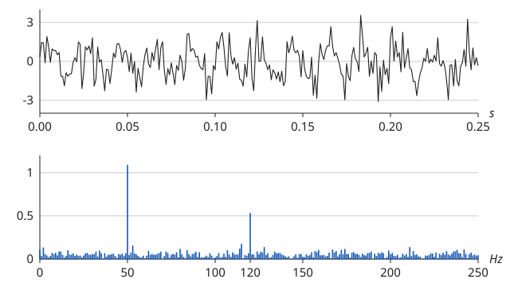
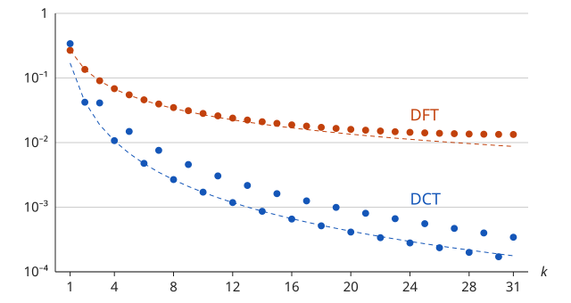
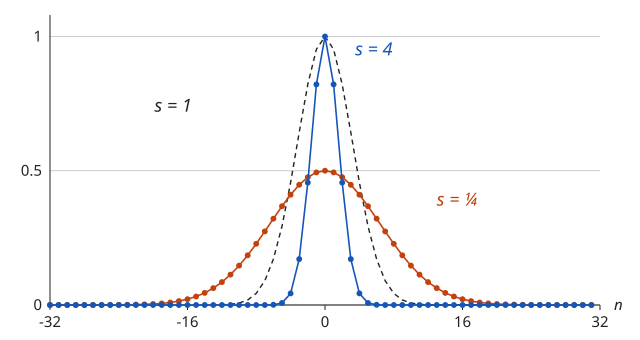

# The discrete and the fast Fourier transform: a trillion operations that became twenty million, the cosine inside every JPEG, and the bell curve the transform cannot change

*The second note in a series that began with [Chebyshev polynomials](chebyshev.en.md). Statements come with proofs; click "Proof" to expand them. Every listing was run (Python with NumPy and SciPy, TypeScript on Node 22, Java), and the output shown under it is what it printed.*

**The short version.** The discrete Fourier transform (DFT) turns $N$ samples of a signal into $N$ numbers that say how much of each frequency the signal contains. Computed from its definition it costs $N^2$ operations. The fast Fourier transform (FFT) produces the same numbers in about $N\log_2 N$, by cutting the problem in half again and again. Mirror the signal before transforming it and you get the cosine transform inside JPEG and MP3. And one shape, the bell curve, comes out of the transform exactly as it went in.

## 0. Why it matters: a million samples

Twenty-four seconds of CD sound is about a million samples. So is a one-megapixel photograph. Take $N = 2^{20} = 1\,048\,576$. Straight from the definition, the DFT needs $N^2 \approx 1.1\cdot10^{12}$ multiplications and additions. The FFT needs about $N\log_2 N \approx 2.1\cdot10^{7}$. On a machine that does $10^9$ of them per second, that is 18 minutes against 0.02 seconds.

| $N$ | $N^2$ | $N\log_2 N$ | How many times fewer |
| --- | --- | --- | --- |
| $1\,024$ | $1.0\cdot10^{6}$ | $1.0\cdot10^{4}$ | 102 |
| $2^{20} \approx 10^6$ | $1.1\cdot10^{12}$ | $2.1\cdot10^{7}$ | 52 000 |
| $2^{30} \approx 10^9$ | $1.2\cdot10^{18}$ | $3.2\cdot10^{10}$ | 36 000 000 |

The last row is 36 years against 32 seconds. Digital sound, images, radio and radar exist in their present form because of that column.

## 1. The DFT: $N$ samples in, $N$ frequencies out

> **Definition.** Let $\omega = e^{2\pi\mathrm{i}/N}$. The DFT of $x_0, \dots, x_{N-1}$ is
> $$X_k = \sum_{n=0}^{N-1} x_n\,\omega^{-kn}, \qquad k = 0, 1, \dots, N-1 .$$
> **Inversion.** $\displaystyle x_n = \frac1N\sum_{k=0}^{N-1} X_k\,\omega^{kn}$. **Parseval.** $\displaystyle\sum_{n}\lvert x_n\rvert^2 = \frac1N\sum_{k}\lvert X_k\rvert^2$.

<details markdown="1">
<summary>Proof</summary>

Both rest on one fact: for integers $n, m$

$$
\sum_{k=0}^{N-1}\omega^{k(n-m)} = \begin{cases} N, & n \equiv m \pmod N,\\ 0, & \text{otherwise.}\end{cases}
$$

It is a geometric series, summed in [§2 of the Chebyshev article](chebyshev.en.md#s2), where the same fact made least squares on a circle diagonal.

*Inversion.* Put the definition of $X_k$ into the right-hand side and swap the sums:

$$
\frac1N\sum_k\Bigl(\sum_m x_m\,\omega^{-km}\Bigr)\omega^{kn} = \frac1N\sum_m x_m\sum_k\omega^{k(n-m)} = x_n .
$$

*Parseval.* $\sum_k\lvert X_k\rvert^2 = \sum_k\sum_n\sum_m x_n\overline{x_m}\,\omega^{-k(n-m)} = N\sum_n\lvert x_n\rvert^2$, by the same fact.
</details>

So nothing is lost and nothing is added. The $X_k$ are the same data in other coordinates: instead of "the value at moment $n$" they give "the amount of frequency $k$".

### 1.1 Reading the output

Suppose the samples are taken every $\Delta$ seconds. The sampling rate is $f_s = 1/\Delta$, and the record lasts $T = N\Delta$ seconds.

- $X_k$ measures the frequency $k/T = k f_s/N$ hertz. Neighbouring coefficients are $1/T$ apart: to tell two tones 1 Hz apart you must listen for at least a second.
- For real samples $X_{N-k} = \overline{X_k}$. The upper half of the output mirrors the lower half, and the highest frequency that can be seen is $f_s/2$.
- **Aliasing.** On the grid the frequencies $k$ and $k + N$ cannot be told apart, because $\omega^{(k+N)n} = \omega^{kn}$. A tone above $f_s/2$ is not lost; it turns up disguised as a lower one. Wagon wheels that turn backwards in old films are the same effect at 24 samples per second.
- A pure tone $A\sin(2\pi f t)$ whose frequency falls exactly on coefficient $k$ gives $\lvert X_k\rvert = AN/2$, so $2\lvert X_k\rvert/N$ is its amplitude. A tone between two coefficients leaks into its neighbours.

A signal can hide in noise and still be obvious in the spectrum:

```python
import numpy as np

fs = 1000                                   # samples per second
t = np.arange(1000) / fs                    # one second of signal
rng = np.random.default_rng(1)
x = np.sin(2*np.pi*50*t) + 0.5*np.sin(2*np.pi*120*t) + rng.normal(0, 1, t.size)

X = np.fft.rfft(x)                          # the N/2 + 1 independent coefficients of a real signal
freq = np.fft.rfftfreq(x.size, d=1/fs)      # the frequency of each one, in hertz
amp = 2 * np.abs(X) / x.size

top = np.argsort(amp)[-2:][::-1]            # the two largest
print([(float(freq[i]), round(float(amp[i]), 2)) for i in top])
# [(50.0, 1.09), (120.0, 0.53)]
```



*Figure 1.* Top: the first quarter second of the signal. The noise is as strong as the louder tone, and neither tone can be seen. Bottom: the amplitudes $2\lvert X_k\rvert/N$ up to 250 Hz. The two tones stand at 1.09 and 0.53; nothing else exceeds 0.18. Noise is spread thinly over all 500 frequencies, while each tone sits in one.

## 2. The FFT: halve, transform, combine

> **Theorem.** Let $N$ be even. Let $E$ be the DFT, of length $N/2$, of the even-numbered samples $x_0, x_2, \dots$ and $O$ that of the odd-numbered samples $x_1, x_3, \dots$. Then for $0 \le k < N/2$
> $$X_k = E_k + \omega^{-k}O_k, \qquad X_{k+N/2} = E_k - \omega^{-k}O_k .$$

<details markdown="1">
<summary>Proof</summary>

Split the sum into even and odd $n$:

$$
X_k = \sum_{m=0}^{N/2-1} x_{2m}\,\omega^{-2mk} + \sum_{m=0}^{N/2-1} x_{2m+1}\,\omega^{-(2m+1)k} = \sum_m x_{2m}\,(\omega^2)^{-mk} + \omega^{-k}\sum_m x_{2m+1}\,(\omega^2)^{-mk} .
$$

Since $\omega^2 = e^{2\pi\mathrm{i}/(N/2)}$ is the root of unity that belongs to length $N/2$, the two sums are $E_k$ and $O_k$. This holds for every integer $k$, and both sums repeat with period $N/2$. Replacing $k$ by $k + N/2$ therefore leaves them unchanged, while $\omega^{-(k+N/2)} = \omega^{-k}e^{-\mathrm{i}\pi} = -\omega^{-k}$.
</details>

Each pair $(X_k, X_{k+N/2})$ costs one multiplication and two additions, a step known as a *butterfly*. Two half-size problems and $N/2$ butterflies give a full-size answer. Apply the same idea to the halves, and to their halves:

> **Cost.** For $N = 2^p$ the number of butterflies satisfies $B(N) = 2B(N/2) + N/2$ with $B(1) = 0$. Hence $B(N) = \tfrac12 N\log_2 N$.

<details markdown="1">
<summary>Proof</summary>

By induction on $p$. If $B(N) = \tfrac12 N\log_2 N$, then $B(2N) = 2\cdot\tfrac12 N\log_2 N + N = N(\log_2 N + 1) = \tfrac12(2N)\log_2(2N)$.
</details>

The theorem, written out line by line:

```python
import cmath

def fft(x):
    n = len(x)                               # a power of two
    if n == 1:
        return list(x)
    even, odd = fft(x[0::2]), fft(x[1::2])
    out = [0] * n
    for k in range(n // 2):
        t = cmath.exp(-2j * cmath.pi * k / n) * odd[k]
        out[k] = even[k] + t
        out[k + n // 2] = even[k] - t
    return out
```

On 1024 random numbers its result differs from `numpy.fft.fft` by at most $5\cdot10^{-14}$.

Real implementations do not recurse and do not allocate. They first reorder the samples (index $i$ swaps with the index whose binary digits are those of $i$ reversed), then combine blocks of 2, 4, 8, … in place:

<details markdown="1">
<summary>The same algorithm in TypeScript, in place</summary>

```typescript
/** In-place radix-2 FFT. re and im hold the real and imaginary parts; their length must be a power of two. */
export function fft(re: Float64Array, im: Float64Array): void {
  const n = re.length;
  if (n !== im.length || (n & (n - 1)) !== 0) throw new Error("length must be a power of two");

  // 1. Reorder: element i swaps places with the element whose index has the bits of i reversed.
  for (let i = 1, j = 0; i < n; i++) {
    let bit = n >> 1;
    for (; j & bit; bit >>= 1) j ^= bit;
    j ^= bit;
    if (i < j) {
      [re[i], re[j]] = [re[j], re[i]];
      [im[i], im[j]] = [im[j], im[i]];
    }
  }

  // 2. Combine blocks of 2, then 4, then 8, ...: X[k] = E[k] + w^k O[k], X[k + half] = E[k] - w^k O[k].
  for (let size = 2; size <= n; size *= 2) {
    const half = size / 2;
    const angle = (-2 * Math.PI) / size;
    for (let start = 0; start < n; start += size) {
      for (let k = 0; k < half; k++) {
        const wr = Math.cos(angle * k), wi = Math.sin(angle * k);
        const a = start + k, b = a + half;
        const tr = wr * re[b] - wi * im[b];
        const ti = wr * im[b] + wi * re[b];
        re[b] = re[a] - tr; im[b] = im[a] - ti;
        re[a] += tr;        im[a] += ti;
      }
    }
  }
}

// A pulse: four ones followed by twelve zeros.
const re = Float64Array.from({ length: 16 }, (_, i) => (i < 4 ? 1 : 0));
const im = new Float64Array(16);
fft(re, im);
console.log(Array.from(re.slice(0, 5), (v) => v.toFixed(3)).join(" "));   // 4.000 3.014 1.000 -0.248 0.000
console.log(Array.from(im.slice(0, 5), (v) => v.toFixed(3)).join(" "));   // 0.000 -2.014 -2.414 -1.248 0.000
```

The printed numbers agree with NumPy's.
</details>

**Other lengths.** If $N$ has a factor 3 or 5, split into three or five parts instead of two. For prime $N$ there are cleverer tricks (Bluestein's and Rader's algorithms). The result is $O(N\log N)$ for every $N$. Nobody has proved that fewer operations are impossible.

### 2.1 Libraries

For real work use a library; the listings here are for understanding.

- **Python:** [`numpy.fft`](https://numpy.org/doc/stable/reference/routines.fft.html) and [`scipy.fft`](https://docs.scipy.org/doc/scipy/reference/fft.html). SciPy adds the cosine and sine transforms.
- **C, and underneath many other tools:** [FFTW](https://www.fftw.org/), "the Fastest Fourier Transform in the West". It assembles a plan suited to each length and each processor.
- **Java:** [JTransforms](https://github.com/wendykierp/JTransforms); Apache Commons Math also has an FFT.
- **JavaScript and TypeScript:** [fft.js](https://github.com/indutny/fft.js). Browsers also carry one inside the Web Audio API (`AnalyserNode`).

## 3. Convolution: multiply by transforming

The *cyclic convolution* of two sequences of length $N$ is $(x * y)_n = \sum_{m=0}^{N-1} x_m\,y_{n-m}$, with indices taken modulo $N$.

> **Theorem.** The DFT turns convolution into multiplication: the DFT of $x * y$ is $X_k Y_k$.

<details markdown="1">
<summary>Proof</summary>

$$
\sum_n\Bigl(\sum_m x_m\,y_{n-m}\Bigr)\omega^{-kn} = \sum_m x_m\,\omega^{-km}\sum_n y_{n-m}\,\omega^{-k(n-m)} = X_k\,Y_k ,
$$

because for each $m$ the index $n - m$ runs once through a full period.
</details>

Multiplying two long numbers by hand is a convolution of their digits, followed by carrying: $N^2$ steps for $N$ digits. Through the theorem it takes three FFTs and $N$ multiplications. Pad both numbers with zeros so that the cyclic wrap-around falls on zeros. Schönhage and Strassen (1971) built on this idea, and it is how numbers with millions of digits are multiplied. The same theorem is behind digital filters and image blur: a filter is a convolution, so it is a multiplication of spectra.

<details markdown="1">
<summary>Multiplying two 2000-digit numbers in Java</summary>

```java
import java.math.BigInteger;

/** Multiplies two long decimal numbers by convolving their digits with the FFT. */
public class FftMultiply {

    /** In-place radix-2 FFT; sign = -1 for the forward transform, +1 for the inverse (not yet divided by n). */
    static void fft(double[] re, double[] im, int sign) {
        int n = re.length;
        for (int i = 1, j = 0; i < n; i++) {
            int bit = n >> 1;
            for (; (j & bit) != 0; bit >>= 1) j ^= bit;
            j ^= bit;
            if (i < j) {
                double t = re[i]; re[i] = re[j]; re[j] = t;
                t = im[i]; im[i] = im[j]; im[j] = t;
            }
        }
        for (int size = 2; size <= n; size *= 2) {
            int half = size / 2;
            double angle = sign * 2 * Math.PI / size;
            for (int start = 0; start < n; start += size) {
                for (int k = 0; k < half; k++) {
                    double wr = Math.cos(angle * k), wi = Math.sin(angle * k);
                    int a = start + k, b = a + half;
                    double tr = wr * re[b] - wi * im[b], ti = wr * im[b] + wi * re[b];
                    re[b] = re[a] - tr; im[b] = im[a] - ti;
                    re[a] += tr;        im[a] += ti;
                }
            }
        }
    }

    static String multiply(String x, String y) {
        int n = Integer.highestOneBit(x.length() + y.length() - 1) << 1;   // room for every digit of the product
        double[] xr = new double[n], xi = new double[n], yr = new double[n], yi = new double[n];
        for (int i = 0; i < x.length(); i++) xr[i] = x.charAt(x.length() - 1 - i) - '0';   // lowest digit first
        for (int i = 0; i < y.length(); i++) yr[i] = y.charAt(y.length() - 1 - i) - '0';

        fft(xr, xi, -1);
        fft(yr, yi, -1);
        for (int k = 0; k < n; k++) {                      // multiply the spectra, entry by entry
            double r = xr[k] * yr[k] - xi[k] * yi[k];
            xi[k] = xr[k] * yi[k] + xi[k] * yr[k];
            xr[k] = r;
        }
        fft(xr, xi, +1);                                   // back to digits: this is the convolution

        StringBuilder out = new StringBuilder();
        long carry = 0;
        for (int i = 0; i < n; i++) {
            long v = Math.round(xr[i] / n) + carry;        // each entry is a whole number, up to rounding
            out.append((char) ('0' + v % 10));
            carry = v / 10;
        }
        while (out.length() > 1 && out.charAt(out.length() - 1) == '0') out.setLength(out.length() - 1);
        return out.reverse().toString();
    }

    public static void main(String[] args) {
        String x = "3".repeat(2000), y = "7".repeat(2000);
        String product = multiply(x, y);
        System.out.println(product.length() + " digits, equal to BigInteger: "
                + product.equals(new BigInteger(x).multiply(new BigInteger(y)).toString()));
        // 4000 digits, equal to BigInteger: true
    }
}
```

The convolution entries are whole numbers, recovered by rounding. With decimal digits they stay below $81N$, far inside the 53 bits a `double` holds exactly, so the rounding is safe for numbers of this size.
</details>

## 4. The cosine transform: the DFT of a mirrored signal

The DFT treats its $N$ samples as one period of an endless repeating signal: the last sample is glued to the first. A row of a photograph rarely ends at the brightness it started with, so the glue line is a jump. A jump means coefficients that fall off only like $1/k$, and ringing around it. That is the Gibbs phenomenon of [§3 of the Chebyshev article](chebyshev.en.md#s3), and the cure is the same as there: turn the seam into a turning point. Read the samples forwards and then backwards, $x_0, \dots, x_{N-1}, x_{N-1}, \dots, x_0$, and the repeating signal has no jump at all.

> **The cosine transform (DCT-II).** $\displaystyle C_k = \sum_{n=0}^{N-1} x_n\cos\frac{\pi k(2n+1)}{2N}$, $k = 0, \dots, N-1$.
> If $y$ is the mirrored signal of length $2N$ and $Y$ its DFT, then $Y_k = 2e^{\mathrm{i}\pi k/(2N)}\,C_k$.

<details markdown="1">
<summary>Proof</summary>

In $Y_k = \sum_{n=0}^{2N-1} y_n e^{-2\pi\mathrm{i}kn/(2N)}$ the sample $x_n$ appears twice, at positions $n$ and $2N-1-n$:

$$
Y_k = \sum_{n=0}^{N-1} x_n\Bigl[e^{-\mathrm{i}\pi kn/N} + e^{-\mathrm{i}\pi k(2N-1-n)/N}\Bigr] = \sum_{n=0}^{N-1} x_n\Bigl[e^{-\mathrm{i}\pi kn/N} + e^{\mathrm{i}\pi k(n+1)/N}\Bigr],
$$

since $e^{-2\pi\mathrm{i}k} = 1$. Take the factor $e^{\mathrm{i}\pi k/(2N)}$ out of the bracket:

$$
Y_k = e^{\mathrm{i}\pi k/(2N)}\sum_{n} x_n\Bigl[e^{-\mathrm{i}\pi k(2n+1)/(2N)} + e^{\mathrm{i}\pi k(2n+1)/(2N)}\Bigr] = 2e^{\mathrm{i}\pi k/(2N)}\,C_k .
$$
</details>

So a cosine transform costs one FFT, uses real numbers only, and can be inverted the same way.

**What the mirror buys.** Take a smooth signal that does not come back to where it started, $x_n = e^{n/N}$ with $N = 64$.



*Figure 2.* Size of the coefficients of $x_n = e^{n/64}$, divided by $N$: DFT and cosine transform (DCT). The dashed lines are $0.27/k$ and $0.17/k^2$.

The DFT coefficients fall like $1/k$, the cosine ones like $1/k^2$. The repeated signal has a jump, the mirrored one only a corner, and the rule that links the two is [§2(a) of the Chebyshev article](chebyshev.en.md#s2). At $k = 16$ the cosine coefficient is already about 30 times smaller. A few coefficients carry nearly everything, and the rest can be stored coarsely or dropped. JPEG does exactly that with $8\times8$ blocks of a picture. MP3 and AAC do it with a close relative of the same transform.

**Back to Chebyshev.** Sample a function at the Chebyshev nodes and the cosine transform of the samples gives its Chebyshev coefficients ([§1.4 there](chebyshev.en.md#s1-4)). For $e^x$ the exact values are known: $I_0(1)$ and $2I_k(1)$.

```python
import numpy as np
from scipy.fft import dct
from scipy.special import iv               # modified Bessel functions I_k

N = 16
nodes = np.cos((2*np.arange(N) + 1) * np.pi / (2*N))    # Chebyshev nodes
c = dct(np.exp(nodes)) / N                 # SciPy's dct returns 2*C_k, so this is (2/N)*C_k
c[0] /= 2                                  # c_0 is the plain average

exact = np.array([iv(0, 1)] + [2*iv(k, 1) for k in range(1, N)])
print(np.round(c[:4], 6), f"{np.max(np.abs(c - exact)):.1e}")
# [1.266066 1.130318 0.271495 0.044337] 2.7e-16
```

## 5. The bell curve: the shape the transform cannot change

### 5.1 On the whole line

For a function on the line, the Fourier transform is $\hat f(\xi) = \int_{-\infty}^{\infty} f(x)\,e^{-2\pi\mathrm{i}x\xi}\,dx$.

> **Theorem.** $e^{-\pi x^2}$ is its own Fourier transform. More generally, for $a > 0$, the transform of $e^{-\pi x^2/a}$ is $\sqrt a\,e^{-\pi a\xi^2}$.

<details markdown="1">
<summary>Proof</summary>

Let $f(x) = e^{-\pi x^2}$. It satisfies $f'(x) = -2\pi x f(x)$. Two general rules, both from differentiating or integrating by parts under the integral: the transform of $f'$ is $2\pi\mathrm{i}\xi\hat f(\xi)$, and the transform of $x f(x)$ is $\frac{\mathrm{i}}{2\pi}\hat f'(\xi)$. Transforming both sides of the equation gives

$$
2\pi\mathrm{i}\xi\,\hat f(\xi) = -2\pi\cdot\frac{\mathrm{i}}{2\pi}\,\hat f'(\xi), \qquad\text{that is}\qquad \hat f'(\xi) = -2\pi\xi\,\hat f(\xi) .
$$

This is the same equation, so $\hat f(\xi) = C e^{-\pi\xi^2}$, and $C = \hat f(0) = \int e^{-\pi x^2}dx = 1$.

For the general case substitute $x = \sqrt a\,u$: the transform of $f(x/\sqrt a)$ is $\sqrt a\,\hat f(\sqrt a\,\xi)$.
</details>

A narrow bell ($a$ small) becomes a wide one, and the other way round. No function can be narrow on both sides: with the widths measured as standard deviations of $\lvert f\rvert^2$ and $\lvert\hat f\rvert^2$, their product is at least $1/(4\pi)$. This is the uncertainty principle, and the bell curve is the only shape that reaches the bound.

### 5.2 On $N$ points

A bell curve sampled at $N$ points is almost unchanged by the DFT. One small adjustment makes that exact: repeat the bell with period $N$ and add up the copies.

> **Theorem.** For $s > 0$ let $\displaystyle g^{(s)}_n = \sum_{m\in\mathbb Z} e^{-\pi s(n+mN)^2/N}$. Then
> $$\frac{1}{\sqrt N}\sum_{n=0}^{N-1} g^{(s)}_n\,\omega^{-kn} = \frac{1}{\sqrt s}\,g^{(1/s)}_k .$$
> In particular $g^{(1)}$ is returned unchanged by the DFT divided by $\sqrt N$.

<details markdown="1">
<summary>Proof</summary>

*Poisson summation.* For a smooth, rapidly decreasing $\varphi$: $\sum_{j\in\mathbb Z}\varphi(j) = \sum_{l\in\mathbb Z}\hat\varphi(l)$. Indeed, $\Phi(x) = \sum_j\varphi(x + j)$ has period 1, and its Fourier coefficients are

$$
\int_0^1\Phi(x)\,e^{-2\pi\mathrm{i}lx}\,dx = \sum_j\int_j^{j+1}\varphi(u)\,e^{-2\pi\mathrm{i}lu}\,du = \hat\varphi(l) .
$$

Its Fourier series converges to it, and at $x = 0$ that reads $\Phi(0) = \sum_l\hat\varphi(l)$.

*The theorem.* Since $e^{-2\pi\mathrm{i}km} = 1$, we may write $\omega^{-kn} = e^{-2\pi\mathrm{i}k(n+mN)/N}$. Every integer $j$ is $n + mN$ for exactly one pair $(n, m)$, so

$$
\sum_{n=0}^{N-1} g^{(s)}_n\,\omega^{-kn} = \sum_{j\in\mathbb Z}\varphi(j), \qquad \varphi(x) = e^{-\pi s x^2/N}\,e^{-2\pi\mathrm{i}kx/N} .
$$

Multiplying by $e^{-2\pi\mathrm{i}kx/N}$ shifts the transform by $k/N$, so by [§5.1](#s5-1) with $a = N/s$

$$
\hat\varphi(l) = \sqrt{N/s}\;e^{-\pi(N/s)(l + k/N)^2} = \sqrt{N/s}\;e^{-\pi(k + lN)^2/(sN)} .
$$

Summing over $l$ gives $\sqrt{N/s}\,g^{(1/s)}_k$. Divide by $\sqrt N$.
</details>

In practice the repeated copies hardly matter. For $s = 1$ they add at most about $e^{-\pi N/4}$, which is $10^{-22}$ for $N = 64$. A plainly sampled bell already passes the test to the last digit:

```python
import numpy as np

N = 64
# indices 0, 1, ..., 31, -32, ..., -1: the bell is centred on index 0
n = (np.arange(N) + N//2) % N - N//2
g = np.exp(-np.pi * n**2 / N)
G = np.fft.fft(g) / np.sqrt(N)
print(f"{np.max(np.abs(G - g)):.1e}")
# 1.1e-16
```



*Figure 3.* $N = 64$. The narrow bell $g^{(4)}$ and its transform $\tfrac12 g^{(1/4)}$: twice as narrow becomes twice as wide. The dashed bell $g^{(1)}$ between them is its own transform.

### 5.3 Why the transform has only four eigenvalues

Let $F$ be the DFT divided by $\sqrt N$, as a matrix.

> **Claim.** $F^2$ reverses a sequence, $(F^2x)_m = x_{-m \bmod N}$. Hence $F^4 = I$, and every eigenvalue of $F$ is one of $1, -1, \mathrm{i}, -\mathrm{i}$.

<details markdown="1">
<summary>Proof</summary>

$(F^2x)_m = \frac1N\sum_k\omega^{-mk}\sum_n x_n\,\omega^{-kn} = \frac1N\sum_n x_n\sum_k\omega^{-k(m+n)} = x_{-m \bmod N}$, by the fact from [§1](#s1). Reversing twice changes nothing, so $F^4 = I$. If $Fv = \lambda v$ with $v \ne 0$, then $v = F^4v = \lambda^4 v$, so $\lambda^4 = 1$.
</details>

Transform any signal four times and you get it back. The bell $g^{(1)}$ belongs to the eigenvalue 1. For $N = 8$ the eight eigenvalues are $1, 1, 1, -1, -1, -\mathrm{i}, -\mathrm{i}, \mathrm{i}$ (computed). On the whole line the same role is played by the Hermite functions, a bell curve multiplied by polynomials, with eigenvalues $(-\mathrm{i})^n$.

## 6. History: asteroids, heat and a test ban

**Gauss, 1805.** Carl Friedrich Gauss was computing the orbits of the newly discovered asteroids Pallas and Juno. He needed the coefficients of a trigonometric series through equally spaced observations, and he found that the work for a composite number of points splits into smaller pieces. That is the idea of [§2](#s2). He wrote it down in Latin, did not publish it and did not count what it saved. It was printed only after his death, in his collected works, and stayed unnoticed.

**Fourier, 1807.** Joseph Fourier (1768–1830) had been to Egypt with Napoleon and was governing a French province from Grenoble when he sent the Paris Institute a memoir on how heat spreads through solid bodies. Its claim was that any distribution of temperature, even one with corners and jumps, is a sum of sines and cosines. Lagrange did not believe it, and the memoir was not printed. The book that made the idea famous, *Théorie analytique de la chaleur*, came out in 1822. One of its examples is heat flowing around a metal ring, exactly the periodic setting of [§1](#s1). Note the dates: Gauss's fast algorithm is two years older than the series it computes.

**Cooley and Tukey, 1965.** In 1963 the statistician John Tukey and the physicist Richard Garwin sat in a meeting of President Kennedy's Science Advisory Committee. The United States wanted a nuclear test ban that could be checked without inspectors on Soviet soil, by seismometers placed around the country. That meant Fourier analysis of long seismic records, too slow for the computers of the day. Tukey had an idea for speeding it up. Garwin saw its worth and took the notes to IBM, where James Cooley was asked to program it. Cooley was told it was for a crystal of helium-3, which was also true: Garwin wanted it for that as well. The program ran in 1964 on an IBM 7094, and the five-page paper appeared in April 1965. Only afterwards did historians trace the idea back, step by step, to Gauss.

**Ahmed, 1972.** Nasir Ahmed, at Kansas State University, asked the US National Science Foundation for money to study a cosine transform for compressing images. The proposal was turned down; one reviewer found the idea too simple. He did the work anyway with his student T. Natarajan and his friend K. R. Rao, and the paper appeared in January 1974. His starting point, he wrote later, was Chebyshev interpolation: the nodes of the [previous note](chebyshev.en.md#s1-4). JPEG (1992) put the result into every camera.

## References

- J. W. Cooley, J. W. Tukey, *An algorithm for the machine calculation of complex Fourier series*, Mathematics of Computation 19 (1965), 297–301.
- M. T. Heideman, D. H. Johnson, C. S. Burrus, *Gauss and the history of the fast Fourier transform*, Archive for History of Exact Sciences 34 (1985), 265–277. [doi:10.1007/BF00348431](https://doi.org/10.1007/BF00348431)
- N. Ahmed, T. Natarajan, K. R. Rao, *Discrete cosine transform*, IEEE Transactions on Computers C-23 (1974), 90–93; and N. Ahmed, *How I came up with the discrete cosine transform*, Digital Signal Processing 1 (1991), 4–5.
- M. Frigo, S. G. Johnson, *The design and implementation of FFTW3*, Proceedings of the IEEE 93 (2005), 216–231.
- J. Fourier, *Théorie analytique de la chaleur*, Paris, 1822.
- IEEE Milestone, [First demonstration of the fast Fourier transform (FFT), 1964](https://ethw.org/Milestones:First_Demonstration_of_the_Fast_Fourier_Transform_(FFT),_1964), Engineering and Technology History Wiki.
