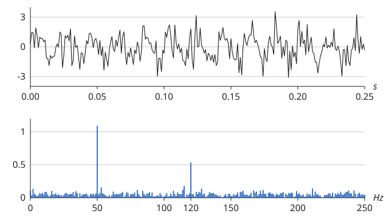
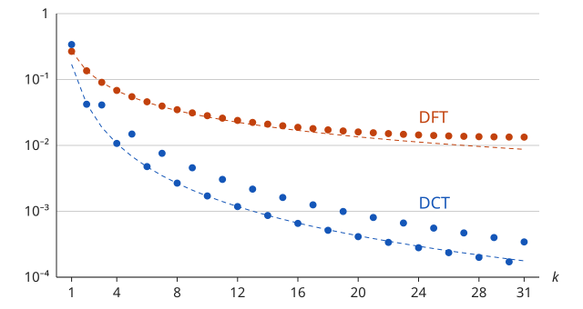
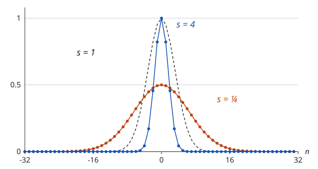
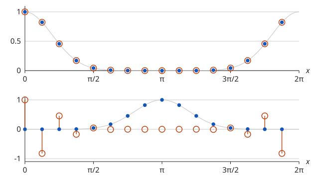
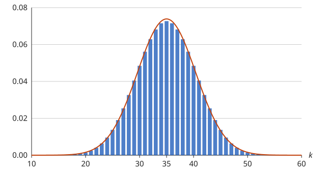

# ДПФ и БПФ: Фурье для тех, кому некогда

*Как триллион операций превратился в двадцать миллионов, какой косинус сидит в каждом JPEG и какую форму преобразование не может изменить. Вторая заметка серии, начатой [полиномами Чебышёва](chebyshev.ru.md). Утверждения даны с доказательствами — их можно раскрыть, нажав «Доказательство». Все листинги запускались (Python с NumPy и SciPy, TypeScript на Node 22, Java), и под каждым показано то, что он напечатал.*

**Коротко.** Дискретное преобразование Фурье (ДПФ) превращает $N$ отсчётов сигнала в $N$ чисел, которые говорят, сколько в сигнале каждой частоты. Если считать по определению, нужно $N^2$ операций. Быстрое преобразование Фурье (БПФ) даёт те же числа примерно за $N\log_2 N$: задача раз за разом делится пополам. Если перед преобразованием отразить сигнал зеркально, получится косинус-преобразование, на котором держатся JPEG и MP3. А одна форма, гауссов колокол, выходит из преобразования точно такой же, какой вошла; на ней удобно проверять БПФ, и она же объясняет, почему шум так часто гауссов.

## 0. Зачем это нужно: миллион отсчётов

Двадцать четыре секунды звука с компакт-диска — это около миллиона отсчётов. Столько же в фотографии на один мегапиксель. Возьмём $N = 2^{20} = 1\,048\,576$. Прямо по определению ДПФ требует $N^2 \approx 1{,}1\cdot10^{12}$ умножений и сложений. БПФ требует около $N\log_2 N \approx 2{,}1\cdot10^{7}$. На машине, которая делает $10^9$ таких операций в секунду, это 18 минут против 0,02 секунды.

| $N$ | $N^2$ | $N\log_2 N$ | Во сколько раз меньше |
| --- | --- | --- | --- |
| $1\,024$ | $1{,}0\cdot10^{6}$ | $1{,}0\cdot10^{4}$ | 102 |
| $2^{20} \approx 10^6$ | $1{,}1\cdot10^{12}$ | $2{,}1\cdot10^{7}$ | 52 000 |
| $2^{30} \approx 10^9$ | $1{,}2\cdot10^{18}$ | $3{,}2\cdot10^{10}$ | 36 000 000 |

Последняя строка — это 36 лет против 32 секунд. Цифровой звук, изображения, радиосвязь и радиолокация существуют в нынешнем виде благодаря этому столбцу.

## 1. ДПФ: на входе $N$ отсчётов, на выходе $N$ частот

> **Определение.** Пусть $\omega = e^{2\pi\mathrm{i}/N}$. ДПФ последовательности $x_0, \dots, x_{N-1}$ — это
> $$X_k = \sum_{n=0}^{N-1} x_n\,\omega^{-kn}, \qquad k = 0, 1, \dots, N-1 .$$
> **Обращение.** $\displaystyle x_n = \frac1N\sum_{k=0}^{N-1} X_k\,\omega^{kn}$. **Равенство Парсеваля.** $\displaystyle\sum_{n}\lvert x_n\rvert^2 = \frac1N\sum_{k}\lvert X_k\rvert^2$.

<details markdown="1">
<summary>Доказательство</summary>

Оба утверждения опираются на один факт: для целых $n, m$

$$
\sum_{k=0}^{N-1}\omega^{k(n-m)} = \begin{cases} N, & n \equiv m \pmod N,\\ 0, & \text{иначе.}\end{cases}
$$

Это сумма геометрической прогрессии; она вычислена в [§2 статьи о полиномах Чебышёва](chebyshev.ru.md#s2), где тот же факт сделал МНК на окружности диагональным.

*Обращение.* Подставим определение $X_k$ в правую часть и поменяем порядок сумм:

$$
\frac1N\sum_k\Bigl(\sum_m x_m\,\omega^{-km}\Bigr)\omega^{kn} = \frac1N\sum_m x_m\sum_k\omega^{k(n-m)} = x_n .
$$

*Парсеваль.* $\sum_k\lvert X_k\rvert^2 = \sum_k\sum_n\sum_m x_n\overline{x_m}\,\omega^{-k(n-m)} = N\sum_n\lvert x_n\rvert^2$ по тому же факту.
</details>

Значит, ничего не теряется и ничего не добавляется. Числа $X_k$ — те же данные в других координатах: вместо «значения в момент $n$» они дают «количество частоты $k$».

### 1.1 Как читать результат

Пусть отсчёты берутся каждые $\Delta$ секунд. Частота дискретизации равна $f_s = 1/\Delta$, а вся запись длится $T = N\Delta$ секунд.

- $X_k$ измеряет частоту $k/T = k f_s/N$ герц. Соседние коэффициенты отстоят на $1/T$: чтобы различить два тона с разницей в 1 Гц, слушать нужно не меньше секунды.
- Для вещественных отсчётов $X_{N-k} = \overline{X_k}$. Верхняя половина результата зеркально повторяет нижнюю, и самая высокая различимая частота равна $f_s/2$.
- **Наложение частот (алиасинг).** На сетке частоты $k$ и $k + N$ неразличимы, потому что $\omega^{(k+N)n} = \omega^{kn}$. Тон выше $f_s/2$ не пропадает, а маскируется под более низкий. Колёса, которые в старых фильмах крутятся назад, — тот же эффект при 24 отсчётах в секунду.
- Чистый тон $A\sin(2\pi f t)$, частота которого попала точно на коэффициент $k$, даёт $\lvert X_k\rvert = AN/2$, так что $2\lvert X_k\rvert/N$ — его амплитуда. Тон между двумя коэффициентами растекается по соседним.

Сигнал может быть спрятан в шуме и при этом отлично виден в спектре:

```python
import numpy as np

fs = 1000                                   # samples per second
t = np.arange(1000) / fs                    # one second of signal
rng = np.random.default_rng(1)
x = np.sin(2*np.pi*50*t) + 0.5*np.sin(2*np.pi*120*t) + rng.normal(0, 1, t.size)

X = np.fft.rfft(x)                          # the N/2 + 1 independent coefficients of a real signal
freq = np.fft.rfftfreq(x.size, d=1/fs)      # the frequency of each one, in hertz
amp = 2 * np.abs(X) / x.size

top = np.argsort(amp)[-2:][::-1]            # the two largest
print([(float(freq[i]), round(float(amp[i]), 2)) for i in top])
# [(50.0, 1.09), (120.0, 0.53)]
```



*Рис. 1.* Сверху: первая четверть секунды сигнала. Шум не слабее более громкого тона, и ни один тон не виден. Снизу: амплитуды $2\lvert X_k\rvert/N$ до 250 Гц. Два тона дают 1,09 и 0,53; всё остальное не выше 0,18. Шум размазан тонким слоем по всем 500 частотам, а каждый тон сидит в одной.

### 1.2 Между отсчётами: $\sin x / x$

Отсчёты ничего не говорят о том, что сигнал делал между ними, если не знать ещё одного: в нём нет частот $f_s/2$ и выше. Тогда отсчёты определяют его полностью, в каждый момент:

$$
x(t) = \sum_{n=-\infty}^{\infty} x(n\Delta)\,\operatorname{sinc}\!\left(\frac{t - n\Delta}{\Delta}\right), \qquad \operatorname{sinc}(u) = \frac{\sin \pi u}{\pi u}.
$$

Это теорема отсчётов Уиттекера, Котельникова и Шеннона. Следующая заметка, [Сколько точек нужно, чтобы нарисовать Землю?](sampling.ru.md), доказывает её и проходит с ней от прямой до кольца, плоскости и сферы, с историей людей, которые её нашли.

## 2. БПФ: разделить пополам, преобразовать, собрать

> **Теорема.** Пусть $N$ чётно. Пусть $E$ — ДПФ длины $N/2$ отсчётов с чётными номерами $x_0, x_2, \dots$, а $O$ — ДПФ отсчётов с нечётными номерами $x_1, x_3, \dots$. Тогда при $0 \le k < N/2$
> $$X_k = E_k + \omega^{-k}O_k, \qquad X_{k+N/2} = E_k - \omega^{-k}O_k .$$

<details markdown="1">
<summary>Доказательство</summary>

Разобьём сумму на чётные и нечётные $n$:

$$
X_k = \sum_{m=0}^{N/2-1} x_{2m}\,\omega^{-2mk} + \sum_{m=0}^{N/2-1} x_{2m+1}\,\omega^{-(2m+1)k} = \sum_m x_{2m}\,(\omega^2)^{-mk} + \omega^{-k}\sum_m x_{2m+1}\,(\omega^2)^{-mk} .
$$

Так как $\omega^2 = e^{2\pi\mathrm{i}/(N/2)}$ — корень из единицы, отвечающий длине $N/2$, эти две суммы и есть $E_k$ и $O_k$. Это верно для любого целого $k$, и обе суммы повторяются с периодом $N/2$. Поэтому замена $k$ на $k + N/2$ их не меняет, а $\omega^{-(k+N/2)} = \omega^{-k}e^{-\mathrm{i}\pi} = -\omega^{-k}$.
</details>

Каждая пара $(X_k, X_{k+N/2})$ стоит одного умножения и двух сложений; такой шаг называют «бабочкой». Две задачи половинного размера и $N/2$ бабочек дают ответ полного размера. Применим ту же идею к половинам, потом к их половинам:

> **Стоимость.** При $N = 2^p$ число бабочек удовлетворяет соотношению $B(N) = 2B(N/2) + N/2$, $B(1) = 0$. Отсюда $B(N) = \tfrac12 N\log_2 N$.

<details markdown="1">
<summary>Доказательство</summary>

Индукция по $p$. Если $B(N) = \tfrac12 N\log_2 N$, то $B(2N) = 2\cdot\tfrac12 N\log_2 N + N = N(\log_2 N + 1) = \tfrac12(2N)\log_2(2N)$.
</details>

Теорема, записанная строчка за строчкой:

```python
import cmath

def fft(x):
    n = len(x)                               # a power of two
    if n == 1:
        return list(x)
    even, odd = fft(x[0::2]), fft(x[1::2])
    out = [0] * n
    for k in range(n // 2):
        t = cmath.exp(-2j * cmath.pi * k / n) * odd[k]
        out[k] = even[k] + t
        out[k + n // 2] = even[k] - t
    return out
```

На 1024 случайных числах результат отличается от `numpy.fft.fft` не больше чем на $5\cdot10^{-14}$.

Настоящие реализации обходятся без рекурсии и без выделения памяти. Сначала они переставляют отсчёты (номер $i$ меняется местами с номером, двоичные цифры которого — цифры $i$ в обратном порядке), а затем собирают блоки по 2, 4, 8, … прямо на месте:

<details markdown="1">
<summary>Тот же алгоритм на TypeScript, на месте</summary>

```typescript
/** In-place radix-2 FFT. re and im hold the real and imaginary parts; their length must be a power of two. */
export function fft(re: Float64Array, im: Float64Array): void {
  const n = re.length;
  if (n !== im.length || (n & (n - 1)) !== 0) throw new Error("length must be a power of two");

  // 1. Reorder: element i swaps places with the element whose index has the bits of i reversed.
  for (let i = 1, j = 0; i < n; i++) {
    let bit = n >> 1;
    for (; j & bit; bit >>= 1) j ^= bit;
    j ^= bit;
    if (i < j) {
      [re[i], re[j]] = [re[j], re[i]];
      [im[i], im[j]] = [im[j], im[i]];
    }
  }

  // 2. Combine blocks of 2, then 4, then 8, ...: X[k] = E[k] + w^k O[k], X[k + half] = E[k] - w^k O[k].
  for (let size = 2; size <= n; size *= 2) {
    const half = size / 2;
    const angle = (-2 * Math.PI) / size;
    for (let start = 0; start < n; start += size) {
      for (let k = 0; k < half; k++) {
        const wr = Math.cos(angle * k), wi = Math.sin(angle * k);
        const a = start + k, b = a + half;
        const tr = wr * re[b] - wi * im[b];
        const ti = wr * im[b] + wi * re[b];
        re[b] = re[a] - tr; im[b] = im[a] - ti;
        re[a] += tr;        im[a] += ti;
      }
    }
  }
}

// A pulse: four ones followed by twelve zeros.
const re = Float64Array.from({ length: 16 }, (_, i) => (i < 4 ? 1 : 0));
const im = new Float64Array(16);
fft(re, im);
console.log(Array.from(re.slice(0, 5), (v) => v.toFixed(3)).join(" "));   // 4.000 3.014 1.000 -0.248 0.000
console.log(Array.from(im.slice(0, 5), (v) => v.toFixed(3)).join(" "));   // 0.000 -2.014 -2.414 -1.248 0.000
```

Напечатанные числа совпадают с тем, что даёт NumPy.
</details>

**Другие длины.** Если у $N$ есть множитель 3 или 5, делим не на две части, а на три или пять. Для простого $N$ есть приёмы похитрее (алгоритмы Блюстейна и Рейдера). В итоге получается $O(N\log N)$ для любого $N$. Никто пока не доказал, что меньшим числом операций обойтись нельзя.

### 2.1 Библиотеки

Для настоящей работы берите библиотеку; листинги здесь нужны для понимания.

- **Python:** [`numpy.fft`](https://numpy.org/doc/stable/reference/routines.fft.html) и [`scipy.fft`](https://docs.scipy.org/doc/scipy/reference/fft.html). В SciPy есть ещё косинус- и синус-преобразования.
- **C, а под капотом и многие другие инструменты:** [FFTW](https://www.fftw.org/), «самое быстрое преобразование Фурье на Западе». Она составляет план вычислений под конкретную длину и конкретный процессор.
- **Java:** [JTransforms](https://github.com/wendykierp/JTransforms); БПФ есть и в Apache Commons Math.
- **JavaScript и TypeScript:** [fft.js](https://github.com/indutny/fft.js). В браузерах БПФ встроено в Web Audio API (`AnalyserNode`).

## 3. Свёртка: умножать, преобразуя

*Циклическая свёртка* двух последовательностей длины $N$ — это $(x * y)_n = \sum_{m=0}^{N-1} x_m\,y_{n-m}$, где индексы берутся по модулю $N$.

> **Теорема.** ДПФ превращает свёртку в умножение: ДПФ последовательности $x * y$ равно $X_k Y_k$.

<details markdown="1">
<summary>Доказательство</summary>

$$
\sum_n\Bigl(\sum_m x_m\,y_{n-m}\Bigr)\omega^{-kn} = \sum_m x_m\,\omega^{-km}\sum_n y_{n-m}\,\omega^{-k(n-m)} = X_k\,Y_k ,
$$

потому что при каждом $m$ индекс $n - m$ один раз пробегает полный период.
</details>

Умножение двух длинных чисел столбиком — это свёртка их цифр с последующим переносом: $N^2$ шагов на $N$ цифр. По теореме хватает трёх БПФ и $N$ умножений. Оба числа нужно дополнить нулями, чтобы циклический «заворот» пришёлся на нули. На этой идее построен алгоритм Шёнхаге и Штрассена (1971), и именно так перемножают числа из миллионов цифр. Та же теорема стоит за цифровыми фильтрами и размытием изображений: фильтр есть свёртка, а значит, умножение спектров.

<details markdown="1">
<summary>Умножение двух 2000-значных чисел на Java</summary>

```java
import java.math.BigInteger;

/** Multiplies two long decimal numbers by convolving their digits with the FFT. */
public class FftMultiply {

    /** In-place radix-2 FFT; sign = -1 for the forward transform, +1 for the inverse (not yet divided by n). */
    static void fft(double[] re, double[] im, int sign) {
        int n = re.length;
        for (int i = 1, j = 0; i < n; i++) {
            int bit = n >> 1;
            for (; (j & bit) != 0; bit >>= 1) j ^= bit;
            j ^= bit;
            if (i < j) {
                double t = re[i]; re[i] = re[j]; re[j] = t;
                t = im[i]; im[i] = im[j]; im[j] = t;
            }
        }
        for (int size = 2; size <= n; size *= 2) {
            int half = size / 2;
            double angle = sign * 2 * Math.PI / size;
            for (int start = 0; start < n; start += size) {
                for (int k = 0; k < half; k++) {
                    double wr = Math.cos(angle * k), wi = Math.sin(angle * k);
                    int a = start + k, b = a + half;
                    double tr = wr * re[b] - wi * im[b], ti = wr * im[b] + wi * re[b];
                    re[b] = re[a] - tr; im[b] = im[a] - ti;
                    re[a] += tr;        im[a] += ti;
                }
            }
        }
    }

    static String multiply(String x, String y) {
        int n = Integer.highestOneBit(x.length() + y.length() - 1) << 1;   // room for every digit of the product
        double[] xr = new double[n], xi = new double[n], yr = new double[n], yi = new double[n];
        for (int i = 0; i < x.length(); i++) xr[i] = x.charAt(x.length() - 1 - i) - '0';   // lowest digit first
        for (int i = 0; i < y.length(); i++) yr[i] = y.charAt(y.length() - 1 - i) - '0';

        fft(xr, xi, -1);
        fft(yr, yi, -1);
        for (int k = 0; k < n; k++) {                      // multiply the spectra, entry by entry
            double r = xr[k] * yr[k] - xi[k] * yi[k];
            xi[k] = xr[k] * yi[k] + xi[k] * yr[k];
            xr[k] = r;
        }
        fft(xr, xi, +1);                                   // back to digits: this is the convolution

        StringBuilder out = new StringBuilder();
        long carry = 0;
        for (int i = 0; i < n; i++) {
            long v = Math.round(xr[i] / n) + carry;        // each entry is a whole number, up to rounding
            out.append((char) ('0' + v % 10));
            carry = v / 10;
        }
        while (out.length() > 1 && out.charAt(out.length() - 1) == '0') out.setLength(out.length() - 1);
        return out.reverse().toString();
    }

    public static void main(String[] args) {
        String x = "3".repeat(2000), y = "7".repeat(2000);
        String product = multiply(x, y);
        System.out.println(product.length() + " digits, equal to BigInteger: "
                + product.equals(new BigInteger(x).multiply(new BigInteger(y)).toString()));
        // 4000 digits, equal to BigInteger: true
    }
}
```

Элементы свёртки — целые числа, и восстанавливаются они округлением. Для десятичных цифр они не превосходят $81N$, что намного меньше 53 бит, которые `double` хранит точно. Поэтому для чисел такого размера округление безопасно.
</details>

## 4. Косинус-преобразование: ДПФ зеркально отражённого сигнала

ДПФ считает свои $N$ отсчётов одним периодом бесконечно повторяющегося сигнала: последний отсчёт приклеен к первому. Строка фотографии редко кончается той же яркостью, с какой началась, поэтому на месте склейки получается скачок. А скачок — это коэффициенты, убывающие лишь как $1/k$, и «звон» вокруг него. Это эффект Гиббса из [§3 статьи о полиномах Чебышёва](chebyshev.ru.md#s3), и лекарство то же, что и там: превратить шов в точку разворота. Прочитаем отсчёты вперёд, а потом назад, $x_0, \dots, x_{N-1}, x_{N-1}, \dots, x_0$, и у повторяющегося сигнала не останется ни одного скачка.

> **Косинус-преобразование (DCT-II).** $\displaystyle C_k = \sum_{n=0}^{N-1} x_n\cos\frac{\pi k(2n+1)}{2N}$, $k = 0, \dots, N-1$.
> Если $y$ — отражённый сигнал длины $2N$, а $Y$ — его ДПФ, то $Y_k = 2e^{\mathrm{i}\pi k/(2N)}\,C_k$.

<details markdown="1">
<summary>Доказательство</summary>

В сумме $Y_k = \sum_{n=0}^{2N-1} y_n e^{-2\pi\mathrm{i}kn/(2N)}$ отсчёт $x_n$ встречается дважды, на местах $n$ и $2N-1-n$:

$$
Y_k = \sum_{n=0}^{N-1} x_n\Bigl[e^{-\mathrm{i}\pi kn/N} + e^{-\mathrm{i}\pi k(2N-1-n)/N}\Bigr] = \sum_{n=0}^{N-1} x_n\Bigl[e^{-\mathrm{i}\pi kn/N} + e^{\mathrm{i}\pi k(n+1)/N}\Bigr],
$$

так как $e^{-2\pi\mathrm{i}k} = 1$. Вынесем из скобки множитель $e^{\mathrm{i}\pi k/(2N)}$:

$$
Y_k = e^{\mathrm{i}\pi k/(2N)}\sum_{n} x_n\Bigl[e^{-\mathrm{i}\pi k(2n+1)/(2N)} + e^{\mathrm{i}\pi k(2n+1)/(2N)}\Bigr] = 2e^{\mathrm{i}\pi k/(2N)}\,C_k .
$$
</details>

Итак, косинус-преобразование стоит одного БПФ, использует только вещественные числа и обращается тем же способом.

**Что даёт зеркало.** Возьмём гладкий сигнал, который не возвращается туда, откуда начал: $x_n = e^{n/N}$ при $N = 64$.



*Рис. 2.* Величина коэффициентов сигнала $x_n = e^{n/64}$, делённая на $N$: ДПФ (DFT) и косинус-преобразование (DCT). Пунктир — $0{,}27/k$ и $0{,}17/k^2$.

Коэффициенты ДПФ убывают как $1/k$, косинусные — как $1/k^2$. У повторённого сигнала есть скачок, у отражённого — только излом, а связывает одно с другим правило из [§2(а) статьи о полиномах Чебышёва](chebyshev.ru.md#s2). При $k = 16$ косинусный коэффициент уже примерно в 30 раз меньше. Почти всё несут несколько первых коэффициентов, а остальные можно хранить грубо или отбросить. Именно так поступает JPEG с блоками $8\times8$ точек. MP3 и AAC делают то же самое с близким родственником этого преобразования.

**Обратно к Чебышёву.** Если взять значения функции в узлах Чебышёва, то косинус-преобразование этих значений даст её коэффициенты Чебышёва ([§1.4 той статьи](chebyshev.ru.md#s1-4)). Для $e^x$ точные значения известны: $I_0(1)$ и $2I_k(1)$.

```python
import numpy as np
from scipy.fft import dct
from scipy.special import iv               # modified Bessel functions I_k

N = 16
nodes = np.cos((2*np.arange(N) + 1) * np.pi / (2*N))    # Chebyshev nodes
c = dct(np.exp(nodes)) / N                 # SciPy's dct returns 2*C_k, so this is (2/N)*C_k
c[0] /= 2                                  # c_0 is the plain average

exact = np.array([iv(0, 1)] + [2*iv(k, 1) for k in range(1, N)])
print(np.round(c[:4], 6), f"{np.max(np.abs(c - exact)):.1e}")
# [1.266066 1.130318 0.271495 0.044337] 2.7e-16
```

## 5. Гауссов колокол: форма, которую преобразование не может изменить

### 5.1 На всей прямой

Для функции на прямой преобразование Фурье — это $\hat f(\xi) = \int_{-\infty}^{\infty} f(x)\,e^{-2\pi\mathrm{i}x\xi}\,dx$.

> **Теорема.** Функция $e^{-\pi x^2}$ совпадает со своим преобразованием Фурье. В общем виде: при $a > 0$ преобразование функции $e^{-\pi x^2/a}$ равно $\sqrt a\,e^{-\pi a\xi^2}$.

<details markdown="1">
<summary>Доказательство</summary>

Пусть $f(x) = e^{-\pi x^2}$. Она удовлетворяет уравнению $f'(x) = -2\pi x f(x)$. Два общих правила, оба получаются дифференцированием под знаком интеграла или интегрированием по частям: преобразование $f'$ равно $2\pi\mathrm{i}\xi\hat f(\xi)$, а преобразование $x f(x)$ равно $\frac{\mathrm{i}}{2\pi}\hat f'(\xi)$. Преобразуя обе части уравнения, получаем

$$
2\pi\mathrm{i}\xi\,\hat f(\xi) = -2\pi\cdot\frac{\mathrm{i}}{2\pi}\,\hat f'(\xi), \qquad\text{то есть}\qquad \hat f'(\xi) = -2\pi\xi\,\hat f(\xi) .
$$

Это то же самое уравнение, поэтому $\hat f(\xi) = C e^{-\pi\xi^2}$, а $C = \hat f(0) = \int e^{-\pi x^2}dx = 1$.

Для общего случая сделаем замену $x = \sqrt a\,u$: преобразование функции $f(x/\sqrt a)$ равно $\sqrt a\,\hat f(\sqrt a\,\xi)$.
</details>

Узкий колокол ($a$ мало) превращается в широкий и наоборот. Ни одна функция не может быть узкой с обеих сторон: если мерить ширину стандартными отклонениями для $\lvert f\rvert^2$ и $\lvert\hat f\rvert^2$, их произведение не меньше $1/(4\pi)$. Это принцип неопределённости, и гауссов колокол — единственная форма, на которой граница достигается.

### 5.2 На $N$ точках

Колокол, взятый в $N$ точках, почти не меняется при ДПФ. Небольшая поправка делает это утверждение точным: повторим колокол с периодом $N$ и сложим все копии.

> **Теорема.** При $s > 0$ положим $\displaystyle g^{(s)}_n = \sum_{m\in\mathbb Z} e^{-\pi s(n+mN)^2/N}$. Тогда
> $$\frac{1}{\sqrt N}\sum_{n=0}^{N-1} g^{(s)}_n\,\omega^{-kn} = \frac{1}{\sqrt s}\,g^{(1/s)}_k .$$
> В частности, ДПФ, делённое на $\sqrt N$, возвращает $g^{(1)}$ без изменений.

<details markdown="1">
<summary>Доказательство</summary>

*Формула суммирования Пуассона.* Для гладкой быстро убывающей $\varphi$: $\sum_{j\in\mathbb Z}\varphi(j) = \sum_{l\in\mathbb Z}\hat\varphi(l)$. В самом деле, $\Phi(x) = \sum_j\varphi(x + j)$ имеет период 1, а её коэффициенты Фурье равны

$$
\int_0^1\Phi(x)\,e^{-2\pi\mathrm{i}lx}\,dx = \sum_j\int_j^{j+1}\varphi(u)\,e^{-2\pi\mathrm{i}lu}\,du = \hat\varphi(l) .
$$

Её ряд Фурье сходится к ней, и при $x = 0$ это даёт $\Phi(0) = \sum_l\hat\varphi(l)$.

*Теорема.* Так как $e^{-2\pi\mathrm{i}km} = 1$, можно записать $\omega^{-kn} = e^{-2\pi\mathrm{i}k(n+mN)/N}$. Каждое целое $j$ представляется как $n + mN$ ровно для одной пары $(n, m)$, поэтому

$$
\sum_{n=0}^{N-1} g^{(s)}_n\,\omega^{-kn} = \sum_{j\in\mathbb Z}\varphi(j), \qquad \varphi(x) = e^{-\pi s x^2/N}\,e^{-2\pi\mathrm{i}kx/N} .
$$

Умножение на $e^{-2\pi\mathrm{i}kx/N}$ сдвигает преобразование на $k/N$, поэтому по [§5.1](#s5-1) с $a = N/s$

$$
\hat\varphi(l) = \sqrt{N/s}\;e^{-\pi(N/s)(l + k/N)^2} = \sqrt{N/s}\;e^{-\pi(k + lN)^2/(sN)} .
$$

Сумма по $l$ даёт $\sqrt{N/s}\,g^{(1/s)}_k$. Остаётся разделить на $\sqrt N$.
</details>

На практике повторённые копии почти ничего не значат. При $s = 1$ их вклад не превышает примерно $e^{-\pi N/4}$, то есть $10^{-22}$ при $N = 64$. Просто взятый в точках колокол уже проходит проверку до последней цифры:

```python
import numpy as np

N = 64
# indices 0, 1, ..., 31, -32, ..., -1: the bell is centred on index 0
n = (np.arange(N) + N//2) % N - N//2
g = np.exp(-np.pi * n**2 / N)
G = np.fft.fft(g) / np.sqrt(N)
print(f"{np.max(np.abs(G - g)):.1e}")
# 1.1e-16
```



*Рис. 3.* $N = 64$. Узкий колокол $g^{(4)}$ и его преобразование $\tfrac12 g^{(1/4)}$: вдвое уже превращается во вдвое шире. Пунктирный колокол $g^{(1)}$ между ними совпадает со своим преобразованием.

### 5.3 Почему у преобразования всего четыре собственных значения

Пусть $F$ — матрица ДПФ, делённого на $\sqrt N$.

> **Утверждение.** $F^2$ переворачивает последовательность: $(F^2x)_m = x_{-m \bmod N}$. Поэтому $F^4 = I$, и каждое собственное значение $F$ — одно из чисел $1, -1, \mathrm{i}, -\mathrm{i}$.

<details markdown="1">
<summary>Доказательство</summary>

$(F^2x)_m = \frac1N\sum_k\omega^{-mk}\sum_n x_n\,\omega^{-kn} = \frac1N\sum_n x_n\sum_k\omega^{-k(m+n)} = x_{-m \bmod N}$ по факту из [§1](#s1). Двойной переворот ничего не меняет, поэтому $F^4 = I$. Если $Fv = \lambda v$ и $v \ne 0$, то $v = F^4v = \lambda^4 v$, откуда $\lambda^4 = 1$.
</details>

Преобразуйте любой сигнал четыре раза, и он вернётся к исходному. Колокол $g^{(1)}$ отвечает собственному значению 1. При $N = 8$ восемь собственных значений таковы: $1, 1, 1, -1, -1, -\mathrm{i}, -\mathrm{i}, \mathrm{i}$ (посчитано). На всей прямой ту же роль играют функции Эрмита — гауссов колокол, умноженный на многочлены, — с собственными значениями $(-\mathrm{i})^n$.

## 6. Колокол в деле: таблица, проверка БПФ и гауссов шум

### 6.1 Колокол в цифрах

ДПФ не знает, на каком отрезке взяты отсчёты: на вход приходят просто $N$ чисел. Отрезок $[0, 2\pi)$ с узлами $x_n = 2\pi n/N$ — лишь подпись под осью, и годится любой другой. Важны две вещи.

- **Ширину выбрать нельзя, её задаёт $N$.** Стандартное отклонение колокола $g^{(1)}$ равно $\sqrt{N/(2\pi)}$ отсчётов, то есть $\sqrt{2\pi/N}$ на отрезке $[0, 2\pi)$. Колокол другой ширины переходит не в себя, а в колокол обратной ширины ([§5.2](#s5-2)).
- **Вершина стоит в нуле.** ДПФ склеивает концы отрезка ([§4](#s4)), поэтому правая половина колокола живёт у $2\pi$: $g_{N-n} = g_n$.

Вот все числа при $N = 16$. Вторая половина таблицы повторяет первую в обратном порядке.

| $n$ | $x_n$ | $g_n$ | ДПФ$/\sqrt{16}$ | $e^{-\pi n^2/16}$ |
| --- | --- | --- | --- | --- |
| 0 | 0 | 1,000000 | 1,000000 | 1,000000 |
| 1 | 0,393 | 0,821725 | 0,821725 | 0,821725 |
| 2 | 0,785 | 0,455938 | 0,455938 | 0,455938 |
| 3 | 1,178 | 0,170820 | 0,170820 | 0,170820 |
| 4 | 1,571 | 0,043214 | 0,043214 | 0,043214 |
| 5 | 1,963 | 0,007382 | 0,007382 | 0,007382 |
| 6 | 2,356 | 0,000851 | 0,000851 | 0,000851 |
| 7 | 2,749 | 0,0000664 | 0,0000664 | 0,0000663 |
| 8 | 3,142 | 0,0000070 | 0,0000070 | 0,0000035 |

Мнимые части результата не больше $10^{-17}$, а вещественные совпадают с $g_n$ во всех 16 строках с точностью $10^{-16}$. Последний столбец — колокол без сложения копий. Он заметно расходится с точным только около $x = \pi$, где встречаются хвосты двух соседних копий, и там он ровно вдвое меньше. Это и есть поправка $e^{-\pi N/4}$ из [§5.2](#s5-2): при $N = 16$ она равна $3{,}5\cdot10^{-6}$, при $N = 64$ — уже $10^{-22}$.

Если поставить вершину посередине, в $x = \pi$, колокол перестанет переходить в себя: ДПФ вернёт его в нуле и с чередующимися знаками, $(-1)^k g_k$. Это частный случай сдвига из [§6.2](#s6-2) при $a = N/2$, $b = 0$. Чтобы нарисовать неподвижный колокол посередине, переставляют обе половины и на входе, и на выходе (в NumPy это `fftshift`).



*Рис. 4.* $N = 16$. Точки — отсчёты, кружки — ДПФ$/\sqrt N$, серая линия — непрерывный колокол. Сверху: вершина в нуле, кружки легли на точки. Снизу: вершина в $\pi$; модули те же, что сверху, но колокол переехал к краям и меняет знак от отсчёта к отсчёту.

### 6.2 Колокол как тест для БПФ

Хороший тест знает правильный ответ заранее и не нуждается во второй реализации ДПФ для сравнения. Колокол таков при любом $N$: степени двойки, 1000, простом 4099. Значения у него иррациональные, но это не мешает: компьютер и так хранит любое число с ошибкой около $10^{-16}$, и сравнивать результат с ответом всё равно приходится с допуском.

Изъян у него другой. Колокол вещественный и чётный, $g_{-n} = g_n$. Поэтому ему всё равно, какой знак стоит в показателе, вызвано ли обратное ДПФ вместо прямого, сопряжён ли результат и не перепутаны ли $k$ и $N - k$. Эти ошибки — самые частые, и ровно стоящий колокол их не видит. Лекарство — сдвинуть колокол и умножить на тон:

> **Утверждение.** Пусть $g = g^{(1)}$, $F$ — ДПФ, делённое на $\sqrt N$, и $a, b$ — целые. Если $x_n = g_{n-a}\,\omega^{bn}$, то $(Fx)_k = \omega^{a(b-k)}\,g_{k-b}$. Индексы берутся по модулю $N$.

<details markdown="1">
<summary>Доказательство</summary>

Сумма идёт по полному периоду, поэтому номер можно сдвинуть: $n = j + a$.

$$
\sum_n g_{n-a}\,\omega^{bn}\,\omega^{-kn} = \omega^{a(b-k)}\sum_j g_j\,\omega^{-(k-b)j} = \omega^{a(b-k)}\sqrt N\,g_{k-b}
$$

по [§5.2](#s5-2). Остаётся разделить на $\sqrt N$.
</details>

Такой вход комплексный и несимметричный, а ответ по-прежнему известен точно. Проверим NumPy и функцию `fft` из [§2](#s2), а затем ту же функцию с неверным знаком:

```python
import cmath
import numpy as np

def bell(N):
    """g_n = sum over m of exp(-pi (n + mN)^2 / N); three copies each side are plenty."""
    n = np.arange(N)
    return sum(np.exp(-np.pi * (n + m*N)**2 / N) for m in range(-3, 4))

def check(fft, N, a=0, b=0):
    """Feeds fft the bell moved by a and modulated by b; returns the largest error against the exact answer."""
    g, n = bell(N), np.arange(N)
    w = lambda p: np.exp(2j*np.pi * (p % N) / N)          # omega^p; reduce p mod N first, or the reference loses digits
    x = np.roll(g, a) * w(b*n)                             # x_n = g_{n-a} omega^{bn}
    exact = w(a*(b - n)) * np.roll(g, b)                   # (Fx)_k = omega^{a(b-k)} g_{k-b}
    return np.max(np.abs(np.asarray(fft(x)) / np.sqrt(N) - exact))

for N in [8, 17, 1000, 1024, 4099, 2**20]:                 # 17 and 4099 are prime
    print(f"{N:>8}  {check(np.fft.fft, N):.0e}  {check(np.fft.fft, N, a=3, b=5):.0e}")

def make_fft(sign):                                         # the fft of section 2, with the sign of the exponent as a parameter
    def fft(x):
        n = len(x)
        if n == 1:
            return list(x)
        even, odd = fft(x[0::2]), fft(x[1::2])
        out = [0] * n
        for k in range(n // 2):
            t = cmath.exp(sign * 2j * cmath.pi * k / n) * odd[k]
            out[k], out[k + n // 2] = even[k] + t, even[k] - t
        return out
    return fft

for name, f in [("correct", make_fft(-1)), ("wrong sign", make_fft(+1))]:
    print(f"{name:>10}  bell {check(f, 64):.0e}  moved bell {check(f, 64, a=3, b=5):.0e}")
#        8  2e-16  3e-16
#       17  1e-16  3e-16
#     1000  2e-16  5e-16
#     1024  2e-16  5e-16
#     4099  4e-16  9e-16
#  1048576  3e-16  6e-16
#    correct  bell 4e-16  moved bell 2e-16
# wrong sign  bell 4e-16  moved bell 1e+00
```

Ошибка NumPy почти не растёт с $N$, даже на миллионе точек. Неверный знак ровно стоящий колокол пропустил, а сдвинутый поймал сразу. Одна тонкость в самом тесте: $\omega^p$ нужно считать от остатка $p \bmod N$. Если возводить $\omega$ в большую степень напрямую, неточным окажется уже эталон: при $N = 2^{20}$ он теряет шесть знаков.

В пару к колоколу полезны ещё две проверки, тоже не требующие второй реализации: равенство Парсеваля из [§1](#s1) и $F^4 = I$ из [§5.3](#s5-3) на случайных данных.

### 6.3 Откуда берётся гауссов шум

Бросим кубик. Сумма двух кубиков распределена уже не ровно, а «домиком»: способов набрать 7 больше, чем 2 или 12. Это свёртка: вероятность суммы $k$ — это $\sum_j p_j\,p_{k-j}$. Значит, по [§3](#s3) спектр распределения суммы равен произведению спектров слагаемых. Для десяти кубиков нужно возвести спектр одного кубика в десятую степень:

```python
import numpy as np

d, N = 10, 64                               # ten dice; 64 slots hold every sum from 0 to 60
die = np.zeros(N); die[1:7] = 1/6           # one die: faces 1..6, equally likely
p = np.fft.ifft(np.fft.fft(die)**d).real    # sum of ten dice: multiply the spectra ten times

mean, var = 3.5*d, d*35/12
k = np.arange(N)
bell = np.exp(-(k - mean)**2 / (2*var)) / np.sqrt(2*np.pi*var)
print(f"P(sum=35) = {p[35]:.5f}, bell {bell[35]:.5f}; largest gap {np.max(np.abs(p - bell)):.1e}")
print(f"ways to roll 35: {round(p[35] * 6**d)}")
# P(sum=35) = 0.07269, bell 0.07387; largest gap 1.2e-03
# ways to roll 35: 4395456
```



*Рис. 5.* Сумма десяти кубиков (столбики) и гауссов колокол со средним 35 и дисперсией $10\cdot35/12$ (линия). Число способов выбросить 35 — 4 395 456 из $6^{10}$ — получено округлением, как цифры в [§3](#s3), и совпадает с прямым перебором.

Кубик ничем не выделен. Если вычесть среднее, почти любой спектр вблизи нулевой частоты выглядит как $1 - \sigma^2 t^2/2$. Если перемножить много таких спектров и растянуть результат, получится $e^{-\sigma^2t^2/2}$ — колокол. Колоколом же будет и распределение, потому что колокол переходит в колокол ([§5.1](#s5-1)).

> **Центральная предельная теорема.** Пусть $X_1, X_2, \dots$ — независимые одинаково распределённые величины со средним 0 и дисперсией $\sigma^2$, и $\varphi(t) = \mathbb E\,e^{-\mathrm{i}tX_1}$ — спектр их распределения (*характеристическая функция*). Тогда спектр величины $(X_1 + \dots + X_n)/\sqrt n$ равен $\varphi(t/\sqrt n)^n$ и при $n \to \infty$ стремится к $e^{-\sigma^2t^2/2}$, спектру нормального распределения.

<details markdown="1">
<summary>Доказательство (главное)</summary>

Спектр суммы независимых величин — произведение спектров, а деление величины на $\sqrt n$ растягивает спектр: отсюда $\varphi(t/\sqrt n)^n$. Разложим $\varphi$ около нуля: $\varphi(0) = 1$, $\varphi'(0) = -\mathrm{i}\,\mathbb E X_1 = 0$, $\varphi''(0) = -\mathbb E X_1^2 = -\sigma^2$, поэтому $\varphi(s) = 1 - \sigma^2s^2/2 + o(s^2)$. Тогда

$$
\varphi(t/\sqrt n)^n = \Bigl(1 - \frac{\sigma^2t^2}{2n} + o\bigl(\tfrac1n\bigr)\Bigr)^n \to e^{-\sigma^2t^2/2} .
$$

Что из сходимости спектров следует сходимость самих распределений, утверждает теорема Леви о непрерывности; её доказательство мы опускаем.
</details>

Поэтому шум так часто гауссов. Тепловой шум в резисторе — сумма бесчисленных толчков отдельных электронов. Ошибка измерения — сумма множества мелких причин, ни одна из которых не главная. Сложение независимых причин — это перемножение спектров, а произведение многих спектров — колокол. Тот же механизм работает и в обработке изображений: несколько проходов простого усредняющего фильтра дают почти точное гауссово размытие.

Есть у ДПФ и ещё один неподвижный объект, на этот раз статистический. Если $N$ отсчётов — независимые комплексные гауссовы величины одной мощности (*белый гауссов шум*), то после $F$ получится в точности такой же шум. $F$ унитарно, то есть это поворот в комплексном $N$-мерном пространстве, а распределение белого гауссова шума от поворотов не меняется. Поэтому шум на [рис. 1](#s1-1) и лёг ровным тонким слоем по всем частотам.

## 7. История: астероиды, тепло, колокол и запрет ядерных испытаний

**Гаусс, 1805.** Карл Фридрих Гаусс (1777–1855) вычислял орбиты только что открытых астероидов Паллада и Юнона. Ему были нужны коэффициенты тригонометрического ряда, проходящего через равноотстоящие наблюдения, и он заметил, что при составном числе точек работа распадается на части поменьше. Это и есть идея [§2](#s2). Он записал её по-латыни, не опубликовал и не подсчитал, сколько она экономит. Напечатали её только после его смерти, в собрании сочинений, и она осталась незамеченной.

**Фурье, 1807.** Жозеф Фурье (1768–1830) побывал с Наполеоном в Египте и управлял французским департаментом из Гренобля, когда послал в парижский Институт мемуар о том, как тепло распространяется в твёрдых телах. В мемуаре утверждалось, что любое распределение температуры, даже с изломами и скачками, есть сумма синусов и косинусов. Лагранж в это не поверил, и мемуар не напечатали. Книга, прославившая идею, — «Аналитическая теория тепла» — вышла в 1822 году. Один из её примеров — тепло, бегущее по металлическому кольцу, то есть в точности периодическая постановка из [§1](#s1). Обратите внимание на даты: быстрый алгоритм Гаусса на два года старше ряда, который он вычисляет.

**Колокол, 1733–1810.** Первым колокол нашёл Абрахам де Муавр в 1733 году: им приближается число гербов при многих бросках монеты. В 1801 году Гаусс прославился, когда по горстке наблюдений вычислил орбиту Цереры, потерянной астрономами, и указал, где её искать; она нашлась почти там, где он сказал. В книге 1809 года о движении небесных тел он вывел колокол как закон ошибок наблюдений и обосновал им метод наименьших квадратов. С тех пор распределение и называют гауссовым, а позже колокол вместе с портретом Гаусса напечатали на немецкой банкноте в 10 марок. В 1810 году Лаплас доказал первую центральную предельную теорему и доказывал её через спектры распределений — характеристические функции из [§6.3](#s6-3). Тот же приём в те же годы выручил Фурье с теплом: в гармониках сложное становится простым.

**Уиттекер, Котельников, Шеннон, 1915–1949.** Теореме отсчётов из [§1.2](#s1-2) и людям, которые её нашли, посвящена [отдельная заметка](sampling.ru.md#s5).

**Кули и Тьюки, 1965.** В 1963 году статистик Джон Тьюки и физик Ричард Гарвин сидели на заседании Научно-консультативного комитета при президенте Кеннеди. Соединённым Штатам нужен был запрет ядерных испытаний, который можно проверять без инспекторов на советской территории — сейсмометрами, расставленными вокруг страны. Для этого требовался анализ Фурье длинных сейсмических записей, непосильный для тогдашних компьютеров. У Тьюки была идея, как его ускорить. Гарвин оценил её и отвёз заметки в IBM, где запрограммировать алгоритм поручили Джеймсу Кули. Кули сказали, что это нужно для кристалла гелия-3, и это тоже было правдой: Гарвину алгоритм требовался и для этого. Программа заработала в 1964 году на IBM 7094, а пятистраничная статья вышла в апреле 1965 года. Лишь потом историки шаг за шагом проследили идею назад, до Гаусса.

**Ахмед, 1972.** Насир Ахмед из Университета штата Канзас попросил у Национального научного фонда США денег на изучение косинус-преобразования для сжатия изображений. Заявку отклонили: одному из рецензентов идея показалась слишком простой. Он всё равно сделал эту работу — со своим аспирантом Т. Натараджаном и другом К. Р. Рао, и статья вышла в январе 1974 года. Отправной точкой, как он писал позже, была чебышёвская интерполяция — узлы из [предыдущей заметки](chebyshev.ru.md#s1-4). Стандарт JPEG (1992) принёс результат в каждую фотокамеру.

## Литература

- J. W. Cooley, J. W. Tukey, *An algorithm for the machine calculation of complex Fourier series*, Mathematics of Computation 19 (1965), 297–301.
- M. T. Heideman, D. H. Johnson, C. S. Burrus, *Gauss and the history of the fast Fourier transform*, Archive for History of Exact Sciences 34 (1985), 265–277. [doi:10.1007/BF00348431](https://doi.org/10.1007/BF00348431)
- N. Ahmed, T. Natarajan, K. R. Rao, *Discrete cosine transform*, IEEE Transactions on Computers C-23 (1974), 90–93; N. Ahmed, *How I came up with the discrete cosine transform*, Digital Signal Processing 1 (1991), 4–5.
- M. Frigo, S. G. Johnson, *The design and implementation of FFTW3*, Proceedings of the IEEE 93 (2005), 216–231.
- H. Fischer, *A History of the Central Limit Theorem: From Classical to Modern Probability Theory*, Springer, 2011.
- Ж. Фурье, *Théorie analytique de la chaleur* («Аналитическая теория тепла»), Париж, 1822.
- IEEE Milestone, [First demonstration of the fast Fourier transform (FFT), 1964](https://ethw.org/Milestones:First_Demonstration_of_the_Fast_Fourier_Transform_(FFT),_1964), Engineering and Technology History Wiki.
