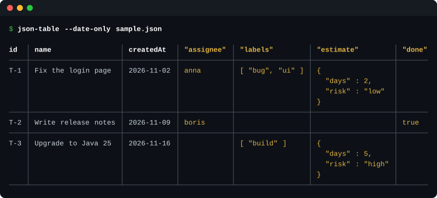

# How Mr. Jackson beat Ms. jq once he moved to GraalVM (and then Go showed up)

*A story about one small Java tool, nine runtimes and a benchmark that was meant to crown Java and ended up humbling everybody, Java included. Every number below comes from [benchmark run №9](https://github.com/krm-demo/ai-misc-graalvm/releases/tag/json-table-bench-9) of 2026-11-20; the code is in [krm-demo/ai-misc-graalvm](https://github.com/krm-demo/ai-misc-graalvm).*

**The short version.** Jackson, the library most Java programs use to read JSON, works in a GraalVM native image without giving anything up, as long as you list in advance every class it has to read. Compiled that way, a small Java tool starts about 40 times faster than the same code on an ordinary JVM. It ties with `jq` on tiny files and beats it 3 to 5 times on bigger ones. Then Go walked in and was faster than everybody, at every size, on every platform.

## 1. The question

It started with a doubt. GraalVM can compile a Java program *ahead of time* into a single executable file: no JVM to start, no code to warm up, the program is simply there, like a C program. The catch is that the compiler has to see everything the program will ever use, and Jackson's whole trick is to look at your classes only at run time, through reflection. So: does Jackson survive the move, or do we have to give up half of its features?

To find out, we wrote tests that run twice, once on an ordinary JVM and once as a native executable: records, nested records, builders, polymorphic types, generic lists, Spring Boot.

The answer is a guest list. A native image is a party with a strict bouncer: only the classes on the list get in. Write a class down and Jackson works exactly as on the JVM. Forget one, even a small nested type travelling as somebody's plus-one, and nothing complains while the image is built. It fails only when the program runs and meets that type for the first time. So the tests that run as a native executable are not optional. The details, with links to every test, are in [Jackson in a GraalVM native image](https://github.com/krm-demo/ai-misc-graalvm/blob/main/docs/jackson-native-image.md).

## 2. The tool

Tests prove that something works, but not how fast it is. For that we needed a real program, small enough to rewrite in other languages. Meet `json-table`: it reads a JSON array of objects and prints it as a table.

What goes in:

```json
[
  { "id": "T-1", "name": "Fix the login page", "createdAt": "2026-11-02T09:30:00Z",
    "assignee": "anna", "labels": ["bug", "ui"], "estimate": { "days": 2, "risk": "low" } },
  { "id": "T-2", "name": "Write release notes", "createdAt": "2026-11-09T14:05:00Z",
    "assignee": "boris", "done": true },
  { "id": "T-3", "name": "Upgrade to Java 25", "createdAt": "2026-11-16T08:00:00Z",
    "assignee": null, "labels": ["build"], "estimate": { "days": 5, "risk": "high" } }
]
```

What comes out:



`id`, `name` and `createdAt` are the columns the program knows about. Every other property gets a column of its own, in yellow, in the order it first appears. Nested objects are printed as small pieces of JSON inside the cell, and a missing value is simply an empty cell.

It is written in Java with Jackson 3 and Picocli, prints help when called without arguments, and reports every error as one polite line instead of a forty-line stack trace. Picocli, by the way, has the same bouncer problem as Jackson and solves it neatly: it writes its own guest list while the code compiles.

## 3. The race

Nine runners lined up:

| Runner | What it is |
| --- | --- |
| Corretto 25, Oracle JDK 25, Zulu 25 | the same `json-table` jar on three popular JVM builds |
| GraalVM 25 (JIT) | the same jar on GraalVM used as an ordinary JVM |
| GraalVM 25 (native) | the same Java code compiled into one executable |
| jq + bash | the same table made by one `jq` call: an 85-line script that nobody should be proud of |
| Go, Node.js 24, Python 3.14 | the same program rewritten with each language's standard library only |

The rules were strict. All runners of one race run on the same machine, one after another. Before the clock starts, every runner must print byte-for-byte the same table, so nobody wins by cutting corners. The stopwatch, [hyperfine](https://github.com/sharkdp/hyperfine), times the whole process, from start to exit, and runs each one 15 times (7 on the largest file) after two warm-up laps.

The races were held by GitHub Actions. One workflow with a *matrix* starts nine jobs at once: three platforms (Linux on Intel, Linux on ARM, macOS) times three input sizes (10, 1,000 and 100,000 objects; the largest file is 24 MB). A final job collects all nine results into one report and publishes it as a GitHub release, because the results of an ordinary workflow run disappear after 90 days and releases stay.

## 4. The results

Linux on Intel, mean time of one run, fastest first. The other platforms are in the [full report](https://github.com/krm-demo/ai-misc-graalvm/releases/tag/json-table-bench-9).

| Runner | 10 objects | 1,000 objects | 100,000 objects |
| --- | ---: | ---: | ---: |
| Go | **1.4 ms** | **7.7 ms** | **0.73 s** |
| GraalVM 25 (native) | 9.4 ms | 44 ms | 3.2 s |
| Python 3.14 | 21 ms | 48 ms | 3.4 s |
| Node.js 24 | 26 ms | 51 ms | 1.4 s |
| jq + bash | 9.5 ms | 148 ms | 16.8 s |
| Corretto, Oracle JDK, Zulu | 376–417 ms | ~750 ms | ~3.7 s |
| GraalVM 25 (JIT) | 440 ms | 741 ms | 4.2 s |

Read it from left to right.

**Ten objects: a draw.** Here only the start-up counts. An ordinary JVM spends almost 400 ms getting ready, like a car that needs to warm up its engine before driving to the corner shop. The native executable is ready in under 10 ms, 40 times sooner, and finishes neck and neck with `jq`: 9.4 ms against 9.5 ms. On ARM and on macOS `jq` is even a hair ahead. The duel at this distance ends in a draw.

**A thousand objects: Mr. Jackson wins.** Now there is real work to do, and the native Jackson needs 44 ms where `jq` needs 148. More than three times faster. This is the result the title promised.

**A hundred thousand objects: everybody grows up.** Jackson beats `jq` five times over (3.2 s against 16.8 s). In fairness to `jq`, its C parser is fine; it loses time drawing the table in its own little language, a job it was never meant for. But something else happens at this distance: the ordinary JVMs catch up with the native executable. Over three seconds the JVM's just-in-time compiler has time to turn the hot code into fast machine code, while a native image is compiled once and stays as it is. On ARM and macOS the plain JVM even overtakes the native executable on the largest file.

**And then there is Go.** Go came to the party late and left with every medal: 1.4 ms, 7.7 ms, 0.73 s, the fastest at every size on every platform. Node.js, which nobody took seriously, is twice as fast as our Java on the largest file. Our Java has not been profiled or tuned, so part of that gap is ours, not Java's. Still, it was a lesson in modesty.

**And the three JVMs?** Corretto, Oracle JDK and Zulu could not be told apart. Pick the one your company already pays for, or the one that is easiest to install.

## 5. So what is GraalVM for?

For programs that start often and live briefly: command-line tools, serverless functions, little helpers that a script calls a thousand times a day. There a native image turns half a second of waiting into a blink, and ships as one file that needs no Java installed.

It is not a free upgrade. The build takes a minute or two instead of seconds, every class that reflection touches has to be on the list, and the tests have to run as a native executable too. And for a long-running service the ordinary JVM is still the better runner: it warms up once and then keeps getting faster.

If you just need to turn some JSON into a table today, write it in Python or Node.js in fifty lines and go home. If you are handing a tool to other people, Go is hard to beat. And if your code and your team already speak Java, GraalVM lets them build the same kind of tool without changing language.

## 6. How it was made

The whole thing was built in conversations with Claude, an AI assistant, over a few evenings. The very first session was opened in an incognito window and vanished without a trace, so for a while neither the human nor the AI could remember what the repository was for. The repository could: everything that had been pushed was still there. The lesson is old and simple, and it applies to people as much as to robots: what is not committed does not exist.

## References

- Repository: [krm-demo/ai-misc-graalvm](https://github.com/krm-demo/ai-misc-graalvm), with the tool, the five other versions and the benchmark workflow.
- Benchmark reports: [the latest](https://github.com/krm-demo/ai-misc-graalvm/releases/latest) and [run №9](https://github.com/krm-demo/ai-misc-graalvm/releases/tag/json-table-bench-9) used in this article.
- [Jackson in a GraalVM native image](https://github.com/krm-demo/ai-misc-graalvm/blob/main/docs/jackson-native-image.md): what has to be registered, with tests.
- [GraalVM Native Image](https://www.graalvm.org/latest/reference-manual/native-image/) documentation.
- [Jackson](https://github.com/FasterXML/jackson), [Picocli](https://picocli.info/), [jq](https://jqlang.org/), [hyperfine](https://github.com/sharkdp/hyperfine).
