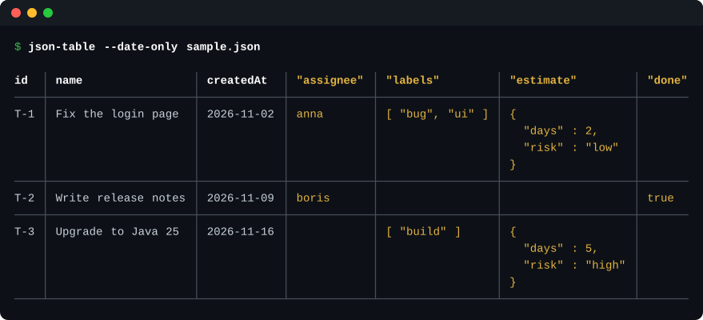

# Как мистер Джексон навалял мисс jq, переехав на GraalVM (а потом пришёл Go)

*История про одну маленькую утилиту на Java, девять рантаймов и benchmark, который должен был короновать Java, а в итоге поставил на место всех, включая саму Java. Все числа ниже взяты из [прогона benchmark'а №9](https://github.com/krm-demo/ai-misc-graalvm/releases/tag/json-table-bench-9) от 20 ноября 2026 года; код лежит в [krm-demo/ai-misc-graalvm](https://github.com/krm-demo/ai-misc-graalvm).*

**Коротко.** Jackson, библиотека, которой большинство Java-программ читает JSON, работает в native image от GraalVM, ничем не жертвуя, если заранее перечислить все классы, которые ей придётся читать. Собранная так маленькая утилита на Java стартует примерно в 40 раз быстрее того же кода на обычной JVM. С `jq` она идёт вровень на крошечных файлах и обгоняет его в 3–5 раз на больших. А потом пришёл Go и оказался быстрее всех, на любом размере и на любой платформе.

## 1. Вопрос

Всё началось с сомнения. GraalVM умеет заранее, *ahead of time*, скомпилировать Java-программу в один исполняемый файл: не нужно запускать JVM, не нужно прогревать код, программа просто есть, как программа на C. Подвох в том, что компилятор должен увидеть всё, чем программа когда-либо воспользуется, а весь фокус Jackson в том, что он разглядывает ваши классы только во время работы, через рефлексию. Так переживёт ли Jackson переезд, или придётся отказаться от половины его возможностей?

Чтобы выяснить, мы написали тесты, которые запускаются дважды: на обычной JVM и как native-бинарник. Record'ы, вложенные record'ы, builder'ы, полиморфные типы, generic-списки, Spring Boot.

Ответ — список гостей. Native image — это вечеринка со строгим охранником на входе: внутрь попадают только классы из списка. Впишите класс — и Jackson работает точно так же, как на JVM. Забудьте хоть один, даже маленький вложенный тип, пришедший «плюс один» к кому-то из гостей, — и при сборке никто не пикнет. Ошибка случится только при запуске, когда программа впервые встретит этот тип. Поэтому тесты, запущенные как native-бинарник, — не роскошь. Подробности со ссылками на каждый тест — в заметке [Jackson in a GraalVM native image](https://github.com/krm-demo/ai-misc-graalvm/blob/main/docs/jackson-native-image.md) (на английском).

## 2. Утилита

Тесты доказывают, что что-то работает, но не говорят, насколько быстро. Для этого нужна была настоящая программа, достаточно маленькая, чтобы переписать её на других языках. Знакомьтесь: `json-table`. Она читает JSON-массив объектов и печатает его таблицей.

Что подаём на вход:

```json
[
  { "id": "T-1", "name": "Fix the login page", "createdAt": "2026-11-02T09:30:00Z",
    "assignee": "anna", "labels": ["bug", "ui"], "estimate": { "days": 2, "risk": "low" } },
  { "id": "T-2", "name": "Write release notes", "createdAt": "2026-11-09T14:05:00Z",
    "assignee": "boris", "done": true },
  { "id": "T-3", "name": "Upgrade to Java 25", "createdAt": "2026-11-16T08:00:00Z",
    "assignee": null, "labels": ["build"], "estimate": { "days": 5, "risk": "high" } }
]
```

Что получаем на выходе:



`id`, `name` и `createdAt` — колонки, о которых программа знает заранее. Каждое остальное свойство получает собственную жёлтую колонку, в порядке первого появления. Вложенные объекты печатаются внутри ячейки маленькими кусочками JSON, а отсутствующее значение — просто пустая ячейка.

Написана она на Java с Jackson 3 и Picocli, без аргументов печатает справку, а любую ошибку сообщает одной вежливой строкой вместо stack trace на сорок строк. Кстати, у Picocli та же проблема с охранником, что и у Jackson, и решает он её изящно: сам составляет свой список гостей, пока код компилируется.

## 3. Забег

На старт вышли девять участников:

| Участник | Кто это |
| --- | --- |
| Corretto 25, Oracle JDK 25, Zulu 25 | один и тот же jar `json-table` на трёх популярных сборках JVM |
| GraalVM 25 (JIT) | тот же jar на GraalVM в роли обычной JVM |
| GraalVM 25 (native) | тот же Java-код, скомпилированный в один исполняемый файл |
| jq + bash | та же таблица одним вызовом `jq`: скрипт на 85 строк, которым никому не стоит гордиться |
| Go, Node.js 24, Python 3.14 | та же программа, переписанная только на стандартной библиотеке каждого языка |

Правила были строгие. Все участники одного забега бегут на одной машине, друг за другом. Перед стартом каждый обязан напечатать байт в байт одинаковую таблицу, чтобы никто не выиграл, срезав угол. Секундомер, [hyperfine](https://github.com/sharkdp/hyperfine), меряет весь процесс от запуска до выхода и гоняет каждого 15 раз (7 на самом большом файле) после двух разминочных кругов.

Забеги проводил GitHub Actions. Один workflow с *матрицей* запускает сразу девять заданий: три платформы (Linux на Intel, Linux на ARM, macOS) на три размера входа (10, 1 000 и 100 000 объектов; самый большой файл весит 24 МБ). Последнее задание собирает все девять результатов в один отчёт и публикует его как релиз на GitHub: результаты обычного прогона workflow исчезают через 90 дней, а релизы остаются.

## 4. Результаты

Linux на Intel, среднее время одного запуска, самые быстрые сверху. Остальные платформы — в [полном отчёте](https://github.com/krm-demo/ai-misc-graalvm/releases/tag/json-table-bench-9).

| Участник | 10 объектов | 1 000 объектов | 100 000 объектов |
| --- | ---: | ---: | ---: |
| Go | **1,4 мс** | **7,7 мс** | **0,73 с** |
| GraalVM 25 (native) | 9,4 мс | 44 мс | 3,2 с |
| Python 3.14 | 21 мс | 48 мс | 3,4 с |
| Node.js 24 | 26 мс | 51 мс | 1,4 с |
| jq + bash | 9,5 мс | 148 мс | 16,8 с |
| Corretto, Oracle JDK, Zulu | 376–417 мс | ~750 мс | ~3,7 с |
| GraalVM 25 (JIT) | 440 мс | 741 мс | 4,2 с |

Читаем слева направо.

**Десять объектов: ничья.** Здесь важен только старт. Обычная JVM тратит почти 400 мс на сборы, как машина, которой надо прогреть двигатель, чтобы доехать до магазина на углу. Native-бинарник готов меньше чем за 10 мс, в 40 раз раньше, и финиширует ноздря в ноздрю с `jq`: 9,4 мс против 9,5 мс. На ARM и на macOS `jq` даже чуть впереди. На этой дистанции дуэль заканчивается вничью.

**Тысяча объектов: мистер Джексон побеждает.** Теперь есть настоящая работа, и native-Джексону нужно 44 мс там, где `jq` нужно 148. Больше чем в три раза быстрее. Вот он, результат, обещанный в заголовке.

**Сто тысяч объектов: все взрослеют.** Джексон обходит `jq` в пять раз (3,2 с против 16,8 с). Справедливости ради, C-парсер у `jq` в порядке: время уходит на рисование таблицы на его собственном маленьком языке, для чего он никогда не предназначался. Но на этой дистанции происходит кое-что ещё: обычные JVM догоняют native-бинарник. За три секунды JIT-компилятор JVM успевает превратить горячий код в быстрый машинный, а native image скомпилирован один раз и таким и остаётся. На ARM и macOS обычная JVM на самом большом файле даже обгоняет native.

**А ещё есть Go.** Go пришёл на вечеринку последним и ушёл со всеми медалями: 1,4 мс, 7,7 мс, 0,73 с — быстрее всех на любом размере и на любой платформе. Node.js, которого никто не принимал всерьёз, на самом большом файле вдвое быстрее нашей Java. Нашу Java никто не профилировал и не тюнил, так что часть разрыва — наша, а не её. И всё же это был урок скромности.

**А три JVM?** Corretto, Oracle JDK и Zulu неотличимы друг от друга. Берите ту, за которую ваша компания уже платит, или ту, которую проще поставить.

## 5. Так зачем нужен GraalVM?

Для программ, которые часто запускаются и недолго живут: утилит командной строки, serverless-функций, маленьких помощников, которых скрипт дёргает тысячу раз в день. Там native image превращает полсекунды ожидания в мгновение и поставляется одним файлом, которому не нужна установленная Java.

Это не бесплатный апгрейд. Сборка занимает минуту-две вместо секунд, каждый класс, к которому прикасается рефлексия, должен быть в списке, и тесты тоже надо гонять как native-бинарник. А для долгоживущего сервиса обычная JVM по-прежнему лучший бегун: она прогревается один раз и дальше только ускоряется.

Если нужно просто превратить немного JSON в таблицу сегодня — напишите на Python или Node.js в пятьдесят строк и идите домой. Если отдаёте утилиту другим людям — Go трудно превзойти. А если ваш код и ваша команда уже говорят на Java, GraalVM позволяет делать такие же утилиты, не меняя языка.

## 6. Как это делалось

Всё это было построено за несколько вечеров в разговорах с Claude, AI-ассистентом. Самая первая сессия была открыта в окне инкогнито и исчезла без следа, так что какое-то время ни человек, ни AI не могли вспомнить, зачем вообще нужен этот репозиторий. А репозиторий помнил: всё, что было запушено, осталось на месте. Урок старый и простой и годится как для людей, так и для роботов: чего нет в коммите, того не существует.

## Источники

- Репозиторий: [krm-demo/ai-misc-graalvm](https://github.com/krm-demo/ai-misc-graalvm) — утилита, пять других версий и workflow benchmark'а.
- Отчёты benchmark'а: [последний](https://github.com/krm-demo/ai-misc-graalvm/releases/latest) и [прогон №9](https://github.com/krm-demo/ai-misc-graalvm/releases/tag/json-table-bench-9), использованный в этой статье.
- [Jackson in a GraalVM native image](https://github.com/krm-demo/ai-misc-graalvm/blob/main/docs/jackson-native-image.md): что нужно регистрировать, с тестами (на английском).
- Документация [GraalVM Native Image](https://www.graalvm.org/latest/reference-manual/native-image/).
- [Jackson](https://github.com/FasterXML/jackson), [Picocli](https://picocli.info/), [jq](https://jqlang.org/), [hyperfine](https://github.com/sharkdp/hyperfine).
