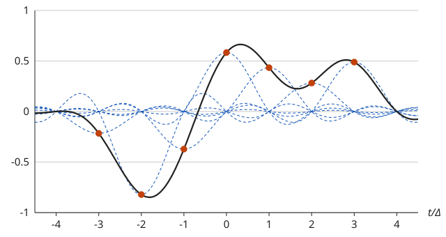
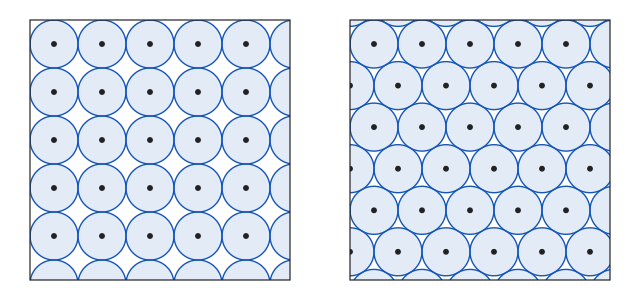
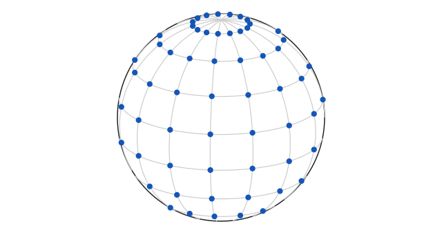

# How many dots does it take to draw the Earth?

*Samples on a line, a ring, a plane and a sphere: when a handful of numbers is enough to know a whole curve, picture or planet, and how few they can be. The third note in a series that began with [Chebyshev polynomials](chebyshev.en.md) and went on with [the FFT](fft.en.md). Statements come with proofs; click "Proof" to expand them. Every listing was run (Python with [NumPy](https://numpy.org/){: .tech} and [SciPy](https://scipy.org/){: .tech}), and the output shown under it is what it printed.*

**The short version.** If a signal contains no frequency of $f_s/2$ or above, its samples, taken $f_s$ times a second, determine it completely: between the samples it is a sum of $\sin x / x$ humps, one per sample. On a ring the hump becomes periodic, and the FFT computes it. On a plane the samples can sit on a square grid, but a hexagonal one needs 13.4% fewer of them; the bees knew. On a sphere there is no even grid at all. The best practical grids need about twice as many points as there are numbers to recover, and their latitudes are, once again, Gauss's.

## 0. Why it matters: from a CD to the weather forecast

A CD stores 44 100 samples per second because we hear up to about 20 000 hertz: twice that, plus a margin. A camera stores pixels, and when a striped shirt is finer than its pixels, the stripes turn into a moiré that was never there. A global weather model stores the atmosphere as numbers at points on a sphere, and the points of the European forecast model sit on a Gaussian grid ([§4](#s4)).

Each time the question is the same: how many samples, and where, so that nothing between them is lost? The answer depends on the shape of the space, and this note follows it from a line to a sphere.

## 1. The line: $\sin x / x$

Take samples every $\Delta$ seconds, $f_s = 1/\Delta$ per second, as in [the FFT note](fft.en.md#s1-1). There it was the aliasing: a tone above $f_s/2$ turns up disguised as a lower one. Here is the good news on the other side.

**Theorem (Whittaker, Kotelnikov, Shannon).** If $x(t)$ contains no frequency of $f_s/2$ or above, then for every $t$

$$
x(t) = \sum_{n=-\infty}^{\infty} x(n\Delta)\,\operatorname{sinc}\!\left(\frac{t - n\Delta}{\Delta}\right), \qquad \operatorname{sinc}(u) = \frac{\sin \pi u}{\pi u}.
$$

<details markdown="1"><summary>Proof</summary>

Let $X(f)$ be the spectrum of $x$, so that $x(t) = \int X(f)\,e^{2\pi\mathrm{i}ft}\,df$, and $X = 0$ outside the interval $\lvert f\rvert < f_s/2$. On that interval, expand $X$ in a Fourier series of period $f_s$. Its coefficients are $\Delta\,x(n\Delta)$, because by the formula above $x(n\Delta) = \int_{-f_s/2}^{f_s/2} X(f)\,e^{2\pi\mathrm{i}fn\Delta}\,df$. So $X(f) = \Delta\sum_n x(n\Delta)\,e^{-2\pi\mathrm{i}fn\Delta}$ there, and

$$
x(t) = \Delta\sum_n x(n\Delta)\int_{-f_s/2}^{f_s/2} e^{2\pi\mathrm{i}f(t - n\Delta)}\,df = \sum_n x(n\Delta)\,\frac{\sin\bigl(\pi(t - n\Delta)/\Delta\bigr)}{\pi(t - n\Delta)/\Delta}.
$$

</details>

Each sample contributes one hump, centred on its own node. The hump is 1 at its node and 0 at every other node, so the sum passes exactly through all the samples, and no other curve without high frequencies does.



*Figure 1.* Seven samples (dots), the hump of each one (dashed) and their sum (solid). At every node all humps but one are zero.

The humps fall off slowly, like $1/n$, so the sum has to reach far:

```python
import numpy as np

# No frequency of 5 Hz or above; 10 samples a second (f_s = 10 Hz)
def x(t):
    return np.sin(2*np.pi*1.3*t) + 0.5*np.cos(2*np.pi*3.7*t + 1)

dt = 0.1
n = np.arange(-2000, 2001)                 # samples from -200 s to 200 s
samples = x(n*dt)

t = np.linspace(-1, 1, 7)                  # instants between the samples
rebuilt = [np.sum(samples*np.sinc((tk - n*dt)/dt)) for tk in t]
print(np.max(np.abs(np.array(rebuilt) - x(t))))
# 7.448820873945383e-05
```

Four thousand samples, to recover a value to $10^{-4}$. The theorem is exact; the infinite sum is what costs. Every real system therefore samples somewhat faster than $2B$ and uses a hump that falls off faster.

## 2. The ring: the periodic hump

On a ring, say the temperature around a metal ring of Fourier's ([the FFT note, §7](fft.en.md#s7)), the signal is periodic, and its frequencies are whole numbers of turns. With $N$ samples per turn, $N$ odd, the frequencies up to $(N-1)/2$ in both directions are exactly $N$ numbers, as many as there are samples, and the DFT turns one set into the other. Between the samples the hump becomes periodic:

$$
x(u) = \sum_{k=0}^{N-1} x_k\,\frac{\sin \pi(u - k)}{N \sin\bigl(\pi(u - k)/N\bigr)} \qquad (u \text{ in samples}).
$$

The FFT computes the same thing another way: pad the spectrum with zeros up to the length you want, and transform back.

```python
import numpy as np

N, M = 9, 90                                  # 9 samples per period, 90 points to draw
x = np.random.default_rng(0).normal(size=N)   # any 9 numbers

# 1. The FFT way: pad the spectrum with zeros, transform back
X = np.fft.fft(x)
h = (N + 1) // 2
Xp = np.zeros(M, complex)
Xp[:h], Xp[-(N - h):] = X[:h], X[h:]
y_fft = np.fft.ifft(Xp).real * M / N

# 2. The hump way: one periodic hump per sample
def hump(u):                                   # u in samples
    s = np.sin(np.pi * u / N)
    return np.where(np.abs(s) < 1e-12, 1.0, np.sin(np.pi * u) / (N * np.where(s == 0, 1, s)))

u = np.arange(M) * N / M
y_hump = sum(x[k] * hump(u - k) for k in range(N))
print(np.max(np.abs(y_fft - y_hump)))
# 1.2212453270876722e-15
```

On the ring the sum is finite and exact: no tails to cut. For even $N$ the frequency $N/2$ cannot tell its two directions apart, and it has to be split between them in half; that is the one wrinkle.

## 3. The plane: bees sample better

On a plane, a picture with no frequency above $f_s/2$ in either direction can be sampled on a square grid, and the hump is a product of two $\sin x / x$, one along each axis. But a lens does not pass a square of frequencies; it passes a disc. Sampling repeats the spectrum around every point of a lattice, and the copies must not overlap. Round copies fit more tightly in a hexagonal pattern than in a square one, and the tighter the copies, the fewer the samples.



*Figure 2.* The same discs in two equal squares. Packed hexagonally (right), they fill more of the square, so the samples can be sparser.

```python
import numpy as np

# The spectrum fills a disc of radius W; its copies must not overlap.
# Square sampling: copies on a square lattice with step 2W; hexagonal: on a
# triangular one. Samples per unit area = area of one cell / (2 pi)^2.
W = 1.0
square = np.linalg.det([[2*W, 0], [0, 2*W]])
hexagonal = np.linalg.det([[2*W, 0], [W, np.sqrt(3)*W]])
print(round(hexagonal / square, 4), f"{1 - hexagonal / square:.1%} fewer samples")
# 0.866 13.4% fewer samples
```

The ratio is $\sqrt3/2$: 13.4% fewer samples for the same picture. Bees build their combs on the same lattice, and the cones in the centre of the human eye are packed almost the same way.

## 4. The sphere: how many dots for the Earth

On a sphere, sines and cosines give way to spherical harmonics $Y_\ell^m$, with degree $\ell = 0, 1, 2, \dots$ and $m = -\ell, \dots, \ell$. A function *band-limited* to degree $L$ has $\ell < L$, and is described by $L^2$ numbers. So at least $L^2$ samples are needed. Where to put them?

Not evenly: points that all see the same picture around them exist only at the vertices of the five Platonic solids, 20 at most. The usual answer is a grid of latitudes and longitudes. Along a latitude the problem is the ring of [§2](#s2): $2L - 1$ equally spaced longitudes. Across the latitudes, the best choice is the zeros of the Legendre polynomial of degree $L$, the nodes of Gauss's quadrature, cousins of the Chebyshev nodes of [the first note](chebyshev.en.md#s1-4). Then the grid has $L(2L-1) \approx 2L^2$ points, and it recovers the function exactly:

```python
import numpy as np
from scipy.special import sph_harm_y

L = 16                          # degrees 0 .. L-1: L^2 = 256 numbers
rng = np.random.default_rng(2)
lm = [(l, m) for l in range(L) for m in range(-l, l + 1)]
a = rng.normal(size=len(lm)) + 1j * rng.normal(size=len(lm))

def f(theta, phi):              # theta: from the pole, phi: around it
    return sum(c * sph_harm_y(l, m, theta, phi) for c, (l, m) in zip(a, lm))

# The grid: L Gauss-Legendre latitudes times 2L-1 equally spaced longitudes
z, w = np.polynomial.legendre.leggauss(L)
theta, phi = np.arccos(z), 2 * np.pi * np.arange(2 * L - 1) / (2 * L - 1)
T, P = np.meshgrid(theta, phi, indexing="ij")
values = f(T, P)
print(values.size, "points for", len(lm), "numbers")

# Read the coefficients back from the samples (the quadrature is exact here) ...
weights = w[:, None] * 2 * np.pi / (2 * L - 1)
b = [np.sum(weights * values * np.conj(sph_harm_y(l, m, T, P))) for l, m in lm]
print(np.max(np.abs(np.array(b) - a)))

# ... and the function anywhere else
t, p = np.arccos(rng.uniform(-1, 1, 5)), rng.uniform(0, 2 * np.pi, 5)
rebuilt = sum(c * sph_harm_y(l, m, t, p) for c, (l, m) in zip(b, lm))
print(np.max(np.abs(rebuilt - f(t, p))))
# 496 points for 256 numbers
# 1.6222938066341745e-14
# 3.7327276539370134e-14
```



*Figure 3.* $L = 8$: eight Gauss latitudes, fifteen meridians, 120 points for 64 numbers. Near the pole the points crowd together: that is where the extra ones go.

Why about twice $L^2$, and not $L^2$? Every latitude gets the same number of points, the short circles near the poles as many as the equator, and they crowd. With equally spaced latitudes it is worse: $2L \times 2L = 4L^2$ points. In principle almost any $L^2$ points in general position would do, but then reading the coefficients back becomes a badly conditioned computation, and no fast transform goes with it. Weather models take the middle road: a *reduced* Gaussian grid, with fewer points on the latitudes near the poles.

## 5. History: Whittaker, Nyquist, Kotelnikov, Shannon, the bees and Gauss again

**Whittaker, 1915.** Edmund Whittaker (1873–1956), a mathematician in Edinburgh, was looking for the smoothest curve through equally spaced values, and found the "cardinal function": the sum of the humps of [§1](#s1).

**Nyquist, 1928.** Harry Nyquist (1889–1976), an engineer at Bell Labs, counted how many independent pulses a telegraph line of bandwidth $B$ can carry each second: $2B$. Engineers have called $f_s/2$ the Nyquist frequency ever since.

**Kotelnikov, 1933.** Vladimir Aleksandrovich Kotelnikov (1908–2005), then a young engineer and later an academician and one of the founders of Soviet radio astronomy and planetary radar, proved that a signal without frequencies above $B$ is carried completely by $2B$ samples per second, and drew the conclusions for telegraph and radio. In Russia the theorem bears his name.

**Shannon, 1948–1949.** Claude Shannon (1916–2001), the father of information theory, published the same theorem in English, with the humps of [§1](#s1), and the West named it after him. By one account, the name of Claude, the AI that helped write these notes, is a nod to him.

**The bees, 1962.** Daniel Petersen and David Middleton showed that for round spectra in a plane or in space the hexagonal lattice and its relatives are the most economical, the 13.4% of [§3](#s3). The bees had settled the question for honeycombs long before.

**Gauss, 1814, and the sphere, 1994.** Carl Friedrich Gauss (1777–1855) found that the zeros of a polynomial of degree $L$ integrate exactly every polynomial up to degree $2L - 1$, twice as many as equally spaced points manage. That is why his latitudes do it with the fewest points in [§4](#s4). James Driscoll and Dennis Healy proved the sampling theorem on the sphere for equally spaced latitudes in 1994, and in 2011 Jason McEwen and Yves Wiaux brought equally spaced latitudes down to about $2L^2$ points as well.

## References

- E. T. Whittaker, *On the functions which are represented by the expansions of the interpolation-theory*, Proceedings of the Royal Society of Edinburgh 35 (1915), 181–194.
- H. Nyquist, *Certain topics in telegraph transmission theory*, Transactions of the AIEE 47 (1928), 617–644.
- V. A. Kotelnikov, *On the transmission capacity of "ether" and wire in electrocommunications*, 1933; English translation in Physics–Uspekhi 49 (2006), 736–744.
- C. E. Shannon, *Communication in the presence of noise*, Proceedings of the IRE 37 (1949), 10–21.
- D. P. Petersen, D. Middleton, *Sampling and reconstruction of wave-number-limited functions in N-dimensional Euclidean spaces*, Information and Control 5 (1962), 279–323.
- J. R. Driscoll, D. M. Healy, *Computing Fourier transforms and convolutions on the 2-sphere*, Advances in Applied Mathematics 15 (1994), 202–250.
- J. D. McEwen, Y. Wiaux, *A novel sampling theorem on the sphere*, IEEE Transactions on Signal Processing 59 (2011), 5876–5887.
