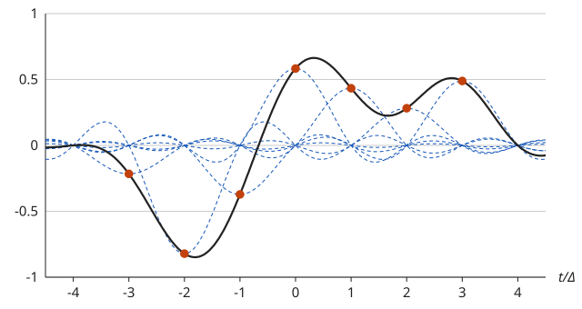
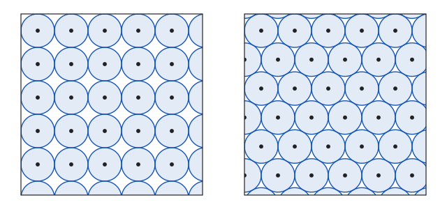
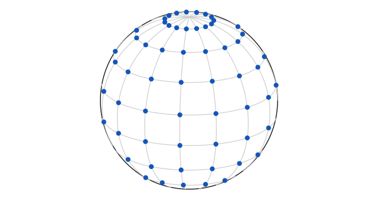
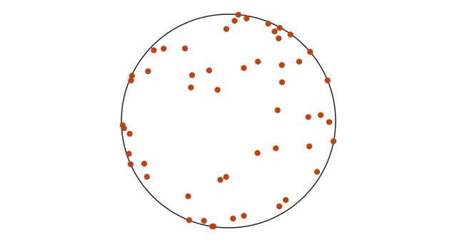

# Сколько точек нужно, чтобы нарисовать Землю?

*Отсчёты на прямой, на кольце, на плоскости и на сфере: когда горстки чисел хватает, чтобы знать целую кривую, картинку или планету, и как мало их может быть. Третья заметка в серии, которая началась с [многочленов Чебышёва](chebyshev.ru.md) и продолжилась [БПФ](fft.ru.md). Утверждения даны с доказательствами; нажмите «Доказательство», чтобы раскрыть. Каждый листинг запускался (Python с [NumPy](https://numpy.org/){: .tech} и [SciPy](https://scipy.org/){: .tech}), и под ним показано ровно то, что он напечатал.*

**Коротко.** Если в сигнале нет частот $f_s/2$ и выше, его отсчёты, взятые $f_s$ раз в секунду, определяют его полностью: между отсчётами он — сумма горбов $\sin x / x$, по одному на отсчёт. На кольце горб становится периодическим, и его считает БПФ. На плоскости отсчёты можно разложить квадратной сеткой, но шестиугольной их нужно на 13,4% меньше; пчёлы знали. На сфере ровной сетки нет вовсе. Лучшим практическим сеткам нужно примерно вдвое больше точек, чем чисел, которые надо восстановить, и их широты — опять гауссовы. Точки, брошенные наугад, справляются почти так же, если бросать с правильной плотностью.

## 0. Зачем это нужно: от компакт-диска до прогноза погоды

Компакт-диск хранит 44 100 отсчётов в секунду, потому что мы слышим примерно до 20 000 герц: вдвое больше, плюс запас. Фотоаппарат хранит пиксели, и когда полоски на рубашке мельче пикселей, они превращаются в муар, которого на рубашке не было. Глобальная модель погоды хранит атмосферу как числа в точках сферы, и точки европейской модели прогноза лежат на гауссовой сетке ([§4](#s4)).

Вопрос каждый раз один: сколько отсчётов и где, чтобы между ними ничего не потерялось? Ответ зависит от формы пространства, и эта заметка проходит с ним от прямой до сферы.

## 1. Прямая: $\sin x / x$

Берём отсчёты каждые $\Delta$ секунд, $f_s = 1/\Delta$ в секунду, как в [заметке про БПФ](fft.ru.md#s1-1). Там речь шла о наложении частот: тон выше $f_s/2$ появляется под видом более низкого. Здесь — хорошая новость с другой стороны.

**Теорема (Уиттекер, Котельников, Шеннон).** Если в $x(t)$ нет частот $f_s/2$ и выше, то для любого $t$

$$
x(t) = \sum_{n=-\infty}^{\infty} x(n\Delta)\,\operatorname{sinc}\!\left(\frac{t - n\Delta}{\Delta}\right), \qquad \operatorname{sinc}(u) = \frac{\sin \pi u}{\pi u}.
$$

<details markdown="1"><summary>Доказательство</summary>

Пусть $X(f)$ — спектр $x$, так что $x(t) = \int X(f)\,e^{2\pi\mathrm{i}ft}\,df$, и $X = 0$ вне интервала $\lvert f\rvert < f_s/2$. На этом интервале разложим $X$ в ряд Фурье с периодом $f_s$. Его коэффициенты равны $\Delta\,x(n\Delta)$, потому что по формуле выше $x(n\Delta) = \int_{-f_s/2}^{f_s/2} X(f)\,e^{2\pi\mathrm{i}fn\Delta}\,df$. Значит, там $X(f) = \Delta\sum_n x(n\Delta)\,e^{-2\pi\mathrm{i}fn\Delta}$, и

$$
x(t) = \Delta\sum_n x(n\Delta)\int_{-f_s/2}^{f_s/2} e^{2\pi\mathrm{i}f(t - n\Delta)}\,df = \sum_n x(n\Delta)\,\frac{\sin\bigl(\pi(t - n\Delta)/\Delta\bigr)}{\pi(t - n\Delta)/\Delta}.
$$

</details>

Каждый отсчёт даёт один горб с центром в своём узле. В своём узле горб равен 1, во всех остальных — 0, поэтому сумма проходит ровно через все отсчёты, и никакая другая кривая без высоких частот через них не проходит.



*Рисунок 1.* Семь отсчётов (точки), горб каждого (пунктир) и их сумма (сплошная линия). В каждом узле все горбы, кроме одного, равны нулю.

Горбы убывают медленно, как $1/n$, поэтому сумма должна заходить далеко:

```python
import numpy as np

# No frequency of 5 Hz or above; 10 samples a second (f_s = 10 Hz)
def x(t):
    return np.sin(2*np.pi*1.3*t) + 0.5*np.cos(2*np.pi*3.7*t + 1)

dt = 0.1
n = np.arange(-2000, 2001)                 # samples from -200 s to 200 s
samples = x(n*dt)

t = np.linspace(-1, 1, 7)                  # instants between the samples
rebuilt = [np.sum(samples*np.sinc((tk - n*dt)/dt)) for tk in t]
print(np.max(np.abs(np.array(rebuilt) - x(t))))
# 7.448820873945383e-05
```

Четыре тысячи отсчётов, чтобы восстановить значение с точностью $10^{-4}$. Теорема точна; дорого обходится бесконечная сумма. Поэтому каждая настоящая система берёт отсчёты чуть чаще, чем $2B$, и пользуется горбом, который убывает быстрее.

## 2. Кольцо: периодический горб

На кольце — скажем, температура вдоль металлического кольца у Фурье ([заметка про БПФ, §7](fft.ru.md#s7)) — сигнал периодичен, и его частоты — целые числа оборотов. При $N$ отсчётах на оборот и нечётном $N$ частоты до $(N-1)/2$ в обе стороны — это ровно $N$ чисел, столько же, сколько отсчётов, и ДПФ переводит одни в другие. Между отсчётами горб становится периодическим:

$$
x(u) = \sum_{k=0}^{N-1} x_k\,\frac{\sin \pi(u - k)}{N \sin\bigl(\pi(u - k)/N\bigr)} \qquad (u \text{ в отсчётах}).
$$

БПФ считает то же самое другим способом: дополните спектр нулями до нужной длины и преобразуйте обратно.

```python
import numpy as np

N, M = 9, 90                                  # 9 samples per period, 90 points to draw
x = np.random.default_rng(0).normal(size=N)   # any 9 numbers

# 1. The FFT way: pad the spectrum with zeros, transform back
X = np.fft.fft(x)
h = (N + 1) // 2
Xp = np.zeros(M, complex)
Xp[:h], Xp[-(N - h):] = X[:h], X[h:]
y_fft = np.fft.ifft(Xp).real * M / N

# 2. The hump way: one periodic hump per sample
def hump(u):                                   # u in samples
    s = np.sin(np.pi * u / N)
    return np.where(np.abs(s) < 1e-12, 1.0, np.sin(np.pi * u) / (N * np.where(s == 0, 1, s)))

u = np.arange(M) * N / M
y_hump = sum(x[k] * hump(u - k) for k in range(N))
print(np.max(np.abs(y_fft - y_hump)))
# 1.2212453270876722e-15
```

На кольце сумма конечна и точна: хвостов, которые надо обрезать, нет. При чётном $N$ частота $N/2$ не различает два своих направления, и её приходится делить между ними пополам; это единственная тонкость.

## 3. Плоскость: пчёлы считают лучше

На плоскости картинку без частот выше $f_s/2$ по каждому направлению можно снять квадратной сеткой, и горб — произведение двух $\sin x / x$, по одному вдоль каждой оси. Но объектив пропускает не квадрат частот, а круг. Дискретизация повторяет спектр вокруг каждой точки решётки, и копии не должны перекрываться. Круглые копии плотнее укладываются шестиугольником, чем квадратом, а чем плотнее копии, тем реже можно брать отсчёты.



*Рисунок 2.* Одинаковые круги в двух одинаковых квадратах. В шестиугольной укладке (справа) они занимают больше квадрата, поэтому отсчёты могут быть реже.

```python
import numpy as np

# The spectrum fills a disc of radius W; its copies must not overlap.
# Square sampling: copies on a square lattice with step 2W; hexagonal: on a
# triangular one. Samples per unit area = area of one cell / (2 pi)^2.
W = 1.0
square = np.linalg.det([[2*W, 0], [0, 2*W]])
hexagonal = np.linalg.det([[2*W, 0], [W, np.sqrt(3)*W]])
print(round(hexagonal / square, 4), f"{1 - hexagonal / square:.1%} fewer samples")
# 0.866 13.4% fewer samples
```

Отношение равно $\sqrt3/2$: на 13,4% меньше отсчётов для той же картинки. На той же решётке пчёлы строят соты, и почти так же уложены колбочки в центре человеческого глаза.

## 4. Сфера: сколько точек нужно Земле

На сфере синусы и косинусы уступают место сферическим гармоникам $Y_\ell^m$ степени $\ell = 0, 1, 2, \dots$ с $m = -\ell, \dots, \ell$. Функция, *ограниченная по полосе* степенью $L$, содержит только $\ell < L$ и описывается $L^2$ числами. Значит, нужно хотя бы $L^2$ отсчётов. Куда их поставить?

Не равномерно: точки, каждая из которых видит вокруг одинаковую картину, бывают только в вершинах пяти правильных многогранников, самое большее 20. Обычный ответ — сетка широт и долгот. Вдоль широты задача та же, что на кольце из [§2](#s2): $2L - 1$ равноотстоящих долгот. Поперёк, лучший выбор широт — нули многочлена Лежандра степени $L$, узлы квадратуры Гаусса, родственники узлов Чебышёва из [первой заметки](chebyshev.ru.md#s1-4). Тогда в сетке $L(2L-1) \approx 2L^2$ точек, и она восстанавливает функцию точно:

```python
import numpy as np
from scipy.special import sph_harm_y

L = 16                          # degrees 0 .. L-1: L^2 = 256 numbers
rng = np.random.default_rng(2)
lm = [(l, m) for l in range(L) for m in range(-l, l + 1)]
a = rng.normal(size=len(lm)) + 1j * rng.normal(size=len(lm))

def f(theta, phi):              # theta: from the pole, phi: around it
    return sum(c * sph_harm_y(l, m, theta, phi) for c, (l, m) in zip(a, lm))

# The grid: L Gauss-Legendre latitudes times 2L-1 equally spaced longitudes
z, w = np.polynomial.legendre.leggauss(L)
theta, phi = np.arccos(z), 2 * np.pi * np.arange(2 * L - 1) / (2 * L - 1)
T, P = np.meshgrid(theta, phi, indexing="ij")
values = f(T, P)
print(values.size, "points for", len(lm), "numbers")

# Read the coefficients back from the samples (the quadrature is exact here) ...
weights = w[:, None] * 2 * np.pi / (2 * L - 1)
b = [np.sum(weights * values * np.conj(sph_harm_y(l, m, T, P))) for l, m in lm]
print(np.max(np.abs(np.array(b) - a)))

# ... and the function anywhere else
t, p = np.arccos(rng.uniform(-1, 1, 5)), rng.uniform(0, 2 * np.pi, 5)
rebuilt = sum(c * sph_harm_y(l, m, t, p) for c, (l, m) in zip(b, lm))
print(np.max(np.abs(rebuilt - f(t, p))))
# 496 points for 256 numbers
# 1.6222938066341745e-14
# 3.7327276539370134e-14
```



*Рисунок 3.* $L = 8$: восемь гауссовых широт, пятнадцать меридианов, 120 точек на 64 числа. У полюса точки толпятся: туда и уходят лишние.

Почему примерно вдвое больше $L^2$, а не $L^2$? Каждая широта получает одинаковое число точек — короткие окружности у полюсов столько же, сколько экватор, — и точки там толпятся. С равноотстоящими широтами ещё хуже: $2L \times 2L = 4L^2$ точек. В принципе подошли бы почти любые $L^2$ точек общего положения, но тогда восстановление коэффициентов становится плохо обусловленной задачей, и быстрого преобразования к ней нет. Модели погоды выбирают середину: *редуцированную* гауссову сетку, где на широтах у полюсов точек меньше.

### 4.1 Бросаем наугад

А если точки не расставлять, а бросать? Это путь Монте-Карло, и для интегралов он знаменит: ошибка убывает как $1/\sqrt N$, какой бы ни была размерность. Медленно, но так же медленно на прямой, как и в тысячемерном пространстве, где любая сетка давно бы утонула.

Восстановить функцию целиком труднее, чем посчитать один интеграл, и случайные точки платят за это небольшую надбавку: примерно $K\ln K$ точек на $K$ неизвестных вместо $K$. *Число обусловленности* ниже показывает, во сколько раз ошибки в данных могут вырасти на обратном пути; 1 — идеал.

```python
import numpy as np
from scipy.special import sph_harm_y

rng = np.random.default_rng(3)
L = 16
lm = [(l, m) for l in range(L) for m in range(-l, l + 1)]
K = len(lm)                                     # 256 numbers to recover

def cond(n):                        # n random points, uniform on the sphere
    t, p = np.arccos(rng.uniform(-1, 1, n)), rng.uniform(0, 2 * np.pi, n)
    A = np.array([sph_harm_y(l, m, t, p) for l, m in lm]).T
    return np.linalg.cond(A)        # how much data errors can grow

for n in (K, 2 * K, round(K * np.log(K)), 4 * round(K * np.log(K))):
    print(n, round(float(np.median([cond(n) for _ in range(5)])), 1))
# 256 41667.7
# 512 21.1
# 1420 3.7
# 5680 1.7
```

С ровно $K$ случайными точками восстановление бесполезно; с $K\ln K$ оно не хуже гауссовой сетки. И на сфере равномерно случайные точки честные: сумма $\sum_m \lvert Y_\ell^m\rvert^2$ одинакова в каждой точке сферы (теорема сложения), так что ни одна точка не важнее другой, и поворот глобуса ничего не меняет.



*Рисунок 4.* 120 точек, брошенных равномерно наугад. Толкотни у полюсов, как на рисунке 3, нет, зато есть пустоты и скопления: за них и платит логарифм.

Противоречит ли это узлам Чебышёва, которые так старательно выбирались в [первой заметке](chebyshev.ru.md)? Нет: объясняет их. На отрезке многочлены сильнее всего раскачиваются у концов, и равномерно случайные точки там плохи. Случайные точки с плотностью Чебышёва, $x = \cos\theta$ при равномерном $\theta$, хороши:

```python
import numpy as np
from numpy.polynomial import legendre

rng = np.random.default_rng(3)
D = 40                                          # polynomials of degree < 40

def cond(x):
    V = legendre.legvander(x, D - 1) * np.sqrt(2 * np.arange(D) + 1)
    return np.linalg.cond(V)

for n in (2 * D, 8 * D):
    uniform = np.median([cond(rng.uniform(-1, 1, n)) for _ in range(5)])
    chebyshev = np.median([cond(np.cos(np.pi * rng.uniform(0, 1, n))) for _ in range(5)])
    print(n, f"{uniform:.3g}", f"{chebyshev:.3g}")
# 80 8.71e+05 544
# 320 18.9 10.2
```

Столбцы: число точек, затем число обусловленности для равномерных и для чебышёвских случайных точек, для многочленов степени ниже 40. Узлы Чебышёва — та же плотность, только без игральных костей. Случай работает, когда его бросают с правильной плотностью, а на сфере правильная плотность — равномерная.

По-настоящему случайность выигрывает в другом: в больших размерностях, где сетке из $n$ точек по каждой оси нужно $n^d$ точек; для *разреженных* сигналов с немногими частотами, которые случайные отсчёты ловят гораздо меньшим числом точек, чем требует Котельников (сжатые измерения, 2006); и в настоящих данных, чьи метеостанции и спутники никто по гауссовым широтам не расставлял.

## 5. История: Уиттекер, Найквист, Котельников, Шеннон, пчёлы, снова Гаусс и игральные кости

**Уиттекер, 1915.** Эдмунд Уиттекер (1873–1956), математик из Эдинбурга, искал самую гладкую кривую через равноотстоящие значения и нашёл «кардинальную функцию» — сумму горбов из [§1](#s1).

**Найквист, 1928.** Гарри Найквист (1889–1976), инженер Bell Labs, посчитал, сколько независимых импульсов в секунду может передать телеграфная линия с полосой $B$: $2B$. С тех пор инженеры называют $f_s/2$ частотой Найквиста.

**Котельников, 1933.** Владимир Александрович Котельников (1908–2005), тогда молодой инженер, а впоследствии академик и один из основателей советской радиоастрономии и планетной радиолокации, доказал, что сигнал без частот выше $B$ полностью передаётся $2B$ отсчётами в секунду, и сделал выводы для телеграфа и радио. В России теорема носит его имя.

**Шеннон, 1948–1949.** Клод Шеннон (1916–2001), отец теории информации, опубликовал ту же теорему по-английски, с горбами из [§1](#s1), и на Западе её назвали в его честь. По одной из версий, имя Claude, ИИ, который помогал писать эти заметки, — дань уважения ему.

**Пчёлы, 1962.** Дэниел Петерсен и Дэвид Миддлтон показали, что для круглых спектров на плоскости и в пространстве самые экономные — шестиугольная решётка и её родственники, те самые 13,4% из [§3](#s3). Для сот пчёлы решили этот вопрос задолго до них.

**Гаусс, 1814, и сфера, 1994.** Карл Фридрих Гаусс (1777–1855) обнаружил, что нули многочлена степени $L$ точно интегрируют любой многочлен до степени $2L - 1$ — вдвое больше, чем удаётся равноотстоящим точкам. Поэтому его широты и обходятся в [§4](#s4) наименьшим числом точек. Джеймс Дрисколл и Деннис Хили доказали теорему отсчётов на сфере для равноотстоящих широт в 1994 году, а в 2011 году Джейсон Макьюэн и Ив Вьо довели и равноотстоящие широты примерно до $2L^2$ точек.

**Монте-Карло и игральные кости, 1949–2013.** Николас Метрополис и Станислав Улам назвали метод Монте-Карло в 1949 году, в честь казино. Его потомки добрались до отсчётов в нашем веке: в 2006 году Эммануэль Кандес, Джастин Ромберг, Теренс Тао и Дэвид Донохо показали, что случайные отсчёты восстанавливают разреженные сигналы гораздо реже, чем требует Котельников, а в 2013 году Альбер Коэн, Марк Давенпорт и Дани Левиатан показали, когда $K\ln K$ случайных точек устойчиво восстанавливают $K$ неизвестных, — та самая надбавка из [§4.1](#s4-1).

## Литература

- E. T. Whittaker, *On the functions which are represented by the expansions of the interpolation-theory*, Proceedings of the Royal Society of Edinburgh 35 (1915), 181–194.
- H. Nyquist, *Certain topics in telegraph transmission theory*, Transactions of the AIEE 47 (1928), 617–644.
- В. А. Котельников, *О пропускной способности «эфира» и проволоки в электросвязи*, 1933; переиздано: УФН 176 (2006), 762–770.
- C. E. Shannon, *Communication in the presence of noise*, Proceedings of the IRE 37 (1949), 10–21.
- D. P. Petersen, D. Middleton, *Sampling and reconstruction of wave-number-limited functions in N-dimensional Euclidean spaces*, Information and Control 5 (1962), 279–323.
- J. R. Driscoll, D. M. Healy, *Computing Fourier transforms and convolutions on the 2-sphere*, Advances in Applied Mathematics 15 (1994), 202–250.
- J. D. McEwen, Y. Wiaux, *A novel sampling theorem on the sphere*, IEEE Transactions on Signal Processing 59 (2011), 5876–5887.
- N. Metropolis, S. Ulam, *The Monte Carlo method*, Journal of the American Statistical Association 44 (1949), 335–341.
- E. J. Candès, J. Romberg, T. Tao, *Robust uncertainty principles: exact signal reconstruction from highly incomplete frequency information*, IEEE Transactions on Information Theory 52 (2006), 489–509.
- A. Cohen, M. A. Davenport, D. Leviatan, *On the stability and accuracy of least squares approximations*, Foundations of Computational Mathematics 13 (2013), 819–834.
